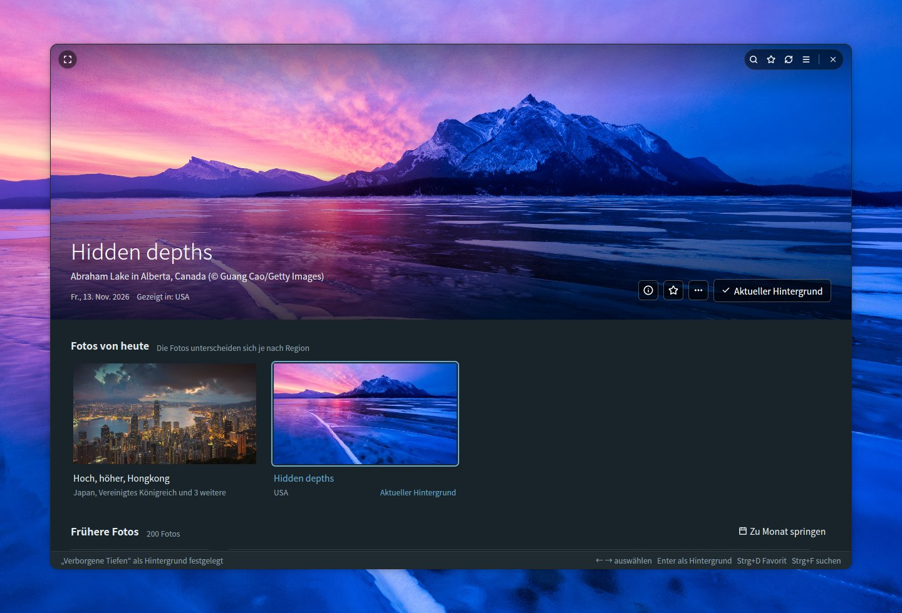
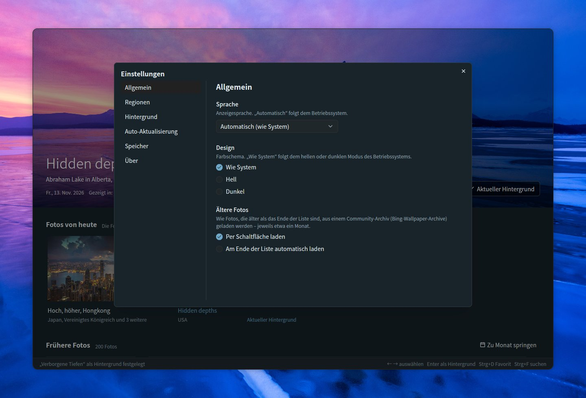
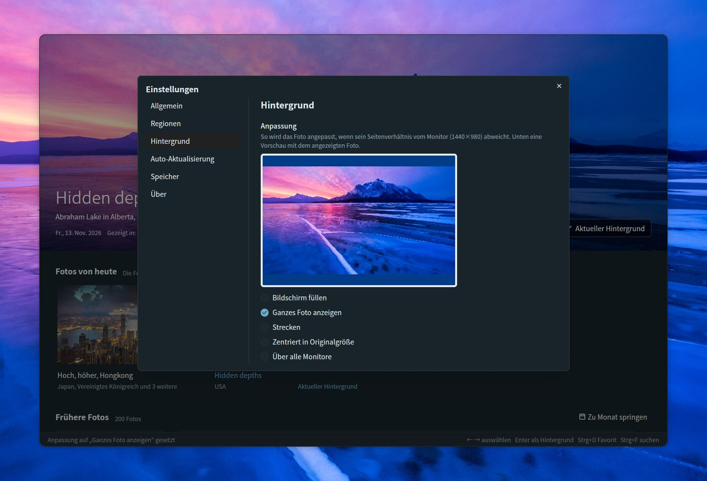
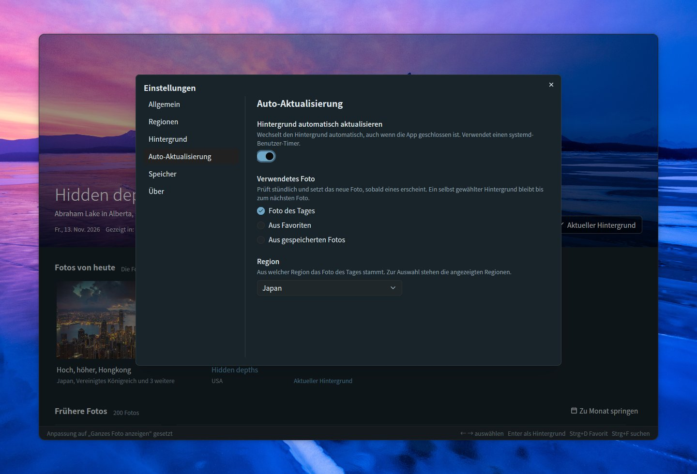
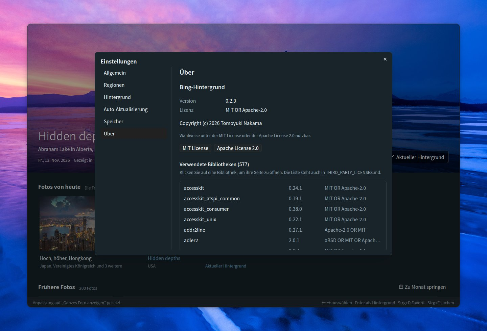

# Bing Wallpaper Manager

[English](README.md) | [日本語](README.ja.md) | [简体中文](README.zh-CN.md) | [繁體中文](README.zh-TW.md) | [한국어](README.ko.md) | **Deutsch** | [Français](README.fr.md) | [Español](README.es.md) | [Italiano](README.it.md) | [Português (Brasil)](README.pt-BR.md) | [Русский](README.ru.md)

Eine Desktop-App für Ubuntu, mit der Sie die täglichen Fotos von Bing durchstöbern und als GNOME-Hintergrund festlegen können. Entwickelt mit Rust, [GPUI](https://gpui.rs) und [gpui-kit](https://gpui-kit.com).



Das ausgewählte Foto füllt den oberen Teil eines abgerundeten, rahmenlosen Fensters. Bewegen Sie die Maus darüber, um die Titelleiste einzublenden; wenn Sie es als Hintergrund festlegen, wird es als *Aktueller Hintergrund* gekennzeichnet.

## Funktionen

- **Dashboard**: Das ausgewählte Foto wird oben groß angezeigt, darunter stehen *Fotos von heute* und *Frühere Fotos* (nach Datum gruppiert). Das große Foto bleibt über der Liste fixiert, schrumpft beim Scrollen zu einer schmalen Leiste und klappt wieder auf, wenn Sie ein Foto auswählen oder auf die Leiste klicken. Beim Wechsel wird weich überblendet, sobald das neue Bild geladen ist
- **Rahmenloses Fenster**: abgerundete Ecken, das große Foto reicht bis an den oberen Rand. Die Titelleiste (Suche, Favoriten, Aktualisieren, Einstellungen, Vollbild und die Fensterschaltflächen) erscheint nur über dem Foto, solange die Maus darauf ist; ziehen Sie am Foto, um das Fenster zu verschieben, und doppelklicken Sie auf den oberen Rand, um es zu maximieren
- **Fotos von heute**: das neueste Foto aus den gewählten Regionen, nach Foto gruppiert und mit den Regionen, die es zeigen. Sechs Regionen sind standardmäßig aktiv (Japan, USA, Vereinigtes Königreich, Deutschland, Frankreich, China); Kanada (Englisch / Französisch), Indien, Spanien, Italien und Brasilien lassen sich in den Einstellungen einschalten. Solange die App geöffnet ist, sucht sie stündlich nach neuen Fotos
- **Als Hintergrund festlegen**: legt den GNOME-Hintergrund für den hellen und den dunklen Stil fest. Der aktuelle Hintergrund wird als *Aktueller Hintergrund* gekennzeichnet
- **Favoriten**: Markieren Sie Fotos mit der ☆-Schaltfläche, dem Kontextmenü oder Strg+D; Favoriten erhalten ein ★-Abzeichen, und die ★-Schaltfläche in der Titelleiste zeigt nur Ihre Favoriten (mit der Suche kombinierbar)
- **Frühere Fotos**: Gespeicherte Fotos werden beim Scrollen fortlaufend geladen. Die offizielle Bing-API reicht 15 Tage zurück. Für ältere Fotos lädt *Ältere Fotos laden* am Ende der Liste jeweils etwa einen Monat aus einem Community-Archiv ([Bing-Wallpaper-Archive](https://github.com/npanuhin/Bing-Wallpaper-Archive); USA seit 2010, andere Regionen seit April 2024). Unter Einstellungen → Allgemein → *Ältere Fotos* können Sie festlegen, dass sie automatisch geladen werden, sobald Sie ans Ende der Liste scrollen, statt die Schaltfläche zu drücken. Ältere Fotos werden nur als Vorschaubild gespeichert; das vollständige Bild wird heruntergeladen, wenn Sie es als Hintergrund festlegen
- **Suche** (Strg+F) in den gespeicherten Fotos
  - Nach Wörtern: Titel, Orte, Beschreibungen, Regionen und Daten (etwa `2026-11-08`). Titel und Beschreibungen werden in allen verfügbaren Sprachen gespeichert, sodass „penguin“, „Pinguin“ und „ペンギン“ dasselbe Foto finden
  - Nach Farbe: Wählen Sie Rot, Orange, Gelb, Grün, Türkis, Blau, Lila, Rosa, Weiß oder Schwarz, um die Fotos mit dem größten Anteil dieser Farbe zuerst aufzulisten. Mit Wörtern kombinierbar
  - Esc schließt die Suche
- **Anpassung**: Legen Sie fest, wie das Foto angepasst wird, wenn sein Seitenverhältnis vom Monitor abweicht – mit einer Vorschau im Seitenverhältnis des Monitors (Bildschirm füllen, ganzes Foto anzeigen, strecken, zentriert in Originalgröße, über alle Monitore)
- **Fotoinfo** (ⓘ auf dem großen Foto, Strg+I): eine Seitenleiste mit Titel, Ort, Datum, Regionen und der Beschreibung des Fotos von Bing, dazu *Bei Bing nachschlagen* und *Titel und Ort kopieren*
- **Fotoaktionen**: Klicken Sie mit der rechten Maustaste auf ein Foto oder nutzen Sie die Schaltfläche *…* auf dem großen Foto, um es als Hintergrund festzulegen, zu den Favoriten hinzuzufügen, seine Infos anzusehen, es bei Bing nachzuschlagen, Titel und Ort zu kopieren, das Bild zu öffnen, es im Ordner anzuzeigen oder es zu löschen
- **Zu Monat springen**: direkt zu einem Monat der früheren Fotos springen
- **Löschen** (Entf-Taste): entfernt ein Foto nach einer Rückfrage aus dem Ordner; gelöschte Fotos werden nicht erneut heruntergeladen
- **Auto-Aktualisierung**: Ein Schalter in den Einstellungen wechselt den Hintergrund für Sie, auch wenn die App geschlossen ist – auf jedes neue Foto des Tages oder in einem von Ihnen gewählten Intervall auf einen anderen Favoriten oder ein anderes gespeichertes Foto
- **Einstellungen** (☰ oben rechts, Strg+,): Allgemein (Sprache, Design, Laden älterer Fotos), Regionen, Hintergrund (Anpassung), Auto-Aktualisierung, Speicher (Ordner und Speicherplatz) und Über (Version, Lizenz, verwendete Bibliotheken)
- **11 Sprachen**: Japanisch, Englisch, Chinesisch (vereinfacht / traditionell), Koreanisch, Deutsch, Französisch, Spanisch, Italienisch, Portugiesisch und Russisch. *Automatisch* folgt der Sprache des Betriebssystems (`LANG`). Bei Titeln und Beschreibungen der Fotos wird die Fassung aus einer Region bevorzugt, in der die gewählte Sprache gesprochen wird
- **Design**: wie System, hell oder dunkel
- **Tastatur**: ← → wählt ein Foto, Enter legt es als Hintergrund fest, Strg+D fügt einen Favoriten hinzu oder entfernt ihn, Strg+I zeigt die Fotoinfo, Entf löscht, Pos1 / Ende springt zu den neuesten oder ältesten Fotos, Bild auf / Bild ab scrollt bildschirmweise, F5 / Strg+R aktualisiert, Strg+F sucht, Strg+, öffnet die Einstellungen, F11 schaltet das Vollbild um
- **Befehlszeile**: `--apply` legt das Foto des Tages (oder mit `--random` ein gespeichertes Foto) als Hintergrund fest, ohne das Fenster zu öffnen
- **Ein Fenster**: Ein erneuter Start der App holt das geöffnete Fenster nach vorn, statt ein zweites zu öffnen, und das Fenster öffnet sich in der Größe, in der Sie es zuletzt verlassen haben

## Durchstöbern

Wenn Sie in der Liste scrollen, schrumpft das große Foto zu einer schmalen Leiste und lässt mehr Platz für die Fotos; wählen Sie ein Foto aus oder klicken Sie auf die Leiste, um es wieder aufzuklappen. Frühere Fotos sind nach Datum gruppiert, Favoriten tragen ein ★-Abzeichen. Klicken Sie mit der rechten Maustaste auf ein beliebiges Foto (oder nutzen Sie *…* auf dem großen Foto), um es als Hintergrund festzulegen, zu den Favoriten hinzuzufügen, seine Infos anzusehen, es bei Bing nachzuschlagen, Titel und Ort zu kopieren, das Bild zu öffnen, es im Ordner anzuzeigen oder es zu löschen.


### Zu Monat springen

Sobald Sie Fotos aus mehr als einem Monat haben, listet **Zu Monat springen** rechts neben *Frühere Fotos* die gespeicherten Monate auf (nach Jahren gruppiert, wenn es mehrere Jahre sind). Wählen Sie einen aus, und die Liste scrollt zum ersten Foto dieses Monats.


### Ein Foto löschen

Wählen Sie **Löschen …** im Menü eines Fotos oder drücken Sie die Entf-Taste für das oben angezeigte Foto. Nach Ihrer Bestätigung werden das Bild, sein Vorschaubild und seine Details aus dem Fotoordner entfernt. Gelöschte Fotos werden vermerkt, sodass sie beim Aktualisieren oder beim Laden älterer Fotos nicht zurückkommen. Die Fotos von heute und der aktuelle Hintergrund können nicht gelöscht werden.


## Fotoinfo

Klicken Sie auf **ⓘ** auf dem großen Foto (oder drücken Sie **Strg+I** oder wählen Sie *Fotoinfo* im Menü eines Fotos), um eine Seitenleiste mit Titel, Ort und Bildnachweis, Datum, den Regionen, die das Foto gezeigt haben, und der Beschreibung von Bing in Ihrer Sprache zu öffnen, sofern es eine gibt. Die Beschreibungen neuerer Fotos werden zusammen mit den Fotos abgerufen; für ältere Fotos stammen sie aus dem Community-Archiv. *Bei Bing nachschlagen* öffnet die Bing-Seite zum Foto im Browser, und *Titel und Ort kopieren* legt beides in die Zwischenablage. Esc schließt die Seitenleiste.


## Suche

Drücken Sie **Strg+F** (oder klicken Sie auf die 🔍-Schaltfläche in der Titelleiste), um die gespeicherten Fotos zu durchsuchen. Während der Suche zeigt die Liste nur die passenden Fotos; klicken Sie auf eines, um es oben groß zu sehen, oder drücken Sie Esc, um zurückzukehren.

### Nach Wörtern

Geben Sie ein beliebiges Wort aus Titel, Ort, Beschreibung, Region oder Datum (etwa `2026-11-08`) eines Fotos ein. Titel und Beschreibungen werden in jeder Sprache gespeichert, in der das Foto gezeigt wurde, und auch die längeren Beschreibungen aus dem Community-Archiv werden durchsucht – ein Wort in einer Sprache findet also auch Fotos, die in anderen Regionen gezeigt wurden.


### Nach Farbe

Wählen Sie eine von zehn Farben (Rot, Orange, Gelb, Grün, Türkis, Blau, Lila, Rosa, Weiß, Schwarz), um die Fotos mit dem größten Anteil dieser Farbe zuerst aufzulisten. Die Farbanteile werden im Hintergrund aus dem Vorschaubild jedes Fotos berechnet. Wörter und eine Farbe lassen sich kombinieren, zum Beispiel „Berg“ + Blau.


## Einstellungen

Öffnen Sie die Einstellungen mit **☰** oben rechts in der Titelleiste oder drücken Sie **Strg+,**. Änderungen wirken sofort, und Esc schließt den Dialog. Die Seiten sind links aufgelistet.

### Allgemein

- **Sprache**: die Anzeigesprache. *Automatisch* folgt dem Betriebssystem
- **Design**: wie System, hell oder dunkel
- **Ältere Fotos**: wie Fotos, die älter als das Ende der Liste sind, aus dem Community-Archiv geladen werden – jeweils etwa ein Monat
  - *Per Schaltfläche laden*: Drücken Sie *Ältere Fotos laden* am Ende der Liste
  - *Am Ende der Liste automatisch laden*: Wenn Sie ans Ende scrollen (oder Ende drücken), wird der nächste Monat von selbst geladen. Die Schaltfläche erscheint nur, wenn das Laden fehlschlägt, damit Sie es erneut versuchen können



### Regionen

Bing zeigt in verschiedenen Regionen unterschiedliche Fotos, Titel und Beschreibungen. Wählen Sie, aus welchen Regionen das Dashboard Fotos abruft: Japan, USA, Vereinigtes Königreich, Deutschland, Frankreich und China sind standardmäßig aktiv, und Kanada (Englisch), Kanada (Französisch), Indien, Spanien, Italien und Brasilien können hinzugefügt werden. Mindestens eine Region bleibt aktiv. Regionen, in denen Bing nur sein weltweites Foto zeigt, sind nicht aufgeführt.


### Hintergrund

Wenn das Seitenverhältnis des Fotos von Ihrem Monitor abweicht, legen Sie fest, wie es angepasst wird: Bildschirm füllen, ganzes Foto anzeigen, strecken, zentriert in Originalgröße oder über alle Monitore. Die Vorschau verwendet das Seitenverhältnis Ihres Monitors und das oben angezeigte Foto; bei *Ganzes Foto anzeigen* wird der freie Platz mit der Hintergrundfarbe gefüllt, die GNOME verwendet. Der aktuelle Hintergrund wird sofort aktualisiert.



### Auto-Aktualisierung

Schalten Sie den Schalter ein, damit der Hintergrund von selbst wechselt, auch wenn die App geschlossen ist. Wählen Sie, was verwendet wird:

- **Foto des Tages**: prüft stündlich (und kurz nach der Anmeldung) und setzt das neue Foto, sobald eines erscheint – für die Region, die Sie auswählen. Ein selbst gewählter Hintergrund bleibt bis zum nächsten Foto
- **Aus Favoriten**: wählt jedes Mal einen anderen Favoriten – alle 30 Minuten, stündlich, alle 3 Stunden, alle 6 Stunden oder täglich
- **Aus gespeicherten Fotos**: dasselbe, aber aus allen gespeicherten Fotos. Ältere Fotos werden bei der Auswahl heruntergeladen

Der Schalter legt einen systemd-Benutzer-Timer an (`~/.config/systemd/user/bing-wallpaper-manager.timer` und `.service`), der diese App mit `--apply` ausführt; beim Ausschalten wird der Timer entfernt. Der Timer startet die App von ihrem jetzigen Speicherort – schalten Sie den Schalter also aus und wieder ein, wenn Sie die App verschieben.



### Speicher

Zeigt den Ordner, in dem die Fotos liegen, wie viel Speicherplatz sie belegen und wie viele es sind. *Ändern …* wählt einen anderen Ordner, und *Ordner öffnen* öffnet ihn in der Dateiverwaltung. Was dort gespeichert wird, steht unter [Dateien](#dateien).


### Über

Die Version, die Lizenz (MIT oder Apache 2.0, mit Schaltflächen zum Lesen der beiden) und die Liste der verwendeten Bibliotheken. Klicken Sie auf eine Bibliothek, um ihre Seite zu öffnen.



## Entwickelt mit

Die Benutzeroberfläche baut auf diesen beiden Open-Source-Projekten auf:

- **[GPUI](https://gpui.rs)** — das GPU-beschleunigte UI-Framework, das [Zed Industries](https://zed.dev) für den Editor Zed entwickelt ([Quellcode](https://github.com/zed-industries/zed), Apache-2.0). Diese App verwendet den Stand, der auf crates.io als `gpui-pre` veröffentlicht ist
- **[gpui-kit](https://gpui-kit.com)** — eine Komponentenbibliothek und ein Toolkit für GPUI von [Longbridge](https://github.com/longbridge) ([Quellcode](https://github.com/longbridge/gpui-kit), Apache-2.0). Schaltflächen, Dialoge, Menüs, Eingabefelder, Auswahllisten, Bildlaufleisten, Titelleiste und Theming stammen aus dessen Crates `gpui-component` und `gpui-base`

Danke an beide Projekte. Alle anderen Bibliotheken sind in [THIRD_PARTY_LICENSES.md](THIRD_PARTY_LICENSES.md) aufgeführt.

## Installation

### Voraussetzungen

- Ubuntu mit dem GNOME-Desktop (entwickelt unter Ubuntu 26.04; Wayland und X11). Der Hintergrund wird über `gsettings` von GNOME festgelegt
- Ein Grafiktreiber mit Vulkan-Unterstützung (in einer normalen Ubuntu-Desktop-Installation enthalten)

### Fertiges Binärpaket (x86_64)

Jedes [Release](https://github.com/TomoyukiNakama/bing-wallpaper-manager/releases/latest) enthält ein fertig gebautes Paket für Ubuntu 26.04 oder neuer (glibc 2.43+). Laden Sie `bing-wallpaper-manager-<Version>-x86_64-linux.tar.gz` herunter und entpacken Sie es nach `~/.local`:

```sh
tar -xzf bing-wallpaper-manager-*-x86_64-linux.tar.gz -C ~/.local --strip-components=1
```

Wenn Sie stattdessen aus dem Quellcode bauen möchten, folgen Sie den Schritten unten.

### 1. Build-Werkzeuge installieren

```sh
sudo apt install git curl build-essential
```

Ein C-Compiler (`build-essential`) wird benötigt, weil eine der Schriftbibliotheken aus C-Quellen gebaut wird.

### 2. Rust installieren

Installieren Sie das aktuelle stabile Rust mit [rustup](https://rustup.rs). Das mit Ubuntu 26.04 ausgelieferte Rust (1.93) ist für GPUI zu alt.

```sh
curl --proto '=https' --tlsv1.2 -sSf https://sh.rustup.rs | sh -s -- -y
source "$HOME/.cargo/env"   # oder ein neues Terminal öffnen
```

Wenn Sie lieber das `cargo` von Ubuntu in Ihrem PATH behalten, funktioniert auch das: `.cargo/config.toml` verweist cargo auf `scripts/rustc-stable`, das den rustc Ihrer stabilen rustup-Toolchain ausführt (und auf den `rustc` in Ihrem PATH zurückfällt, wenn rustup nicht installiert ist).

### 3. Quellcode holen

```sh
git clone https://github.com/TomoyukiNakama/bing-wallpaper-manager.git
cd bing-wallpaper-manager
```

### 4. Bauen und installieren

```sh
scripts/install.sh
```

Das baut die Release-Version und installiert die App, ihr Symbol und einen Desktop-Eintrag unter `~/.local`. *Bing-Hintergrund* erscheint dann in der GNOME-Anwendungsübersicht (melden Sie sich ab und wieder an, falls es nicht sofort auftaucht), und `bing-wallpaper-manager` lässt sich aus einem Terminal starten, wenn `~/.local/bin` in Ihrem PATH liegt. Der erste Build lädt und kompiliert alle Abhängigkeiten und dauert mehrere Minuten.

Um an einem anderen Ort zu installieren, setzen Sie `PREFIX`, zum Beispiel `PREFIX=/opt/bing-wallpaper scripts/install.sh`.

### Aktualisieren

```sh
git pull
scripts/install.sh
```

`scripts/install.sh` baut vor dem Installieren immer neu; ein erneuter Aufruf nach `git pull` installiert also die neue Version.

### Deinstallieren

```sh
scripts/install.sh --uninstall
```

Das entfernt die App, das Symbol und den Desktop-Eintrag. Ihre Einstellungen (`~/.config/bing-wallpaper-manager/`) und die gespeicherten Fotos (der Speicherordner) bleiben erhalten; löschen Sie sie selbst, wenn Sie sie nicht mehr brauchen.

### Ohne Installation ausführen

```sh
cargo run --release
```

## Dateien

Den Speicherordner wählen Sie unter *Einstellungen → Speicher* (Standard: `~/Pictures/BingWallpaper` bzw. der lokalisierte Bilder-Ordner). Die Einstellungen werden in `~/.config/bing-wallpaper-manager/config.json` gespeichert, und was sich die App merkt (etwa die Fenstergröße), in `state.json` im selben Ordner.
Ein Foto wird nur einmal gespeichert, auch wenn es in mehreren Regionen oder an verschiedenen Tagen gezeigt wird, und gespeicherte Bilder werden nie erneut heruntergeladen.

```text
<Speicherordner>/
  20261108_OHR.Foo_UHD.jpg              Hintergrundbild (UHD)
  .bing-wallpaper/meta/OHR.Foo.json     Metadaten: Titel, Beschreibungen, Regionen, Farbanteile
  .bing-wallpaper/thumbs/OHR.Foo.jpg    Vorschaubild (640x360)
  .bing-wallpaper/previews/OHR.Foo.jpg  Mittelgroßes Bild, um ältere Fotos groß anzuzeigen (1920x1080)
  .bing-wallpaper/deleted.txt           Von Ihnen gelöschte Fotos (damit sie nicht erneut heruntergeladen werden)
```

## Befehlszeile

```sh
bing-wallpaper-manager --apply                       # Foto des Tages als Hintergrund festlegen
bing-wallpaper-manager --apply --mkt en-US           # Region wählen
bing-wallpaper-manager --apply --if-new              # nichts tun, wenn es dasselbe Foto wie zuletzt ist
bing-wallpaper-manager --apply --random              # ein zufälliges gespeichertes Foto festlegen
bing-wallpaper-manager --apply --random --favorites  # einen zufälligen Favoriten festlegen
```

Ohne `--mkt` wird die unter *Auto-Aktualisierung* gewählte Region verwendet (oder die erste angezeigte Region). Wenn das Netzwerk noch nicht bereit ist, etwa direkt nach der Anmeldung, versucht `--apply` es einige Male erneut, bevor es aufgibt.

### Täglich aktualisieren

Schalten Sie den Schalter unter **Einstellungen** → **Auto-Aktualisierung** ein (siehe [Auto-Aktualisierung](#auto-aktualisierung)); er richtet den systemd-Benutzer-Timer für Sie ein. So sehen Sie nach, ob er läuft:

```sh
systemctl --user list-timers bing-wallpaper-manager.timer
journalctl --user -u bing-wallpaper-manager.service
```

Wenn Sie mit einer früheren Version `bing-wallpaper.timer` von Hand angelegt haben, deaktivieren Sie ihn, damit nicht beide laufen: `systemctl --user disable --now bing-wallpaper.timer`.

## Entwicklung

### Screenshots

`scripts/screenshot.sh` führt die App auf einem virtuellen Wayland-Display aus (sway im Headless-Modus) und speichert ein PNG.
Ihr Desktop, Ihre Einstellungen, Ihr Speicherordner, Ihr Hintergrund und Ihre systemd-Timer bleiben unberührt (die Screenshot-Daten liegen in `target/screenshot-fixture/`).

```sh
sudo apt install sway grim          # nur beim ersten Mal
cargo build --release
scripts/screenshot.sh target/shot.png            # Standard: 15 s warten, 1440x960
BWM_THEME=dark BWM_LANG=de scripts/screenshot.sh target/dark.png 10 1280x1300
```

`BWM_THEME=light|dark` legt das Design fest und `BWM_LANG=de` (usw.) die Sprache; beides funktioniert auch bei einem normalen Start.
`FLOAT=1280x840` zeigt das Fenster schwebend, statt den Bildschirm zu füllen (um die abgerundeten Ecken und die Fensterschaltflächen zu prüfen), und `BG=<Bild>` legt ein Bild als Desktop-Hintergrund dahinter.

Tragen Sie Klicks, Rechtsklicks, Ziehbewegungen, Scrollen, Tasten und Texteingaben in `ACTIONS` ein, um die App vor dem Screenshot zu bedienen. Die Eingaben werden über eine virtuelle Maus und Tastatur in `tools/vpointer` gesendet (wird bei der ersten Verwendung automatisch gebaut).

```sh
ACTIONS=$'key ctrl-f\ntype penguin\nsleep 3\nshot target/step1.png' \
  scripts/screenshot.sh target/step2.png 10 1280x1000
```

Die Bilder in `docs/` werden auf diese Weise mit dem dunklen Design aufgenommen und als JPEG mit Qualität 85 gespeichert. Den Haupt-Screenshot und die Einstellungsseiten gibt es in jeder Sprache (`docs/<Name>.<Sprache>.jpg`; Englisch hat kein Suffix); die übrigen Bilder werden auf Englisch und Japanisch aufgenommen, und die READMEs der anderen Sprachen verwenden die englischen. Zum Beispiel:

```sh
BG=target/screenshot-fixture/store/20261112_OHR.AbrahamCanada_UHD.jpg FLOAT=1280x840 BWM_LANG=en BWM_THEME=dark \
  ACTIONS=$'click 583 660\nsleep 1.5\nkey enter\nsleep 2\nclick 720 250\nsleep 1.5' \
  scripts/screenshot.sh target/main.png 12 1440x980
```

### Release-Pakete

`scripts/package-release.sh` baut die Release-Version und erzeugt `target/dist/bing-wallpaper-manager-<Version>-x86_64-linux.tar.gz` (und die zugehörige `.sha256`) mit der Programmdatei, den Symbolen, dem Desktop-Eintrag und den Lizenzdateien, einschließlich der Lizenztexte aller mitgelieferten Bibliotheken. Die Version stammt aus `Cargo.toml`.

### Übersetzungen

Die Texte liegen in `locales/<Sprache>.yml` (`ja`, `en`, `zh-CN`, `zh-TW`, `ko`, `de`, `fr`, `es`, `it`, `pt-BR`, `ru`).

- Platzhalter werden als `%{count}` geschrieben
- Jede Datei muss dieselben Schlüssel enthalten (`cargo test` prüft das). Fehlende Übersetzungen fallen auf Englisch zurück
- Um eine Sprache hinzuzufügen, legen Sie eine Datei unter `locales/` an und ergänzen Sie eine Variante in `Language` in `src/i18n.rs`
- Das README gibt es in jeder Sprache (`README.md` auf Englisch, `README.<Sprache>.md` für die anderen). Wenn sich eine Funktion ändert, aktualisieren Sie alle

### Aufbau

| Datei | Aufgabe |
| --- | --- |
| `src/main.rs` | Dashboard-Oberfläche und CLI |
| `src/bing.rs` | Bing-HPImageArchive-API und Downloads |
| `src/archive.rs` | Ältere Fotos und Beschreibungen aus dem Community-Archiv |
| `src/library.rs` | Speichern und Laden der Fotos im Speicherordner |
| `src/search.rs` | Suche nach Wörtern und Farben |
| `src/colors.rs` | Analyse der Farbanteile der Fotos |
| `src/settings.rs` | Einstellungsdialog |
| `src/info.rs` | Fotoinfo-Seitenleiste |
| `src/schedule.rs` | Auto-Aktualisierung (systemd-Benutzer-Timer) |
| `src/single.rs` | Sorgt für ein einziges Fenster (ein zweiter Start holt es nach vorn) |
| `src/config.rs` | Einstellungsdatei |
| `src/theme.rs` | Farben (hell / dunkel) und Schrift |
| `src/i18n.rs` | Sprachumschaltung und Datumsformate (Texte werden mit `tr!("key")` referenziert) |
| `src/wallpaper.rs` | Festlegen des GNOME-Hintergrunds mit `gsettings` |
| `locales/*.yml` | Übersetzungen (beim Bauen mit rust-i18n eingebettet) |
| `src/third_party.tsv` / `THIRD_PARTY_LICENSES.md` | Verwendete Bibliotheken (erzeugt von `scripts/gen-third-party.py`) |
| `assets/icons/` | App-Symbol (SVG sowie von `scripts/render-icon.py` gerenderte PNGs) |
| `assets/bing-wallpaper-manager.desktop` | Desktop-Eintrag (installiert von `scripts/install.sh`) |
| `scripts/rustc-stable` | Wählt den stabilen rustc von rustup für cargo aus (siehe „2. Rust installieren“) |
| `scripts/screenshot.sh` | Screenshots auf einem virtuellen Display |
| `tools/vpointer/` | Virtuelle Maus und Tastatur für Screenshots (eigenes Crate) |

## Lizenz

Lizenziert wahlweise unter der [MIT License](LICENSE-MIT) oder der [Apache License 2.0](LICENSE-APACHE) (MIT OR Apache-2.0). Die verwendeten Bibliotheken sind in [THIRD_PARTY_LICENSES.md](THIRD_PARTY_LICENSES.md) aufgeführt (nach Änderungen an den Abhängigkeiten mit `python3 scripts/gen-third-party.py` neu erzeugen).

Die Fotos sind urheberrechtlich geschützt; die Rechte liegen bei ihren Fotografen und Anbietern. Diese App steht in keiner Verbindung zu Microsoft.
