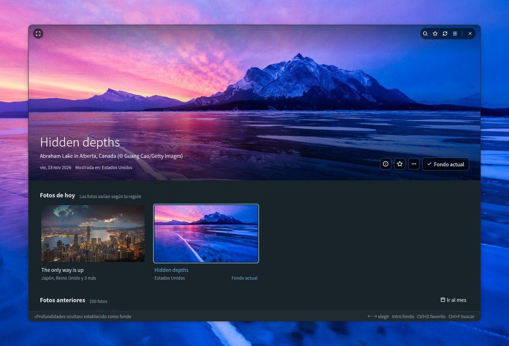
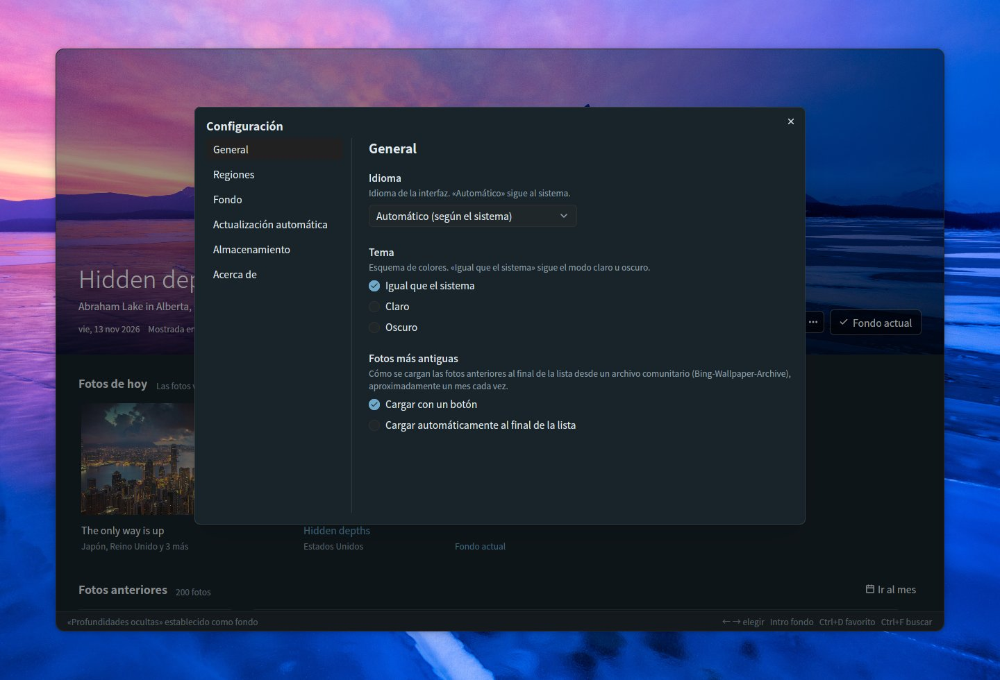
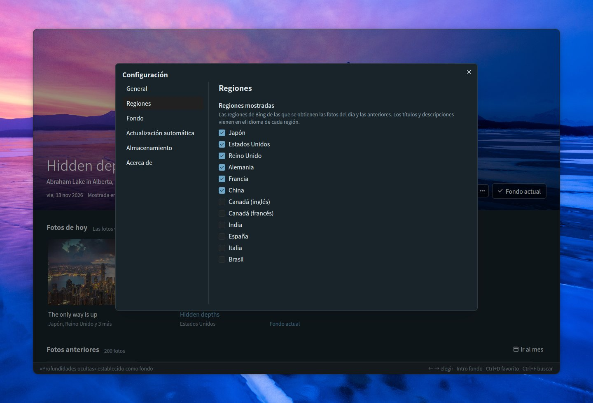
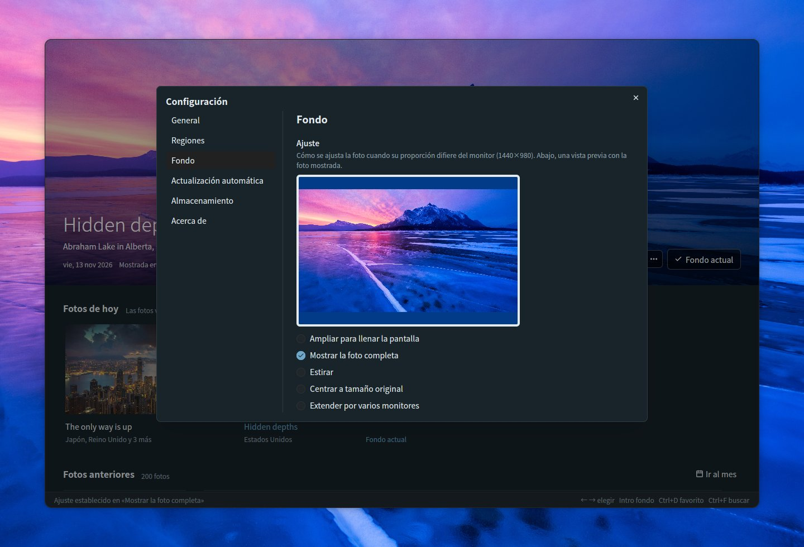
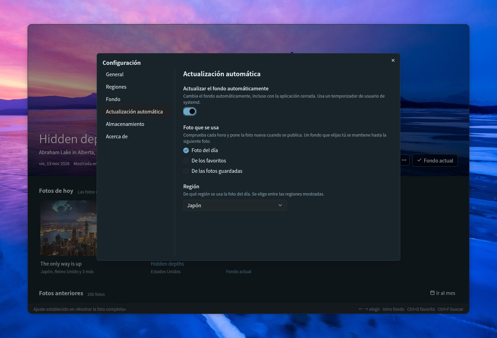
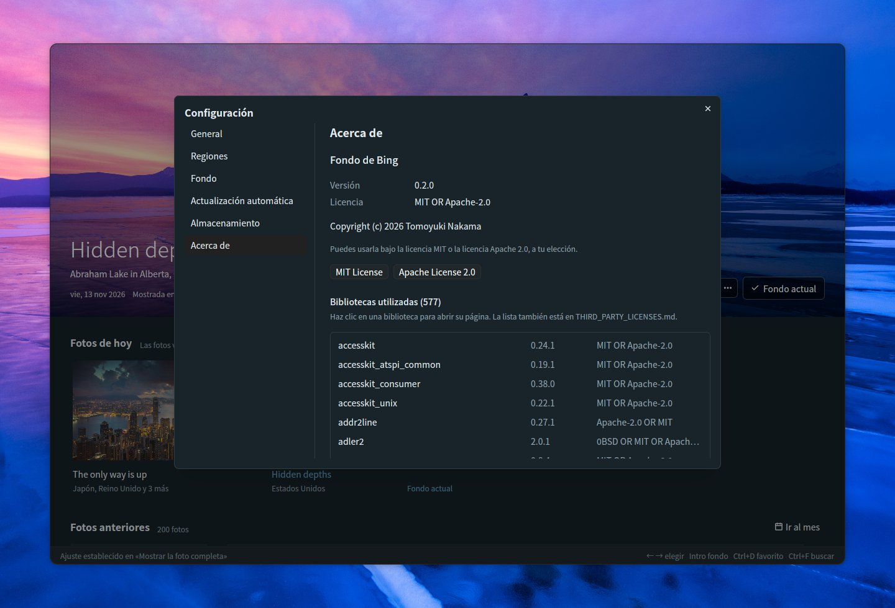

# Bing Wallpaper Manager

[English](README.md) | [日本語](README.ja.md) | [简体中文](README.zh-CN.md) | [繁體中文](README.zh-TW.md) | [한국어](README.ko.md) | [Deutsch](README.de.md) | [Français](README.fr.md) | **Español** | [Italiano](README.it.md) | [Português (Brasil)](README.pt-BR.md) | [Русский](README.ru.md)

Una aplicación de escritorio para Ubuntu que te permite explorar las fotos diarias de Bing y establecerlas como fondo de pantalla de GNOME. Creada con Rust, [GPUI](https://gpui.rs) y [gpui-kit](https://gpui-kit.com).



La foto que elijas ocupa la parte superior de una ventana redondeada y sin marco. Pasa el ratón por encima para que aparezca la barra de título; establécela como fondo y quedará marcada como *Fondo actual*.

## Características

- **Panel**: la foto seleccionada se muestra en grande arriba, con *Fotos de hoy* y *Fotos anteriores* (agrupadas por fecha) debajo. La foto grande permanece fija sobre la lista, se reduce a una barra estrecha mientras te desplazas y vuelve a expandirse cuando eliges una foto o haces clic en la barra. El cambio de foto se hace con un fundido suave en cuanto la nueva imagen se ha cargado
- **Ventana sin marco**: esquinas redondeadas, con la foto grande llegando hasta el borde superior. La barra de título (búsqueda, favoritos, actualizar, configuración, pantalla completa y los botones de la ventana) aparece sobre la foto solo mientras el ratón está encima; arrastra la foto para mover la ventana y haz doble clic en el borde superior para maximizarla
- **Fotos de hoy**: la foto más reciente de las regiones que elijas, agrupadas por foto junto con las regiones que la muestran. Seis regiones están activadas de forma predeterminada (Japón, Estados Unidos, Reino Unido, Alemania, Francia, China); Canadá (inglés / francés), India, España, Italia y Brasil se pueden activar en la configuración. Mientras la aplicación permanece abierta, comprueba cada hora si hay fotos nuevas
- **Establecer como fondo**: establece el fondo de pantalla de GNOME tanto para el estilo claro como para el oscuro. El fondo en uso se marca como *Fondo actual*
- **Favoritos**: marca fotos con el botón ☆, el menú contextual o Ctrl+D; los favoritos llevan una insignia ★, y el botón ★ de la barra de título muestra solo tus favoritos (se puede combinar con la búsqueda)
- **Fotos anteriores**: las fotos guardadas se cargan de forma continua a medida que te desplazas. La API oficial de Bing llega hasta 15 días atrás. Para fotos más antiguas, *Cargar fotos más antiguas*, al final de la lista, carga aproximadamente un mes cada vez desde un archivo comunitario ([Bing-Wallpaper-Archive](https://github.com/npanuhin/Bing-Wallpaper-Archive); Estados Unidos desde 2010, otras regiones desde abril de 2024). En Configuración → General → *Fotos más antiguas* puedes hacer que se carguen automáticamente al llegar al final de la lista, en lugar de pulsar el botón. Las fotos más antiguas se guardan solo como miniaturas; la imagen completa se descarga cuando la estableces como fondo
- **Búsqueda** (Ctrl+F) en las fotos guardadas
  - Por palabras: títulos, lugares, descripciones, regiones y fechas (como `2026-11-08`). Los títulos y las descripciones se guardan en todos los idiomas disponibles, así que «penguin», «Pinguin» y «ペンギン» encuentran la misma foto
  - Por color: elige rojo, naranja, amarillo, verde, cian, azul, morado, rosa, blanco o negro para listar primero las fotos que más tienen de ese color. Se puede combinar con palabras
  - Pulsa Escape para cerrar la búsqueda
- **Ajuste**: elige cómo se ajusta la foto cuando su proporción difiere de la del monitor, con una vista previa en las proporciones del monitor (ampliar para llenar la pantalla, mostrar la foto completa, estirar, centrar a tamaño original, extender por varios monitores)
- **Información de la foto** (ⓘ en la foto grande, Ctrl+I): un panel lateral con el título, el lugar, la fecha, las regiones y la descripción de la foto que ofrece Bing, además de *Buscar en Bing* y *Copiar título y lugar*
- **Acciones de la foto**: haz clic derecho en una foto o usa el botón *…* de la foto grande para establecerla como fondo, añadirla a tus favoritos, ver su información, buscarla en Bing, copiar su título y lugar, abrir la imagen, mostrarla en su carpeta o eliminarla
- **Ir al mes**: salta directamente a un mes de las fotos anteriores
- **Eliminar** (tecla Supr): quita una foto de la carpeta tras una confirmación; las fotos eliminadas no se vuelven a descargar
- **Actualización automática**: un interruptor en la configuración cambia el fondo por ti incluso con la aplicación cerrada: a cada nueva foto del día, o a un favorito o una foto guardada distintos con el intervalo que elijas
- **Configuración** (☰ arriba a la derecha, Ctrl+,): General (idioma, tema, cómo se cargan las fotos más antiguas), Regiones, Fondo (ajuste), Actualización automática, Almacenamiento (carpeta y uso de disco) y Acerca de (versión, licencia, bibliotecas utilizadas)
- **11 idiomas**: japonés, inglés, chino (simplificado / tradicional), coreano, alemán, francés, español, italiano, portugués y ruso. *Automático* sigue el idioma del sistema (`LANG`). Para los títulos y las descripciones de las fotos se prefiere la versión mostrada en una región que use el idioma seleccionado
- **Tema**: igual que el sistema, claro u oscuro
- **Teclado**: ← → para elegir una foto, Intro para establecerla como fondo, Ctrl+D para añadir o quitar un favorito, Ctrl+I para la información de la foto, Supr para eliminar, Inicio / Fin para saltar a las fotos más recientes o más antiguas, Re Pág / Av Pág para desplazarte una pantalla cada vez, F5 / Ctrl+R para actualizar, Ctrl+F para buscar, Ctrl+, para la configuración, F11 para pantalla completa
- **Línea de comandos**: `--apply` establece la foto del día (o, con `--random`, una foto guardada) como fondo sin abrir la ventana
- **Una sola ventana**: al iniciar la aplicación de nuevo, la ventana abierta pasa al frente en lugar de abrirse una segunda, y la ventana se abre con el tamaño con el que la dejaste

## Exploración

Desplázate por la lista y la foto grande se reduce a una barra estrecha, lo que deja más espacio para las fotos; elige una foto o haz clic en la barra para expandirla de nuevo. Las fotos anteriores se agrupan por fecha, y los favoritos llevan una insignia ★. Haz clic derecho en cualquier foto (o usa *…* en la foto grande) para establecerla como fondo, añadirla a tus favoritos, ver su información, buscarla en Bing, copiar su título y lugar, abrir la imagen, mostrarla en su carpeta o eliminarla.


### Ir al mes

Cuando tengas fotos de más de un mes, **Ir al mes**, a la derecha de *Fotos anteriores*, lista los meses que tienes guardados (agrupados por año cuando hay varios años). Elige uno y la lista se desplaza hasta la primera foto de ese mes.


### Eliminar una foto

Elige **Eliminar…** en el menú de una foto, o pulsa la tecla Supr para la foto que se muestra arriba. Tras confirmarlo, la imagen, su miniatura y sus datos se quitan de la carpeta de fotos. Las fotos eliminadas se recuerdan, así que actualizar o cargar fotos más antiguas no las trae de vuelta. Las fotos de hoy y el fondo actual no se pueden eliminar.


## Información de la foto

Haz clic en **ⓘ** en la foto grande (o pulsa **Ctrl+I**, o elige *Información de la foto* en el menú de una foto) para abrir un panel con el título de la foto, el lugar y el crédito, la fecha, las regiones que la mostraron y la descripción de Bing en tu idioma cuando la hay. Las descripciones de las fotos recientes se obtienen junto con las fotos; las de las fotos más antiguas provienen del archivo comunitario. *Buscar en Bing* abre en tu navegador la página de Bing sobre la foto, y *Copiar título y lugar* los copia al portapapeles. Pulsa Escape para cerrar el panel.


## Búsqueda

Pulsa **Ctrl+F** (o haz clic en el botón 🔍 de la barra de título) para buscar en las fotos que tienes guardadas. Durante la búsqueda, la lista muestra solo las fotos que coinciden; haz clic en una para verla en grande arriba, o pulsa Escape para volver.

### Por palabras

Escribe cualquier palabra del título, el lugar, la descripción, la región o la fecha (como `2026-11-08`) de una foto. Los títulos y las descripciones se guardan en todos los idiomas en los que se mostró la foto, y también se busca en las descripciones más largas del archivo comunitario, de modo que una palabra en un idioma también encuentra fotos mostradas en otras regiones.


### Por color

Elige uno de los diez colores (rojo, naranja, amarillo, verde, cian, azul, morado, rosa, blanco, negro) para listar primero las fotos que más contienen de ese color. Las proporciones de color se calculan en segundo plano a partir de la miniatura de cada foto. Se pueden combinar palabras y un color, por ejemplo «montaña» + azul.


## Configuración

Abre la configuración con **☰** arriba a la derecha de la barra de título, o pulsa **Ctrl+,**. Los cambios se aplican al instante, y Escape cierra el cuadro de diálogo. Las páginas aparecen a la izquierda.

### General

- **Idioma**: el idioma de la interfaz. *Automático* sigue al sistema
- **Tema**: igual que el sistema, claro u oscuro
- **Fotos más antiguas**: cómo se cargan las fotos anteriores al final de la lista desde el archivo comunitario, aproximadamente un mes cada vez
  - *Cargar con un botón*: pulsa *Cargar fotos más antiguas* al final de la lista
  - *Cargar automáticamente al final de la lista*: al desplazarte hasta el final (o al pulsar Fin) se carga solo el mes siguiente. El botón aparece únicamente si la carga falla, para que puedas volver a intentarlo



### Regiones

Bing muestra fotos, títulos y descripciones distintos en cada región. Elige de qué regiones obtiene fotos el panel: Japón, Estados Unidos, Reino Unido, Alemania, Francia y China están activadas de forma predeterminada, y se pueden añadir Canadá (inglés), Canadá (francés), India, España, Italia y Brasil. Al menos una región permanece activada. Las regiones en las que Bing solo muestra su foto mundial no aparecen en la lista.



### Fondo

Cuando la proporción de la foto difiere de la de tu monitor, elige cómo se ajusta: ampliar para llenar la pantalla, mostrar la foto completa, estirar, centrar a tamaño original o extender por varios monitores. La vista previa usa las proporciones de tu monitor y la foto que se muestra arriba; con *Mostrar la foto completa*, el espacio sobrante se rellena con el color de fondo que usa GNOME. El fondo actual se actualiza al instante.



### Actualización automática

Activa el interruptor para que el fondo cambie solo, incluso con la aplicación cerrada. Elige qué se usa:

- **Foto del día**: comprueba cada hora (y poco después de iniciar sesión) y pone la foto nueva cuando se publica, para la región que elijas. Un fondo que elijas tú se mantiene hasta que llega la siguiente foto
- **De los favoritos**: elige cada vez un favorito distinto, cada 30 minutos, cada hora, cada 3 horas, cada 6 horas o cada día
- **De las fotos guardadas**: lo mismo, entre todo lo que tienes guardado. Las fotos más antiguas se descargan al elegirlas

El interruptor crea un temporizador de usuario de systemd (`~/.config/systemd/user/bing-wallpaper-manager.timer` y `.service`) que ejecuta esta aplicación con `--apply`, y al desactivarlo se elimina el temporizador. El temporizador ejecuta la aplicación desde donde está ahora, así que desactiva y vuelve a activar el interruptor si mueves la aplicación.



### Almacenamiento

Muestra la carpeta donde se guardan las fotos, cuánto espacio en disco ocupan y cuántas hay. *Cambiar…* elige otra carpeta, y *Abrir carpeta* la abre en el gestor de archivos. Consulta [Archivos](#archivos) para ver qué se guarda allí.


### Acerca de

La versión, la licencia (MIT o Apache 2.0, con botones para leer cada una) y la lista de bibliotecas utilizadas. Haz clic en una biblioteca para abrir su página.



## Creado con

La interfaz de usuario se basa en estos dos proyectos de código abierto:

- **[GPUI](https://gpui.rs)** — el framework de interfaz acelerado por GPU que desarrolla [Zed Industries](https://zed.dev) para el editor Zed ([código fuente](https://github.com/zed-industries/zed), Apache-2.0). Esta aplicación usa la instantánea publicada en crates.io como `gpui-pre`
- **[gpui-kit](https://gpui-kit.com)** — una biblioteca de componentes y un conjunto de herramientas para GPUI de [Longbridge](https://github.com/longbridge) ([código fuente](https://github.com/longbridge/gpui-kit), Apache-2.0). Los botones, cuadros de diálogo, menús, campos de entrada, listas desplegables, barras de desplazamiento, la barra de título y los temas provienen de sus crates `gpui-component` y `gpui-base`

Gracias a ambos proyectos. Todas las demás bibliotecas se enumeran en [THIRD_PARTY_LICENSES.md](THIRD_PARTY_LICENSES.md).

## Instalación

### Requisitos

- Ubuntu con el escritorio GNOME (desarrollado en Ubuntu 26.04; Wayland y X11). El fondo se establece mediante `gsettings` de GNOME
- Un controlador gráfico compatible con Vulkan (incluido en una instalación normal de Ubuntu Desktop)

### Binario precompilado (x86_64)

Cada [versión publicada](https://github.com/TomoyukiNakama/bing-wallpaper-manager/releases/latest) incluye un paquete precompilado para Ubuntu 26.04 o posterior (glibc 2.43+). Descarga `bing-wallpaper-manager-<versión>-x86_64-linux.tar.gz` y extráelo en `~/.local`:

```sh
tar -xzf bing-wallpaper-manager-*-x86_64-linux.tar.gz -C ~/.local --strip-components=1
```

Si prefieres compilar desde el código fuente, sigue los pasos de abajo.

### 1. Instalar las herramientas de compilación

```sh
sudo apt install git curl build-essential
```

Se necesita un compilador de C (`build-essential`) porque una de las bibliotecas de fuentes se compila a partir de código C.

### 2. Instalar Rust

Instala la versión estable actual de Rust con [rustup](https://rustup.rs). El Rust que viene con Ubuntu 26.04 (1.93) es demasiado antiguo para GPUI.

```sh
curl --proto '=https' --tlsv1.2 -sSf https://sh.rustup.rs | sh -s -- -y
source "$HOME/.cargo/env"   # o abre un terminal nuevo
```

Si prefieres mantener el `cargo` de Ubuntu en tu PATH, también funciona: `.cargo/config.toml` hace que cargo use `scripts/rustc-stable`, que ejecuta el rustc de tu toolchain estable de rustup (y recurre al `rustc` de tu PATH cuando rustup no está instalado).

### 3. Obtener el código fuente

```sh
git clone https://github.com/TomoyukiNakama/bing-wallpaper-manager.git
cd bing-wallpaper-manager
```

### 4. Compilar e instalar

```sh
scripts/install.sh
```

Esto compila la versión de lanzamiento e instala la aplicación, su icono y una entrada de escritorio en `~/.local`. *Fondo de Bing* aparece entonces en la cuadrícula de aplicaciones de GNOME (cierra la sesión y vuelve a iniciarla si no aparece enseguida), y `bing-wallpaper-manager` se puede iniciar desde un terminal si `~/.local/bin` está en tu PATH. La primera compilación descarga y compila todas las dependencias y tarda varios minutos.

Para instalar en otro lugar, define `PREFIX`, por ejemplo `PREFIX=/opt/bing-wallpaper scripts/install.sh`.

### Actualizar

```sh
git pull
scripts/install.sh
```

`scripts/install.sh` siempre vuelve a compilar antes de instalar, así que ejecutarlo de nuevo después de `git pull` instala la nueva versión.

### Desinstalar

```sh
scripts/install.sh --uninstall
```

Esto elimina la aplicación, el icono y la entrada de escritorio. Tu configuración (`~/.config/bing-wallpaper-manager/`) y las fotos guardadas (la carpeta de almacenamiento) se conservan; bórralas tú si ya no las necesitas.

### Ejecutar sin instalar

```sh
cargo run --release
```

## Archivos

Elige la carpeta de almacenamiento en *Configuración → Almacenamiento* (predeterminada: `~/Pictures/BingWallpaper`, o la carpeta Imágenes localizada). La configuración se guarda en `~/.config/bing-wallpaper-manager/config.json`, y lo que la aplicación recuerda (como el tamaño de la ventana), en `state.json`, en la misma carpeta.
Una foto se guarda una sola vez aunque se muestre en varias regiones o en días distintos, y las imágenes guardadas nunca se vuelven a descargar.

```text
<carpeta de almacenamiento>/
  20261108_OHR.Foo_UHD.jpg              Imagen del fondo (UHD)
  .bing-wallpaper/meta/OHR.Foo.json     Metadatos: títulos, descripciones, regiones, proporciones de color
  .bing-wallpaper/thumbs/OHR.Foo.jpg    Miniatura (640x360)
  .bing-wallpaper/previews/OHR.Foo.jpg  Imagen de tamaño medio para mostrar en grande las fotos más antiguas (1920x1080)
  .bing-wallpaper/deleted.txt           Fotos que has eliminado (para que no se vuelvan a descargar)
```

## Línea de comandos

```sh
bing-wallpaper-manager --apply                       # establecer la foto del día como fondo
bing-wallpaper-manager --apply --mkt en-US           # elegir la región
bing-wallpaper-manager --apply --if-new              # no hacer nada si es la misma foto que la última vez
bing-wallpaper-manager --apply --random              # establecer una foto guardada al azar
bing-wallpaper-manager --apply --random --favorites  # establecer un favorito al azar
```

Sin `--mkt`, se usa la región elegida en *Actualización automática* (o la primera región mostrada). Si la red aún no está disponible, por ejemplo justo después de iniciar sesión, `--apply` lo reintenta varias veces antes de desistir.

### Actualizar cada día

Activa el interruptor en **Configuración** → **Actualización automática** (consulta [Actualización automática](#actualización-automática)); este configura por ti el temporizador de usuario de systemd. Para comprobar su estado:

```sh
systemctl --user list-timers bing-wallpaper-manager.timer
journalctl --user -u bing-wallpaper-manager.service
```

Si creaste `bing-wallpaper.timer` a mano con una versión anterior, desactívalo para que no se ejecuten los dos: `systemctl --user disable --now bing-wallpaper.timer`.

## Desarrollo

### Capturas de pantalla

`scripts/screenshot.sh` ejecuta la aplicación en una pantalla Wayland virtual (sway en modo headless) y guarda un PNG.
No toca tu escritorio, tu configuración, tu carpeta de almacenamiento, tu fondo ni tus temporizadores de systemd (los datos de las capturas están en `target/screenshot-fixture/`).

```sh
sudo apt install sway grim          # solo la primera vez
cargo build --release
scripts/screenshot.sh target/shot.png            # predeterminado: esperar 15 s, 1440x960
BWM_THEME=dark BWM_LANG=de scripts/screenshot.sh target/dark.png 10 1280x1300
```

`BWM_THEME=light|dark` fija el tema y `BWM_LANG=de` (etc.) fija el idioma; ambos funcionan también en un inicio normal.
`FLOAT=1280x840` muestra la ventana flotando en lugar de llenar la pantalla (para comprobar las esquinas redondeadas y los botones de la ventana), y `BG=<imagen>` coloca una imagen detrás como fondo del escritorio.

Pon clics, clics derechos, arrastres, desplazamientos, teclas y texto en `ACTIONS` para interactuar antes de la captura. La entrada se envía mediante un ratón y un teclado virtuales en `tools/vpointer` (se compila automáticamente en el primer uso).

```sh
ACTIONS=$'key ctrl-f\ntype penguin\nsleep 3\nshot target/step1.png' \
  scripts/screenshot.sh target/step2.png 10 1280x1000
```

Las imágenes de `docs/` se toman de esta forma con el tema oscuro y se guardan como JPEG con calidad 85. La captura principal y las páginas de configuración existen en todos los idiomas (`docs/<nombre>.<idioma>.jpg`; el inglés no lleva sufijo); las demás imágenes se toman en inglés y en japonés, y los README de los demás idiomas usan las inglesas. Por ejemplo:

```sh
BG=target/screenshot-fixture/store/20261112_OHR.AbrahamCanada_UHD.jpg FLOAT=1280x840 BWM_LANG=en BWM_THEME=dark \
  ACTIONS=$'click 583 660\nsleep 1.5\nkey enter\nsleep 2\nclick 720 250\nsleep 1.5' \
  scripts/screenshot.sh target/main.png 12 1440x980
```

### Paquetes de lanzamiento

`scripts/package-release.sh` compila la versión de lanzamiento y crea `target/dist/bing-wallpaper-manager-<versión>-x86_64-linux.tar.gz` (y su `.sha256`) con el binario, los iconos, la entrada de escritorio y los archivos de licencia, incluidos los textos de licencia de todas las bibliotecas incluidas. La versión se toma de `Cargo.toml`.

### Traducciones

Los textos están en `locales/<idioma>.yml` (`ja`, `en`, `zh-CN`, `zh-TW`, `ko`, `de`, `fr`, `es`, `it`, `pt-BR`, `ru`).

- Escribe los marcadores de posición como `%{count}`
- Todos los archivos deben tener las mismas claves (`cargo test` lo comprueba). Las traducciones que faltan recurren al inglés
- Para añadir un idioma, añade un archivo en `locales/` y una variante a `Language` en `src/i18n.rs`
- El README existe en todos los idiomas (`README.md` en inglés, `README.<idioma>.md` para los demás). Cuando cambie una función, actualízalos todos

### Estructura

| Archivo | Función |
| --- | --- |
| `src/main.rs` | Interfaz del panel y CLI |
| `src/bing.rs` | API HPImageArchive de Bing y descargas |
| `src/archive.rs` | Fotos más antiguas y descripciones del archivo comunitario |
| `src/library.rs` | Guardado y carga de fotos en la carpeta de almacenamiento |
| `src/search.rs` | Búsqueda por palabras y colores |
| `src/colors.rs` | Análisis de las proporciones de color de las fotos |
| `src/settings.rs` | Cuadro de diálogo de configuración |
| `src/info.rs` | Panel de información de la foto |
| `src/schedule.rs` | Actualización automática (temporizador de usuario de systemd) |
| `src/single.rs` | Mantiene una sola ventana (un segundo inicio la trae al frente) |
| `src/config.rs` | Archivo de configuración |
| `src/theme.rs` | Colores (claro / oscuro) y fuente |
| `src/i18n.rs` | Cambio de idioma y formatos de fecha (los textos se referencian con `tr!("key")`) |
| `src/wallpaper.rs` | Establecimiento del fondo de GNOME con `gsettings` |
| `locales/*.yml` | Traducciones (incrustadas al compilar con rust-i18n) |
| `src/third_party.tsv` / `THIRD_PARTY_LICENSES.md` | Bibliotecas utilizadas (generadas por `scripts/gen-third-party.py`) |
| `assets/icons/` | Icono de la aplicación (SVG, y PNG generados por `scripts/render-icon.py`) |
| `assets/bing-wallpaper-manager.desktop` | Entrada de escritorio (instalada por `scripts/install.sh`) |
| `scripts/rustc-stable` | Elige el rustc estable de rustup para cargo (consulta «2. Instalar Rust») |
| `scripts/screenshot.sh` | Capturas de pantalla en una pantalla virtual |
| `tools/vpointer/` | Ratón y teclado virtuales para las capturas (crate independiente) |

## Licencia

Se distribuye, a tu elección, bajo la [licencia MIT](LICENSE-MIT) o la [licencia Apache 2.0](LICENSE-APACHE) (MIT OR Apache-2.0). Las bibliotecas utilizadas se enumeran en [THIRD_PARTY_LICENSES.md](THIRD_PARTY_LICENSES.md) (vuelve a generarlo con `python3 scripts/gen-third-party.py` después de cambiar las dependencias).

Los derechos de autor de las fotos pertenecen a sus fotógrafos y proveedores. Esta aplicación no está afiliada a Microsoft.
