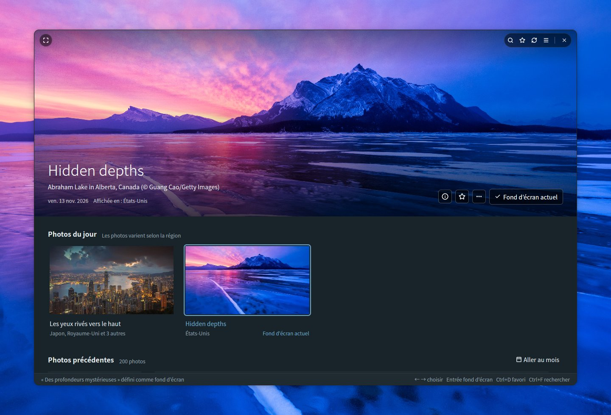
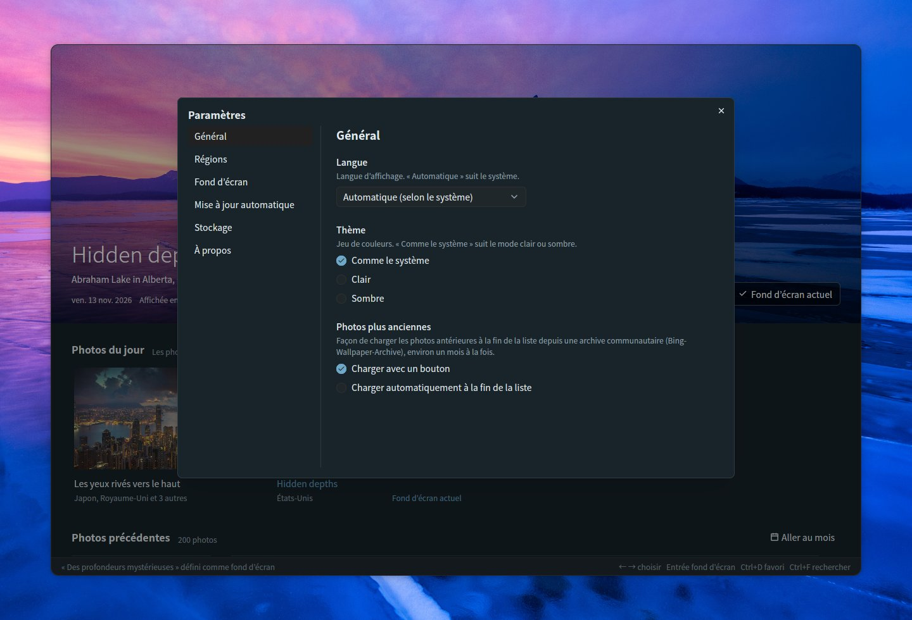
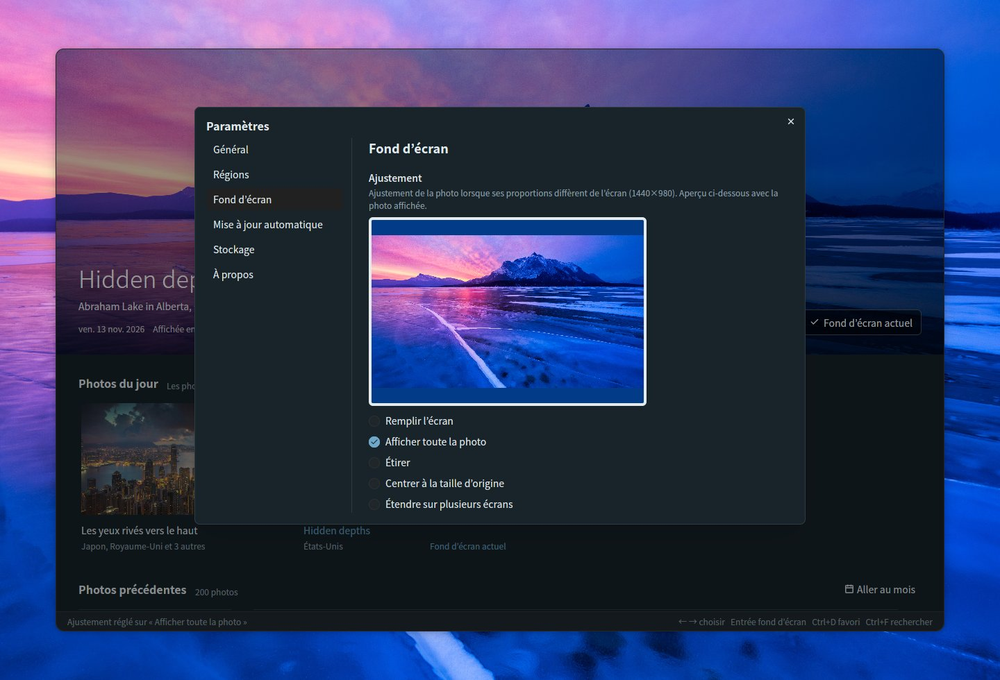
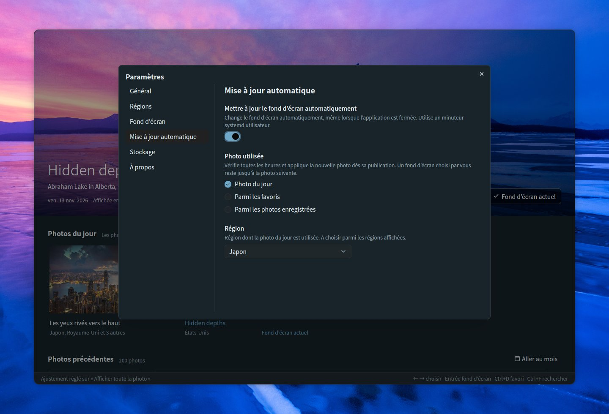
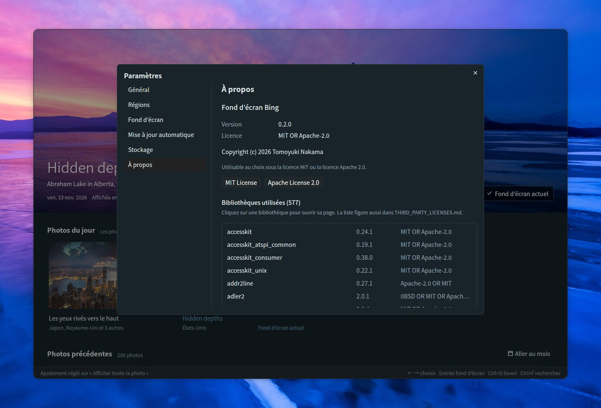

# Bing Wallpaper Manager

[English](README.md) | [日本語](README.ja.md) | [简体中文](README.zh-CN.md) | [繁體中文](README.zh-TW.md) | [한국어](README.ko.md) | [Deutsch](README.de.md) | **Français** | [Español](README.es.md) | [Italiano](README.it.md) | [Português (Brasil)](README.pt-BR.md) | [Русский](README.ru.md)

Une application de bureau pour Ubuntu qui permet de parcourir les photos du jour de Bing et de les définir comme fond d’écran GNOME. Développée avec Rust, [GPUI](https://gpui.rs) et [gpui-kit](https://gpui-kit.com).



La photo que vous choisissez occupe le haut d’une fenêtre sans bordure aux coins arrondis. Survolez-la pour faire apparaître la barre de titre ; définissez-la comme fond d’écran et elle porte la mention *Fond d’écran actuel*.

## Fonctionnalités

- **Tableau de bord** : la photo sélectionnée s’affiche en grand en haut, avec *Photos du jour* et *Photos précédentes* (regroupées par date) en dessous. La grande photo reste fixée au-dessus de la liste, se réduit à une fine barre pendant le défilement et se redéploie lorsque vous choisissez une photo ou cliquez sur la barre. Le passage d’une photo à l’autre se fait par un fondu enchaîné dès que la nouvelle image est chargée
- **Fenêtre sans bordure** : coins arrondis, la grande photo allant jusqu’au bord supérieur. La barre de titre (recherche, favoris, actualisation, paramètres, plein écran et boutons de la fenêtre) ne s’affiche par-dessus la photo que lorsque la souris s’y trouve ; faites glisser la photo pour déplacer la fenêtre, double-cliquez sur le bord supérieur pour l’agrandir
- **Photos du jour** : la dernière photo des régions que vous choisissez, regroupées par photo avec les régions qui l’affichent. Six régions sont activées par défaut (Japon, États-Unis, Royaume-Uni, Allemagne, France, Chine) ; le Canada (anglais / français), l’Inde, l’Espagne, l’Italie et le Brésil peuvent être activés dans les paramètres. Tant que l’application reste ouverte, elle vérifie toutes les heures s’il y a de nouvelles photos
- **Définir comme fond d’écran** : définit le fond d’écran GNOME pour les styles clair et sombre. Le fond d’écran en cours porte la mention *Fond d’écran actuel*
- **Favoris** : marquez des photos avec le bouton ☆, le menu contextuel ou Ctrl+D ; les favoris reçoivent un badge ★, et le bouton ★ de la barre de titre n’affiche que vos favoris (combinable avec la recherche)
- **Photos précédentes** : les photos enregistrées se chargent en continu pendant le défilement. L’API officielle de Bing remonte à 15 jours. Pour les photos plus anciennes, *Charger des photos plus anciennes*, à la fin de la liste, en charge environ un mois à la fois depuis une archive communautaire ([Bing-Wallpaper-Archive](https://github.com/npanuhin/Bing-Wallpaper-Archive) ; les États-Unis depuis 2010, les autres régions depuis avril 2024). Dans Paramètres → Général → *Photos plus anciennes*, vous pouvez demander qu’elles se chargent automatiquement lorsque vous arrivez à la fin de la liste, sans appuyer sur le bouton. Les photos plus anciennes ne sont enregistrées que sous forme de miniatures ; l’image complète est téléchargée lorsque vous la définissez comme fond d’écran
- **Recherche** (Ctrl+F) dans les photos enregistrées
  - Par mots : titres, lieux, descriptions, régions et dates (par exemple `2026-11-08`). Les titres et les descriptions sont enregistrés dans toutes les langues disponibles, si bien que « penguin », « Pinguin » et « ペンギン » trouvent tous la même photo
  - Par couleur : choisissez rouge, orange, jaune, vert, cyan, bleu, violet, rose, blanc ou noir pour lister en premier les photos qui contiennent le plus de cette couleur. Combinable avec des mots
  - Appuyez sur Échap pour fermer la recherche
- **Ajustement** : choisissez comment la photo est ajustée lorsque ses proportions diffèrent de celles de l’écran, avec un aperçu aux proportions de l’écran (remplir l’écran, afficher toute la photo, étirer, centrer à la taille d’origine, étendre sur plusieurs écrans)
- **Infos sur la photo** (ⓘ sur la grande photo, Ctrl+I) : un panneau latéral avec le titre, le lieu, la date, les régions et la description de la photo par Bing, ainsi que *Rechercher sur Bing* et *Copier le titre et le lieu*
- **Actions sur la photo** : faites un clic droit sur une photo ou utilisez le bouton *…* de la grande photo pour la définir comme fond d’écran, l’ajouter à vos favoris, voir ses infos, la rechercher sur Bing, copier son titre et son lieu, ouvrir l’image, l’afficher dans son dossier ou la supprimer
- **Aller au mois** : accédez directement à un mois des photos précédentes
- **Supprimer** (touche Suppr) : retire une photo du dossier après confirmation ; les photos supprimées ne sont pas téléchargées de nouveau
- **Mise à jour automatique** : un interrupteur dans les paramètres change le fond d’écran pour vous, même lorsque l’application est fermée — à chaque nouvelle photo du jour, ou avec un autre favori ou une autre photo enregistrée à l’intervalle de votre choix
- **Paramètres** (☰ en haut à droite, Ctrl+,) : Général (langue, thème, chargement des photos plus anciennes), Régions, Fond d’écran (ajustement), Mise à jour automatique, Stockage (dossier et espace disque utilisé) et À propos (version, licence, bibliothèques utilisées)
- **11 langues** : japonais, anglais, chinois (simplifié / traditionnel), coréen, allemand, français, espagnol, italien, portugais et russe. *Automatique* suit la langue du système (`LANG`). Pour les titres et les descriptions des photos, la version affichée dans une région qui utilise la langue sélectionnée est privilégiée
- **Thème** : comme le système, clair ou sombre
- **Clavier** : ← → pour choisir une photo, Entrée pour la définir comme fond d’écran, Ctrl+D pour ajouter ou retirer un favori, Ctrl+I pour les infos sur la photo, Suppr pour supprimer, Origine / Fin pour aller aux photos les plus récentes ou les plus anciennes, Page précédente / Page suivante pour défiler d’un écran à la fois, F5 / Ctrl+R pour actualiser, Ctrl+F pour rechercher, Ctrl+, pour les paramètres, F11 pour le plein écran
- **Ligne de commande** : `--apply` définit la photo du jour (ou, avec `--random`, une photo enregistrée) comme fond d’écran sans ouvrir la fenêtre
- **Une seule fenêtre** : relancer l’application ramène la fenêtre ouverte au premier plan au lieu d’en ouvrir une seconde, et la fenêtre s’ouvre à la taille où vous l’avez laissée

## Navigation

Faites défiler la liste et la grande photo se réduit à une fine barre, ce qui laisse plus de place aux photos ; choisissez une photo ou cliquez sur la barre pour la redéployer. Les photos précédentes sont regroupées par date, et les favoris portent un badge ★. Faites un clic droit sur n’importe quelle photo (ou utilisez *…* sur la grande photo) pour la définir comme fond d’écran, l’ajouter à vos favoris, voir ses infos, la rechercher sur Bing, copier son titre et son lieu, ouvrir l’image, l’afficher dans son dossier ou la supprimer.


### Aller au mois

Dès que vous avez des photos de plus d’un mois, **Aller au mois**, à droite de *Photos précédentes*, liste les mois enregistrés (regroupés par année lorsqu’il y en a plusieurs). Choisissez-en un et la liste défile jusqu’à la première photo de ce mois.


### Supprimer une photo

Choisissez **Supprimer…** dans le menu d’une photo, ou appuyez sur la touche Suppr pour la photo affichée en haut. Après confirmation, l’image, sa miniature et ses informations sont retirées du dossier des photos. Les photos supprimées sont mémorisées : l’actualisation ou le chargement de photos plus anciennes ne les fait donc pas revenir. Les photos du jour et le fond d’écran actuel ne peuvent pas être supprimés.


## Infos sur la photo

Cliquez sur **ⓘ** sur la grande photo (ou appuyez sur **Ctrl+I**, ou choisissez *Infos sur la photo* dans le menu d’une photo) pour ouvrir un panneau avec le titre de la photo, le lieu et le crédit, la date, les régions qui l’ont affichée et, lorsqu’elle existe, la description de Bing dans votre langue. Les descriptions des photos récentes sont récupérées en même temps que les photos ; celles des photos plus anciennes proviennent de l’archive communautaire. *Rechercher sur Bing* ouvre dans votre navigateur la page de Bing consacrée à la photo, et *Copier le titre et le lieu* les place dans le presse-papiers. Appuyez sur Échap pour fermer le panneau.


## Recherche

Appuyez sur **Ctrl+F** (ou cliquez sur le bouton 🔍 de la barre de titre) pour rechercher dans les photos que vous avez enregistrées. Pendant la recherche, la liste n’affiche que les photos correspondantes ; cliquez sur l’une d’elles pour la voir en grand en haut, ou appuyez sur Échap pour revenir.

### Par mots

Saisissez n’importe quel mot du titre, du lieu, de la description, de la région ou de la date (par exemple `2026-11-08`) d’une photo. Les titres et les descriptions sont enregistrés dans toutes les langues dans lesquelles la photo a été affichée, et la recherche porte aussi sur les descriptions plus longues de l’archive communautaire : un mot dans une langue trouve donc aussi des photos affichées dans d’autres régions.


### Par couleur

Choisissez l’une des dix couleurs (rouge, orange, jaune, vert, cyan, bleu, violet, rose, blanc, noir) pour lister en premier les photos qui contiennent le plus de cette couleur. Les proportions de couleurs sont calculées en arrière-plan à partir de la miniature de chaque photo. Des mots et une couleur peuvent être combinés, par exemple « montagne » + bleu.


## Paramètres

Ouvrez les paramètres avec **☰** en haut à droite de la barre de titre, ou appuyez sur **Ctrl+,**. Les modifications prennent effet immédiatement, et Échap ferme la boîte de dialogue. Les pages sont listées à gauche.

### Général

- **Langue** : la langue d’affichage. *Automatique* suit le système
- **Thème** : comme le système, clair ou sombre
- **Photos plus anciennes** : la façon de charger les photos antérieures à la fin de la liste depuis l’archive communautaire, environ un mois à la fois
  - *Charger avec un bouton* : appuyez sur *Charger des photos plus anciennes* à la fin de la liste
  - *Charger automatiquement à la fin de la liste* : arriver à la fin de la liste (ou appuyer sur Fin) charge le mois suivant tout seul. Le bouton n’apparaît que si le chargement échoue, pour que vous puissiez réessayer



### Régions

Bing affiche des photos, des titres et des descriptions différents selon les régions. Choisissez les régions dont le tableau de bord récupère les photos : le Japon, les États-Unis, le Royaume-Uni, l’Allemagne, la France et la Chine sont activés par défaut, et le Canada (anglais), le Canada (français), l’Inde, l’Espagne, l’Italie et le Brésil peuvent être ajoutés. Au moins une région reste activée. Les régions où Bing n’affiche que sa photo mondiale ne sont pas listées.


### Fond d’écran

Lorsque les proportions de la photo diffèrent de celles de votre écran, choisissez comment elle est ajustée : remplir l’écran, afficher toute la photo, étirer, centrer à la taille d’origine ou étendre sur plusieurs écrans. L’aperçu utilise les proportions de votre écran et la photo affichée en haut ; avec *Afficher toute la photo*, l’espace restant est rempli avec la couleur d’arrière-plan qu’utilise GNOME. Le fond d’écran actuel est mis à jour immédiatement.



### Mise à jour automatique

Activez l’interrupteur pour que le fond d’écran change tout seul, même lorsque l’application est fermée. Choisissez ce qui est utilisé :

- **Photo du jour** : vérifie toutes les heures (et peu après l’ouverture de session) et applique la nouvelle photo dès sa publication, pour la région que vous choisissez. Un fond d’écran choisi par vous reste jusqu’à la photo suivante
- **Parmi les favoris** : choisit chaque fois un favori différent, toutes les 30 minutes, toutes les heures, toutes les 3 heures, toutes les 6 heures ou tous les jours
- **Parmi les photos enregistrées** : la même chose, parmi tout ce que vous avez enregistré. Les photos plus anciennes sont téléchargées au moment où elles sont choisies

L’interrupteur crée un minuteur systemd utilisateur (`~/.config/systemd/user/bing-wallpaper-manager.timer` et `.service`) qui exécute cette application avec `--apply` ; le désactiver supprime le minuteur. Le minuteur lance l’application depuis son emplacement actuel : désactivez puis réactivez l’interrupteur si vous déplacez l’application.



### Stockage

Affiche le dossier où les photos sont conservées, l’espace disque qu’elles occupent et leur nombre. *Modifier…* choisit un autre dossier, et *Ouvrir le dossier* l’ouvre dans le gestionnaire de fichiers. Voir [Fichiers](#fichiers) pour ce qui y est stocké.


### À propos

La version, la licence (MIT ou Apache 2.0, avec des boutons pour lire chacune) et la liste des bibliothèques utilisées. Cliquez sur une bibliothèque pour ouvrir sa page.



## Construit avec

L’interface utilisateur repose sur ces deux projets open source :

- **[GPUI](https://gpui.rs)** — le framework d’interface accéléré par GPU développé par [Zed Industries](https://zed.dev) pour l’éditeur Zed ([code source](https://github.com/zed-industries/zed), Apache-2.0). Cette application utilise l’instantané publié sur crates.io sous le nom `gpui-pre`
- **[gpui-kit](https://gpui-kit.com)** — une bibliothèque de composants et une boîte à outils pour GPUI par [Longbridge](https://github.com/longbridge) ([code source](https://github.com/longbridge/gpui-kit), Apache-2.0). Les boutons, boîtes de dialogue, menus, champs de saisie, listes déroulantes, barres de défilement, la barre de titre et les thèmes proviennent de ses crates `gpui-component` et `gpui-base`

Merci à ces deux projets. Toutes les autres bibliothèques sont listées dans [THIRD_PARTY_LICENSES.md](THIRD_PARTY_LICENSES.md).

## Installation

### Prérequis

- Ubuntu avec le bureau GNOME (développé sous Ubuntu 26.04 ; Wayland et X11). Le fond d’écran est défini au moyen de `gsettings` de GNOME
- Un pilote graphique prenant en charge Vulkan (inclus dans une installation normale d’Ubuntu Desktop)

### Binaire précompilé (x86_64)

Chaque [version](https://github.com/TomoyukiNakama/bing-wallpaper-manager/releases/latest) fournit un paquet précompilé pour Ubuntu 26.04 ou plus récent (glibc 2.43+). Téléchargez `bing-wallpaper-manager-<version>-x86_64-linux.tar.gz` et extrayez-le dans `~/.local` :

```sh
tar -xzf bing-wallpaper-manager-*-x86_64-linux.tar.gz -C ~/.local --strip-components=1
```

Pour compiler depuis les sources, suivez plutôt les étapes ci-dessous.

### 1. Installer les outils de compilation

```sh
sudo apt install git curl build-essential
```

Un compilateur C (`build-essential`) est nécessaire, car l’une des bibliothèques de polices est compilée à partir de sources C.

### 2. Installer Rust

Installez la version stable actuelle de Rust avec [rustup](https://rustup.rs). Le Rust fourni avec Ubuntu 26.04 (1.93) est trop ancien pour GPUI.

```sh
curl --proto '=https' --tlsv1.2 -sSf https://sh.rustup.rs | sh -s -- -y
source "$HOME/.cargo/env"   # ou ouvrez un nouveau terminal
```

Si vous préférez garder le `cargo` d’Ubuntu dans votre PATH, cela fonctionne aussi : `.cargo/config.toml` fait pointer cargo vers `scripts/rustc-stable`, qui exécute le rustc de votre chaîne d’outils stable de rustup (et se rabat sur le `rustc` de votre PATH lorsque rustup n’est pas installé).

### 3. Récupérer les sources

```sh
git clone https://github.com/TomoyukiNakama/bing-wallpaper-manager.git
cd bing-wallpaper-manager
```

### 4. Compiler et installer

```sh
scripts/install.sh
```

Cette commande compile la version release et installe l’application, son icône et une entrée de bureau sous `~/.local`. *Fond d’écran Bing* apparaît alors dans la grille d’applications de GNOME (fermez puis rouvrez votre session s’il n’apparaît pas tout de suite), et `bing-wallpaper-manager` peut être lancé depuis un terminal si `~/.local/bin` est dans votre PATH. La première compilation télécharge et compile toutes les dépendances et prend plusieurs minutes.

Pour installer ailleurs, définissez `PREFIX`, par exemple `PREFIX=/opt/bing-wallpaper scripts/install.sh`.

### Mise à jour

```sh
git pull
scripts/install.sh
```

`scripts/install.sh` recompile toujours avant d’installer : le relancer après `git pull` installe donc la nouvelle version.

### Désinstallation

```sh
scripts/install.sh --uninstall
```

Cette commande supprime l’application, l’icône et l’entrée de bureau. Vos paramètres (`~/.config/bing-wallpaper-manager/`) et vos photos enregistrées (le dossier de stockage) sont conservés ; supprimez-les vous-même si vous n’en avez plus besoin.

### Exécuter sans installer

```sh
cargo run --release
```

## Fichiers

Choisissez le dossier de stockage dans *Paramètres → Stockage* (par défaut : `~/Pictures/BingWallpaper`, ou le dossier Images localisé). Les paramètres sont enregistrés dans `~/.config/bing-wallpaper-manager/config.json`, et ce dont l’application se souvient (comme la taille de la fenêtre) dans `state.json`, dans le même dossier.
Une photo n’est enregistrée qu’une seule fois, même si elle est affichée dans plusieurs régions ou à des jours différents, et les images enregistrées ne sont jamais téléchargées de nouveau.

```text
<dossier de stockage>/
  20261108_OHR.Foo_UHD.jpg              Image du fond d’écran (UHD)
  .bing-wallpaper/meta/OHR.Foo.json     Métadonnées : titres, descriptions, régions, proportions de couleurs
  .bing-wallpaper/thumbs/OHR.Foo.jpg    Miniature (640x360)
  .bing-wallpaper/previews/OHR.Foo.jpg  Image de taille moyenne pour afficher en grand les photos plus anciennes (1920x1080)
  .bing-wallpaper/deleted.txt           Photos que vous avez supprimées (pour ne pas les télécharger de nouveau)
```

## Ligne de commande

```sh
bing-wallpaper-manager --apply                       # définir la photo du jour comme fond d’écran
bing-wallpaper-manager --apply --mkt en-US           # choisir la région
bing-wallpaper-manager --apply --if-new              # ne rien faire si c’est la même photo que la dernière fois
bing-wallpaper-manager --apply --random              # définir au hasard une photo enregistrée
bing-wallpaper-manager --apply --random --favorites  # définir au hasard un favori
```

Sans `--mkt`, la région choisie dans *Mise à jour automatique* est utilisée (ou la première région affichée). Si le réseau n’est pas encore disponible, par exemple juste après l’ouverture de session, `--apply` réessaie plusieurs fois avant d’abandonner.

### Mise à jour quotidienne

Activez l’interrupteur dans **Paramètres** → **Mise à jour automatique** (voir [Mise à jour automatique](#mise-à-jour-automatique)) ; il configure le minuteur systemd utilisateur pour vous. Pour vérifier son état :

```sh
systemctl --user list-timers bing-wallpaper-manager.timer
journalctl --user -u bing-wallpaper-manager.service
```

Si vous avez créé `bing-wallpaper.timer` à la main avec une version antérieure, désactivez-le pour que les deux ne s’exécutent pas en même temps : `systemctl --user disable --now bing-wallpaper.timer`.

## Développement

### Captures d’écran

`scripts/screenshot.sh` exécute l’application sur un écran Wayland virtuel (sway en mode headless) et enregistre un PNG.
Il ne touche ni à votre bureau, ni à vos paramètres, ni à votre dossier de stockage, ni à votre fond d’écran, ni à vos minuteurs systemd (les données des captures se trouvent dans `target/screenshot-fixture/`).

```sh
sudo apt install sway grim          # la première fois seulement
cargo build --release
scripts/screenshot.sh target/shot.png            # par défaut : attente de 15 s, 1440x960
BWM_THEME=dark BWM_LANG=de scripts/screenshot.sh target/dark.png 10 1280x1300
```

`BWM_THEME=light|dark` fixe le thème et `BWM_LANG=de` (etc.) fixe la langue ; les deux fonctionnent aussi lors d’un lancement normal.
`FLOAT=1280x840` affiche la fenêtre flottante au lieu de remplir l’écran (pour vérifier les coins arrondis et les boutons de la fenêtre), et `BG=<image>` place une image derrière elle en guise de fond de bureau.

Placez des clics, des clics droits, des glissements, du défilement, des touches et de la saisie dans `ACTIONS` pour interagir avant la capture. Les entrées sont envoyées par une souris et un clavier virtuels situés dans `tools/vpointer` (compilé automatiquement à la première utilisation).

```sh
ACTIONS=$'key ctrl-f\ntype penguin\nsleep 3\nshot target/step1.png' \
  scripts/screenshot.sh target/step2.png 10 1280x1000
```

Les images de `docs/` sont prises de cette façon avec le thème sombre et enregistrées en JPEG de qualité 85. La capture principale et les pages des paramètres existent dans chaque langue (`docs/<nom>.<langue>.jpg` ; l’anglais n’a pas de suffixe) ; les autres images sont prises en anglais et en japonais, et les README des autres langues utilisent les images anglaises. Par exemple :

```sh
BG=target/screenshot-fixture/store/20261112_OHR.AbrahamCanada_UHD.jpg FLOAT=1280x840 BWM_LANG=en BWM_THEME=dark \
  ACTIONS=$'click 583 660\nsleep 1.5\nkey enter\nsleep 2\nclick 720 250\nsleep 1.5' \
  scripts/screenshot.sh target/main.png 12 1440x980
```

### Paquets de version

`scripts/package-release.sh` compile la version release et crée `target/dist/bing-wallpaper-manager-<version>-x86_64-linux.tar.gz` (et son `.sha256`) avec le binaire, les icônes, l’entrée de bureau et les fichiers de licence, y compris les textes de licence de toutes les bibliothèques incluses. La version provient de `Cargo.toml`.

### Traductions

Les textes se trouvent dans `locales/<langue>.yml` (`ja`, `en`, `zh-CN`, `zh-TW`, `ko`, `de`, `fr`, `es`, `it`, `pt-BR`, `ru`).

- Écrivez les variables sous la forme `%{count}`
- Chaque fichier doit avoir les mêmes clés (`cargo test` le vérifie). Les traductions manquantes se rabattent sur l’anglais
- Pour ajouter une langue, ajoutez un fichier dans `locales/` et une variante à `Language` dans `src/i18n.rs`
- Le README existe dans chaque langue (`README.md` en anglais, `README.<langue>.md` pour les autres). Lorsqu’une fonctionnalité change, mettez-les tous à jour

### Organisation du code

| Fichier | Rôle |
| --- | --- |
| `src/main.rs` | Interface du tableau de bord et ligne de commande |
| `src/bing.rs` | API HPImageArchive de Bing et téléchargements |
| `src/archive.rs` | Photos plus anciennes et descriptions de l’archive communautaire |
| `src/library.rs` | Enregistrement et chargement des photos dans le dossier de stockage |
| `src/search.rs` | Recherche par mots et par couleurs |
| `src/colors.rs` | Analyse des proportions de couleurs des photos |
| `src/settings.rs` | Boîte de dialogue des paramètres |
| `src/info.rs` | Panneau d’infos sur la photo |
| `src/schedule.rs` | Mise à jour automatique (minuteur systemd utilisateur) |
| `src/single.rs` | Garde une seule fenêtre (un second lancement la ramène au premier plan) |
| `src/config.rs` | Fichier de paramètres |
| `src/theme.rs` | Couleurs (clair / sombre) et police |
| `src/i18n.rs` | Changement de langue et formats de date (les textes sont référencés avec `tr!("key")`) |
| `src/wallpaper.rs` | Définition du fond d’écran GNOME avec `gsettings` |
| `locales/*.yml` | Traductions (intégrées à la compilation avec rust-i18n) |
| `src/third_party.tsv` / `THIRD_PARTY_LICENSES.md` | Bibliothèques utilisées (générées par `scripts/gen-third-party.py`) |
| `assets/icons/` | Icône de l’application (SVG, et PNG rendus par `scripts/render-icon.py`) |
| `assets/bing-wallpaper-manager.desktop` | Entrée de bureau (installée par `scripts/install.sh`) |
| `scripts/rustc-stable` | Choisit le rustc stable de rustup pour cargo (voir « 2. Installer Rust ») |
| `scripts/screenshot.sh` | Captures d’écran sur un écran virtuel |
| `tools/vpointer/` | Souris et clavier virtuels pour les captures d’écran (crate séparée) |

## Licence

Distribué, à votre choix, sous la [licence MIT](LICENSE-MIT) ou la [licence Apache 2.0](LICENSE-APACHE) (MIT OR Apache-2.0). Les bibliothèques utilisées sont listées dans [THIRD_PARTY_LICENSES.md](THIRD_PARTY_LICENSES.md) (à régénérer avec `python3 scripts/gen-third-party.py` après toute modification des dépendances).

Les photos sont la propriété de leurs photographes et fournisseurs. Cette application n’est pas affiliée à Microsoft.
