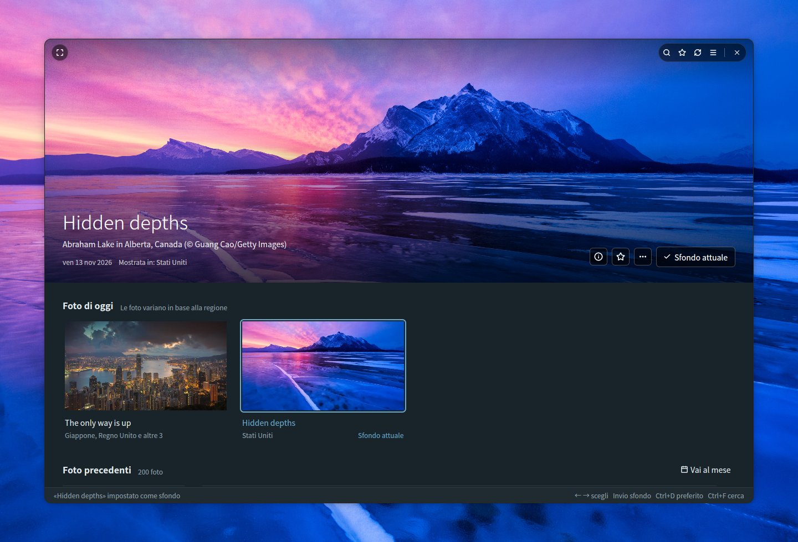
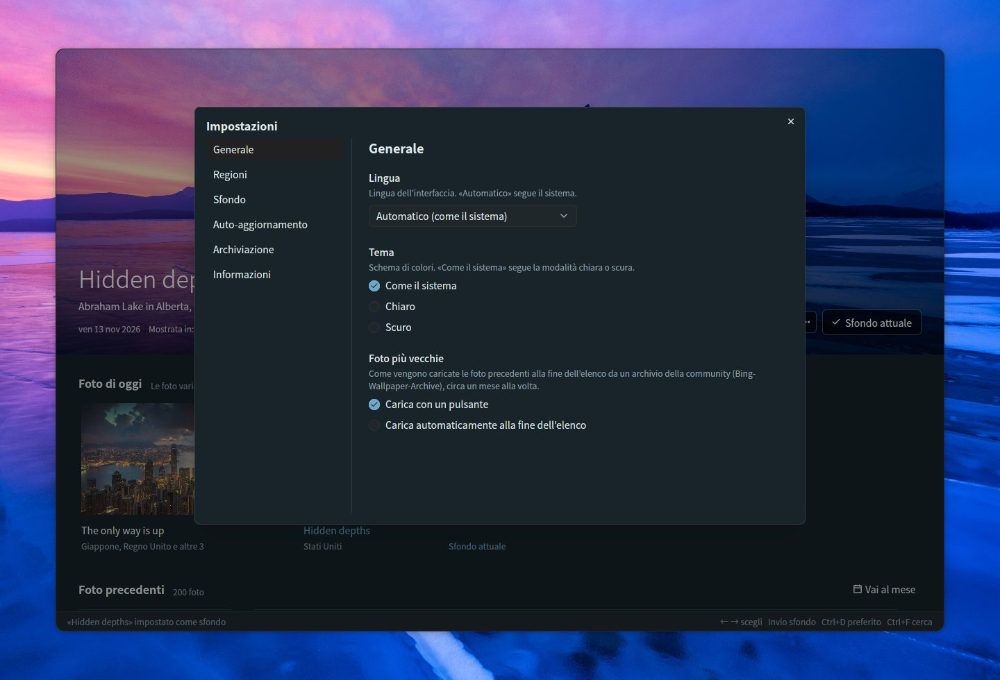
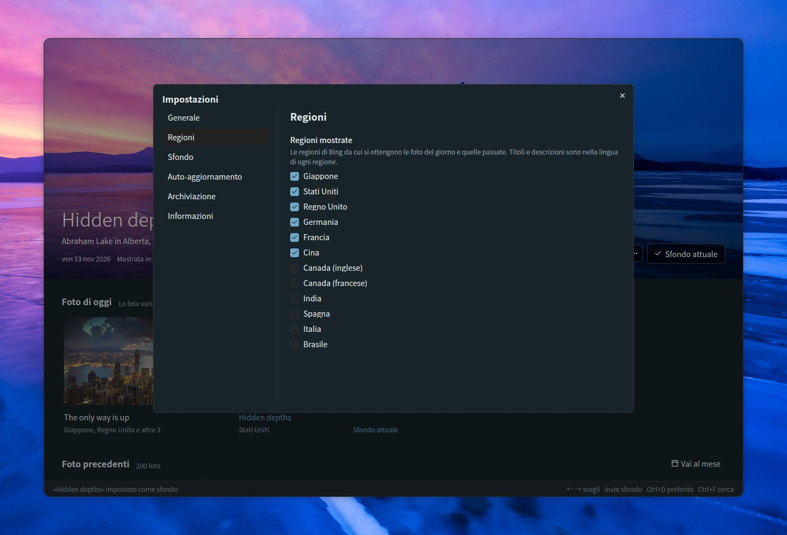
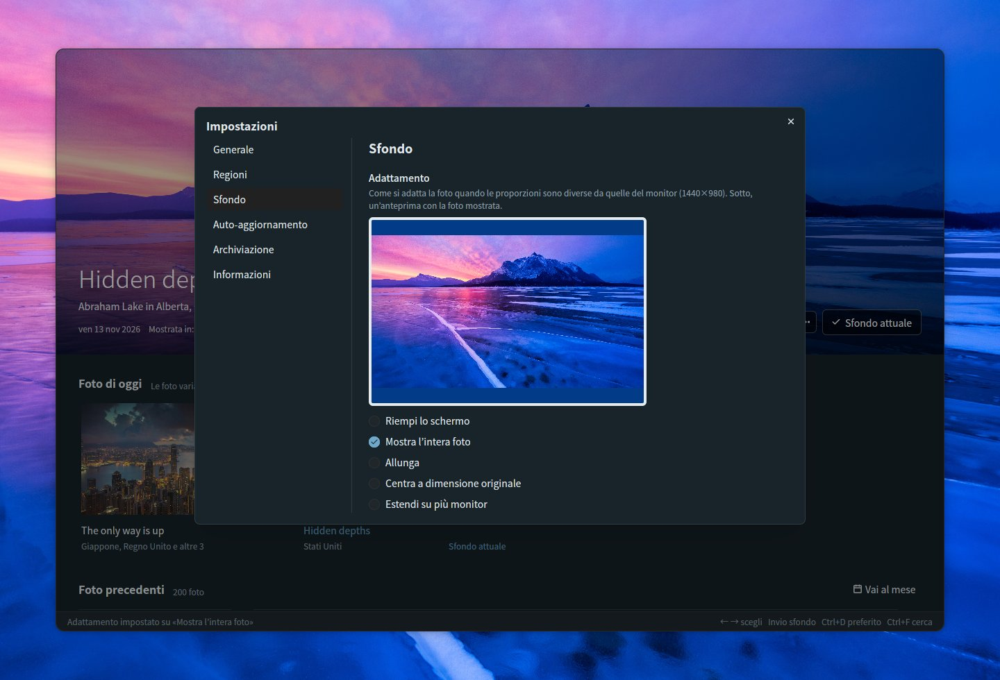
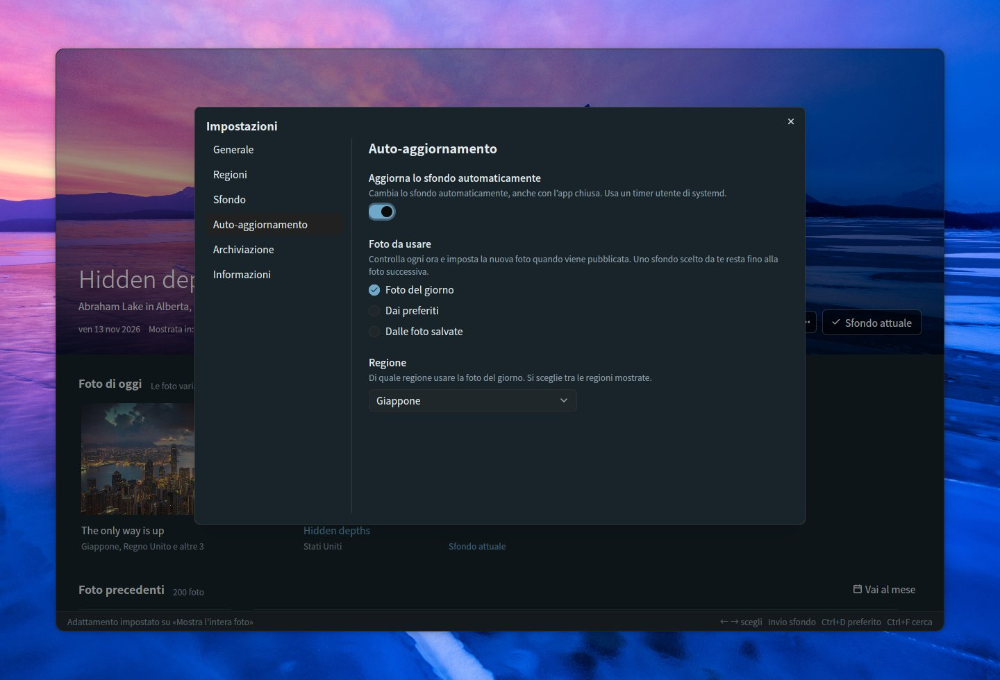
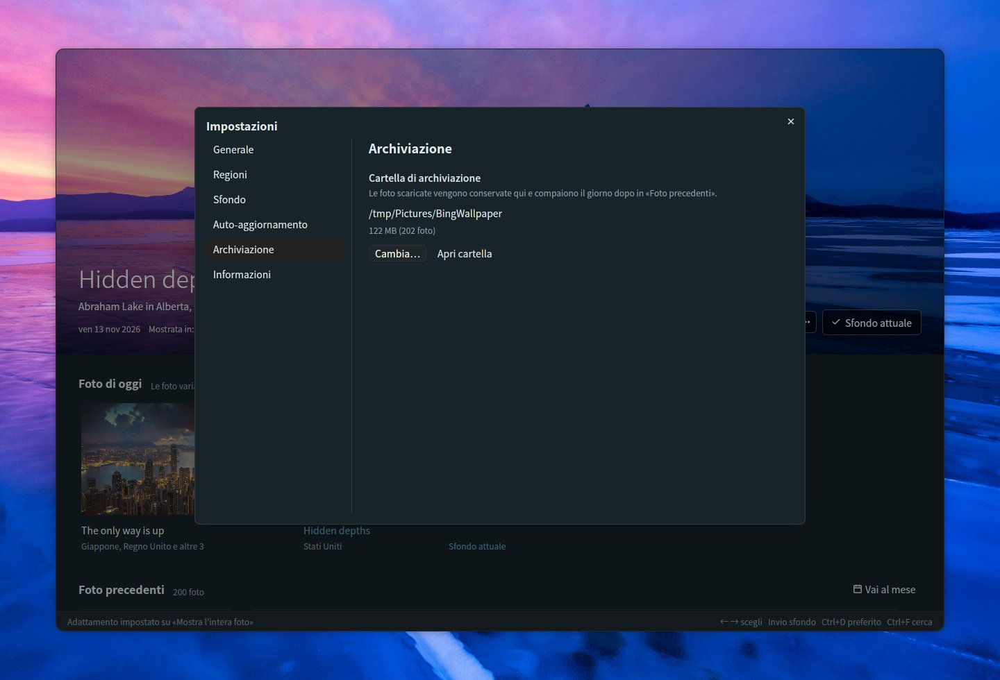

# Bing Wallpaper Manager

[English](README.md) | [日本語](README.ja.md) | [简体中文](README.zh-CN.md) | [繁體中文](README.zh-TW.md) | [한국어](README.ko.md) | [Deutsch](README.de.md) | [Français](README.fr.md) | [Español](README.es.md) | **Italiano** | [Português (Brasil)](README.pt-BR.md) | [Русский](README.ru.md)

Un’app desktop per Ubuntu per sfogliare le foto del giorno di Bing e impostarle come sfondo di GNOME. Realizzata con Rust, [GPUI](https://gpui.rs) e [gpui-kit](https://gpui-kit.com).



La foto che scegli occupa la parte superiore di una finestra senza cornice, dagli angoli arrotondati. Passaci sopra con il mouse per far comparire la barra del titolo; impostala come sfondo e viene contrassegnata con *Sfondo attuale*.

## Funzionalità

- **Dashboard**: la foto selezionata è mostrata in grande in alto, con sotto *Foto di oggi* e *Foto precedenti* (raggruppate per data). La foto grande resta fissa sopra l’elenco, si riduce a una barra sottile mentre scorri e torna a espandersi quando scegli una foto o fai clic sulla barra. Il passaggio da una foto all’altra avviene con una dissolvenza fluida, non appena la nuova immagine è stata caricata
- **Finestra senza cornice**: angoli arrotondati, con la foto grande che arriva fino al bordo superiore. La barra del titolo (ricerca, preferiti, aggiornamento, impostazioni, schermo intero e i pulsanti della finestra) compare sopra la foto solo mentre il mouse vi è sopra; trascina la foto per spostare la finestra, fai doppio clic sul bordo superiore per ingrandirla
- **Foto di oggi**: la foto più recente delle regioni che scegli, raggruppate per foto con le regioni che la mostrano. Sei regioni sono attive per impostazione predefinita (Giappone, Stati Uniti, Regno Unito, Germania, Francia, Cina); Canada (inglese / francese), India, Spagna, Italia e Brasile si possono attivare nelle impostazioni. Finché l’app resta aperta, controlla ogni ora se ci sono nuove foto
- **Imposta come sfondo**: imposta lo sfondo di GNOME sia per lo stile chiaro sia per quello scuro. Lo sfondo in uso è contrassegnato con *Sfondo attuale*
- **Preferiti**: contrassegna le foto con il pulsante ☆, il menu contestuale o Ctrl+D; i preferiti ricevono un’etichetta ★ e il pulsante ★ nella barra del titolo mostra solo i preferiti (si può combinare con la ricerca)
- **Foto precedenti**: le foto salvate vengono caricate man mano che scorri. L’API ufficiale di Bing risale fino a 15 giorni fa. Per le foto più vecchie, *Carica foto più vecchie* in fondo all’elenco ne carica circa un mese alla volta da un archivio della community ([Bing-Wallpaper-Archive](https://github.com/npanuhin/Bing-Wallpaper-Archive); Stati Uniti dal 2010, altre regioni da aprile 2024). In Impostazioni → Generale → *Foto più vecchie* puoi farle caricare automaticamente quando arrivi alla fine dell’elenco, invece di premere il pulsante. Delle foto più vecchie viene salvata solo la miniatura; l’immagine completa viene scaricata quando la imposti come sfondo
- **Ricerca** (Ctrl+F) tra le foto salvate
  - Per parole: titoli, luoghi, descrizioni, regioni e date (ad esempio `2026-11-08`). Titoli e descrizioni sono salvati in tutte le lingue disponibili, quindi «penguin», «Pinguin» e «ペンギン» trovano tutti la stessa foto
  - Per colore: scegli rosso, arancione, giallo, verde, ciano, blu, viola, rosa, bianco o nero per elencare per prime le foto che contengono più di quel colore. Si può combinare con le parole
  - Premi Esc per chiudere la ricerca
- **Adattamento**: scegli come si adatta la foto quando le sue proporzioni sono diverse da quelle del monitor, con un’anteprima nelle proporzioni del monitor (riempi lo schermo, mostra l’intera foto, allunga, centra a dimensione originale, estendi su più monitor)
- **Informazioni sulla foto** (ⓘ sulla foto grande, Ctrl+I): un pannello laterale con titolo, luogo, data, regioni e la descrizione della foto fornita da Bing, oltre a *Cerca su Bing* e *Copia titolo e luogo*
- **Azioni sulla foto**: fai clic con il pulsante destro su una foto o usa il pulsante *…* sulla foto grande per impostarla come sfondo, aggiungerla ai preferiti, vederne le informazioni, cercarla su Bing, copiarne titolo e luogo, aprire l’immagine, mostrarla nella sua cartella o eliminarla
- **Vai al mese**: salta direttamente a un mese delle foto precedenti
- **Elimina** (tasto Canc): rimuove una foto dalla cartella dopo una conferma; le foto eliminate non vengono scaricate di nuovo
- **Auto-aggiornamento**: un interruttore nelle impostazioni cambia lo sfondo al posto tuo anche con l’app chiusa: con ogni nuova foto del giorno, oppure con un preferito o una foto salvata diversi a un intervallo a tua scelta
- **Impostazioni** (☰ in alto a destra, Ctrl+,): Generale (lingua, tema, caricamento delle foto più vecchie), Regioni, Sfondo (adattamento), Auto-aggiornamento, Archiviazione (cartella e spazio occupato) e Informazioni (versione, licenza, librerie utilizzate)
- **11 lingue**: giapponese, inglese, cinese (semplificato / tradizionale), coreano, tedesco, francese, spagnolo, italiano, portoghese e russo. *Automatico* segue la lingua del sistema (`LANG`). Per titoli e descrizioni delle foto si preferisce la versione mostrata in una regione che usa la lingua selezionata
- **Tema**: come il sistema, chiaro o scuro
- **Tastiera**: ← → per scegliere una foto, Invio per impostarla come sfondo, Ctrl+D per aggiungere o rimuovere un preferito, Ctrl+I per le informazioni sulla foto, Canc per eliminare, Home / Fine per saltare alle foto più recenti o più vecchie, Pag ↑ / Pag ↓ per scorrere di una schermata alla volta, F5 / Ctrl+R per aggiornare, Ctrl+F per cercare, Ctrl+, per le impostazioni, F11 per lo schermo intero
- **Riga di comando**: `--apply` imposta come sfondo la foto del giorno (o, con `--random`, una foto salvata) senza aprire la finestra
- **Una sola finestra**: avviare di nuovo l’app porta in primo piano la finestra già aperta invece di aprirne una seconda, e la finestra si apre con le dimensioni che aveva l’ultima volta

## Sfogliare le foto

Scorri l’elenco e la foto grande si riduce a una barra sottile, lasciando più spazio alle foto; scegli una foto o fai clic sulla barra per espanderla di nuovo. Le foto precedenti sono raggruppate per data e i preferiti hanno un’etichetta ★. Fai clic con il pulsante destro su una foto qualsiasi (o usa *…* sulla foto grande) per impostarla come sfondo, aggiungerla ai preferiti, vederne le informazioni, cercarla su Bing, copiarne titolo e luogo, aprire l’immagine, mostrarla nella sua cartella o eliminarla.


### Vai al mese

Quando hai foto di più mesi, **Vai al mese** a destra di *Foto precedenti* elenca i mesi salvati (raggruppati per anno se gli anni sono più di uno). Scegline uno e l’elenco scorre fino alla prima foto di quel mese.


### Eliminare una foto

Scegli **Elimina…** nel menu di una foto, oppure premi il tasto Canc per la foto mostrata in alto. Dopo la conferma, l’immagine, la miniatura e i relativi dati vengono rimossi dalla cartella delle foto. Le foto eliminate vengono ricordate, quindi l’aggiornamento o il caricamento delle foto più vecchie non le riporta indietro. Le foto di oggi e lo sfondo attuale non possono essere eliminati.


## Informazioni sulla foto

Fai clic su **ⓘ** sulla foto grande (oppure premi **Ctrl+I**, o scegli *Informazioni sulla foto* nel menu di una foto) per aprire un pannello con titolo, luogo e crediti della foto, la data, le regioni che l’hanno mostrata e la descrizione di Bing nella tua lingua, quando esiste. Le descrizioni delle foto recenti vengono scaricate insieme alle foto; per quelle più vecchie provengono dall’archivio della community. *Cerca su Bing* apre nel browser la pagina di Bing dedicata alla foto e *Copia titolo e luogo* li copia negli appunti. Premi Esc per chiudere il pannello.


## Ricerca

Premi **Ctrl+F** (o fai clic sul pulsante 🔍 nella barra del titolo) per cercare tra le foto salvate. Durante la ricerca l’elenco mostra solo le foto corrispondenti; fai clic su una per vederla in grande in alto, oppure premi Esc per tornare indietro.

### Per parole

Digita una parola qualsiasi del titolo, del luogo, della descrizione, della regione o della data di una foto (ad esempio `2026-11-08`). Titoli e descrizioni sono salvati in tutte le lingue in cui la foto è stata mostrata e la ricerca comprende anche le descrizioni più lunghe dell’archivio della community, quindi una parola in una lingua trova anche le foto mostrate in altre regioni.


### Per colore

Scegli uno dei dieci colori (rosso, arancione, giallo, verde, ciano, blu, viola, rosa, bianco, nero) per elencare per prime le foto che contengono più di quel colore. Le percentuali dei colori vengono calcolate in background dalla miniatura di ogni foto. Parole e colore si possono combinare, ad esempio «mountain» + blu.


## Impostazioni

Apri le impostazioni con **☰** in alto a destra nella barra del titolo, oppure premi **Ctrl+,**. Le modifiche hanno effetto subito ed Esc chiude la finestra di dialogo. Le pagine sono elencate a sinistra.

### Generale

- **Lingua**: la lingua dell’interfaccia. *Automatico* segue il sistema
- **Tema**: come il sistema, chiaro o scuro
- **Foto più vecchie**: come vengono caricate dall’archivio della community le foto precedenti alla fine dell’elenco, circa un mese alla volta
  - *Carica con un pulsante*: premi *Carica foto più vecchie* in fondo all’elenco
  - *Carica automaticamente alla fine dell’elenco*: scorrendo fino alla fine (o premendo Fine) il mese successivo viene caricato da solo. Il pulsante compare solo se il caricamento non riesce, così puoi riprovare



### Regioni

Bing mostra foto, titoli e descrizioni diversi a seconda della regione. Scegli da quali regioni la dashboard ottiene le foto: Giappone, Stati Uniti, Regno Unito, Germania, Francia e Cina sono attive per impostazione predefinita, e si possono aggiungere Canada (inglese), Canada (francese), India, Spagna, Italia e Brasile. Almeno una regione resta sempre attiva. Le regioni in cui Bing mostra solo la foto mondiale non sono elencate.



### Sfondo

Quando le proporzioni della foto sono diverse da quelle del monitor, scegli come adattarla: riempire lo schermo, mostrare l’intera foto, allungarla, centrarla a dimensione originale o estenderla su più monitor. L’anteprima usa le proporzioni del tuo monitor e la foto mostrata in alto; con *Mostra l’intera foto*, lo spazio rimanente viene riempito con il colore di sfondo usato da GNOME. Lo sfondo attuale si aggiorna subito.



### Auto-aggiornamento

Attiva l’interruttore per far cambiare lo sfondo da solo, anche con l’app chiusa. Scegli che cosa usare:

- **Foto del giorno**: controlla ogni ora (e poco dopo l’accesso) e imposta la nuova foto quando viene pubblicata, per la regione che scegli. Uno sfondo scelto da te resta fino all’arrivo della foto successiva
- **Dai preferiti**: sceglie ogni volta un preferito diverso, ogni 30 minuti, ogni ora, ogni 3 ore, ogni 6 ore o ogni giorno
- **Dalle foto salvate**: lo stesso, ma tra tutte le foto salvate. Le foto più vecchie vengono scaricate quando sono scelte

L’interruttore crea un timer utente di systemd (`~/.config/systemd/user/bing-wallpaper-manager.timer` e `.service`) che esegue questa app con `--apply`; disattivandolo, il timer viene rimosso. Il timer esegue l’app dalla posizione in cui si trova ora, quindi se la sposti disattiva e riattiva l’interruttore.



### Archiviazione

Mostra la cartella in cui sono conservate le foto, lo spazio su disco che occupano e quante sono. *Cambia…* sceglie un’altra cartella e *Apri cartella* la apre nel gestore di file. Vedi [File](#file) per sapere che cosa vi viene salvato.



### Informazioni

La versione, la licenza (MIT o Apache 2.0, con i pulsanti per leggerle) e l’elenco delle librerie utilizzate. Fai clic su una libreria per aprirne la pagina.


## Realizzata con

L’interfaccia utente si basa su questi due progetti open source:

- **[GPUI](https://gpui.rs)** — il framework per interfacce con accelerazione GPU sviluppato da [Zed Industries](https://zed.dev) per l’editor Zed ([sorgente](https://github.com/zed-industries/zed), Apache-2.0). Questa app usa lo snapshot pubblicato su crates.io come `gpui-pre`
- **[gpui-kit](https://gpui-kit.com)** — una libreria di componenti e un toolkit per GPUI di [Longbridge](https://github.com/longbridge) ([sorgente](https://github.com/longbridge/gpui-kit), Apache-2.0). Pulsanti, finestre di dialogo, menu, campi di immissione, elenchi a discesa, barre di scorrimento, barra del titolo e temi provengono dai suoi crate `gpui-component` e `gpui-base`

Grazie a entrambi i progetti. Tutte le altre librerie sono elencate in [THIRD_PARTY_LICENSES.md](THIRD_PARTY_LICENSES.md).

## Installazione

### Requisiti

- Ubuntu con il desktop GNOME (sviluppata su Ubuntu 26.04; Wayland e X11). Lo sfondo viene impostato tramite `gsettings` di GNOME
- Un driver grafico con supporto Vulkan (incluso in una normale installazione desktop di Ubuntu)

### Binario precompilato (x86_64)

Ogni [release](https://github.com/TomoyukiNakama/bing-wallpaper-manager/releases/latest) include un pacchetto precompilato per Ubuntu 26.04 o successivo (glibc 2.43+). Scarica `bing-wallpaper-manager-<version>-x86_64-linux.tar.gz` ed estrailo in `~/.local`:

```sh
tar -xzf bing-wallpaper-manager-*-x86_64-linux.tar.gz -C ~/.local --strip-components=1
```

Per compilare invece dai sorgenti, segui i passaggi qui sotto.

### 1. Installa gli strumenti di compilazione

```sh
sudo apt install git curl build-essential
```

Serve un compilatore C (`build-essential`) perché una delle librerie per i font viene compilata da sorgenti C.

### 2. Installa Rust

Installa l’attuale versione stabile di Rust con [rustup](https://rustup.rs). Il Rust incluso in Ubuntu 26.04 (1.93) è troppo vecchio per GPUI.

```sh
curl --proto '=https' --tlsv1.2 -sSf https://sh.rustup.rs | sh -s -- -y
source "$HOME/.cargo/env"   # oppure apri un nuovo terminale
```

Se preferisci tenere nel PATH il `cargo` di Ubuntu, funziona lo stesso: `.cargo/config.toml` indica a cargo di usare `scripts/rustc-stable`, che esegue il rustc della toolchain stabile di rustup (e ripiega sul `rustc` presente nel PATH quando rustup non è installato).

### 3. Scarica i sorgenti

```sh
git clone https://github.com/TomoyukiNakama/bing-wallpaper-manager.git
cd bing-wallpaper-manager
```

### 4. Compila e installa

```sh
scripts/install.sh
```

Lo script compila la versione di release e installa l’app, la sua icona e una voce desktop in `~/.local`. *Sfondo Bing* compare quindi nella griglia delle applicazioni di GNOME (se non appare subito, esci e accedi di nuovo), e `bing-wallpaper-manager` può essere avviato da un terminale se `~/.local/bin` è nel PATH. La prima compilazione scarica e compila tutte le dipendenze e richiede diversi minuti.

Per installare in un’altra posizione, imposta `PREFIX`, ad esempio `PREFIX=/opt/bing-wallpaper scripts/install.sh`.

### Aggiornamento

```sh
git pull
scripts/install.sh
```

`scripts/install.sh` ricompila sempre prima di installare, quindi eseguirlo di nuovo dopo `git pull` installa la nuova versione.

### Disinstallazione

```sh
scripts/install.sh --uninstall
```

Rimuove l’app, l’icona e la voce desktop. Le impostazioni (`~/.config/bing-wallpaper-manager/`) e le foto salvate (la cartella di archiviazione) vengono conservate; eliminale tu se non ti servono più.

### Esecuzione senza installazione

```sh
cargo run --release
```

## File

Scegli la cartella di archiviazione in *Impostazioni → Archiviazione* (predefinita: `~/Pictures/BingWallpaper`, o la cartella Immagini localizzata). Le impostazioni vengono salvate in `~/.config/bing-wallpaper-manager/config.json`, e ciò che l’app ricorda (come le dimensioni della finestra) in `state.json` nella stessa cartella.
Una foto viene salvata una sola volta anche se è mostrata in più regioni o in giorni diversi, e le immagini salvate non vengono mai scaricate di nuovo.

```text
<cartella di archiviazione>/
  20261108_OHR.Foo_UHD.jpg              Immagine dello sfondo (UHD)
  .bing-wallpaper/meta/OHR.Foo.json     Metadati: titoli, descrizioni, regioni, percentuali dei colori
  .bing-wallpaper/thumbs/OHR.Foo.jpg    Miniatura (640x360)
  .bing-wallpaper/previews/OHR.Foo.jpg  Immagine di media grandezza per mostrare in grande le foto più vecchie (1920x1080)
  .bing-wallpaper/deleted.txt           Foto che hai eliminato (così non vengono scaricate di nuovo)
```

## Riga di comando

```sh
bing-wallpaper-manager --apply                       # imposta la foto del giorno come sfondo
bing-wallpaper-manager --apply --mkt en-US           # scegli la regione
bing-wallpaper-manager --apply --if-new              # non fa nulla se è la stessa foto dell’ultima volta
bing-wallpaper-manager --apply --random              # imposta una foto salvata a caso
bing-wallpaper-manager --apply --random --favorites  # imposta un preferito a caso
```

Senza `--mkt` viene usata la regione scelta in *Auto-aggiornamento* (o la prima regione mostrata). Se la rete non è ancora disponibile, ad esempio subito dopo l’accesso, `--apply` riprova alcune volte prima di rinunciare.

### Aggiornamento quotidiano

Attiva l’interruttore in **Impostazioni** → **Auto-aggiornamento** (vedi [Auto-aggiornamento](#auto-aggiornamento)): configura per te il timer utente di systemd. Per controllarlo:

```sh
systemctl --user list-timers bing-wallpaper-manager.timer
journalctl --user -u bing-wallpaper-manager.service
```

Se con una versione precedente avevi creato a mano `bing-wallpaper.timer`, disattivalo perché non vengano eseguiti entrambi: `systemctl --user disable --now bing-wallpaper.timer`.

## Sviluppo

### Screenshot

`scripts/screenshot.sh` esegue l’app su uno schermo Wayland virtuale (sway in modalità headless) e salva un PNG.
Non tocca il tuo desktop, le impostazioni, la cartella di archiviazione, lo sfondo o i timer di systemd (i dati per gli screenshot si trovano in `target/screenshot-fixture/`).

```sh
sudo apt install sway grim          # solo la prima volta
cargo build --release
scripts/screenshot.sh target/shot.png            # predefinito: attesa di 15 s, 1440x960
BWM_THEME=dark BWM_LANG=de scripts/screenshot.sh target/dark.png 10 1280x1300
```

`BWM_THEME=light|dark` fissa il tema e `BWM_LANG=de` (ecc.) fissa la lingua; entrambe funzionano anche in un avvio normale.
`FLOAT=1280x840` mostra la finestra flottante invece che a tutto schermo (per controllare gli angoli arrotondati e i pulsanti della finestra), e `BG=<immagine>` le mette dietro un’immagine come sfondo del desktop.

Inserisci in `ACTIONS` clic, clic destri, trascinamenti, scorrimenti, tasti e testo da digitare per interagire prima dello screenshot. L’input viene inviato tramite un mouse e una tastiera virtuali in `tools/vpointer` (compilato automaticamente al primo utilizzo).

```sh
ACTIONS=$'key ctrl-f\ntype penguin\nsleep 3\nshot target/step1.png' \
  scripts/screenshot.sh target/step2.png 10 1280x1000
```

Le immagini in `docs/` sono realizzate in questo modo con il tema scuro e salvate come JPEG a qualità 85. Lo screenshot principale e le pagine delle impostazioni esistono in tutte le lingue (`docs/<nome>.<lingua>.jpg`; l’inglese non ha suffisso); le altre immagini sono realizzate in inglese e in giapponese, e i README delle altre lingue usano quelle in inglese. Ad esempio:

```sh
BG=target/screenshot-fixture/store/20261112_OHR.AbrahamCanada_UHD.jpg FLOAT=1280x840 BWM_LANG=en BWM_THEME=dark \
  ACTIONS=$'click 583 660\nsleep 1.5\nkey enter\nsleep 2\nclick 720 250\nsleep 1.5' \
  scripts/screenshot.sh target/main.png 12 1440x980
```

### Pacchetti di release

`scripts/package-release.sh` compila la versione di release e crea `target/dist/bing-wallpaper-manager-<version>-x86_64-linux.tar.gz` (con il relativo `.sha256`) contenente il binario, le icone, la voce desktop e i file di licenza, compresi i testi delle licenze di tutte le librerie incluse. La versione viene presa da `Cargo.toml`.

### Traduzioni

Le stringhe si trovano in `locales/<lingua>.yml` (`ja`, `en`, `zh-CN`, `zh-TW`, `ko`, `de`, `fr`, `es`, `it`, `pt-BR`, `ru`).

- Scrivi i segnaposto come `%{count}`
- Tutti i file devono avere le stesse chiavi (`cargo test` lo verifica). Per le traduzioni mancanti si usa l’inglese
- Per aggiungere una lingua, aggiungi un file in `locales/` e una variante a `Language` in `src/i18n.rs`
- Il README esiste in tutte le lingue (`README.md` in inglese, `README.<lingua>.md` per le altre). Quando una funzionalità cambia, aggiornali tutti

### Struttura

| File | Ruolo |
| --- | --- |
| `src/main.rs` | Interfaccia della dashboard e CLI |
| `src/bing.rs` | API HPImageArchive di Bing e download |
| `src/archive.rs` | Foto più vecchie e descrizioni dall’archivio della community |
| `src/library.rs` | Salvataggio e caricamento delle foto nella cartella di archiviazione |
| `src/search.rs` | Ricerca per parole e colori |
| `src/colors.rs` | Analisi delle percentuali dei colori delle foto |
| `src/settings.rs` | Finestra di dialogo delle impostazioni |
| `src/info.rs` | Pannello delle informazioni sulla foto |
| `src/schedule.rs` | Auto-aggiornamento (timer utente di systemd) |
| `src/single.rs` | Mantiene una sola finestra (un secondo avvio la porta in primo piano) |
| `src/config.rs` | File delle impostazioni |
| `src/theme.rs` | Colori (chiaro / scuro) e font |
| `src/i18n.rs` | Cambio di lingua e formati delle date (le stringhe si richiamano con `tr!("key")`) |
| `src/wallpaper.rs` | Impostazione dello sfondo di GNOME con `gsettings` |
| `locales/*.yml` | Traduzioni (incorporate in fase di compilazione con rust-i18n) |
| `src/third_party.tsv` / `THIRD_PARTY_LICENSES.md` | Librerie utilizzate (generato da `scripts/gen-third-party.py`) |
| `assets/icons/` | Icona dell’app (SVG e PNG generati da `scripts/render-icon.py`) |
| `assets/bing-wallpaper-manager.desktop` | Voce desktop (installata da `scripts/install.sh`) |
| `scripts/rustc-stable` | Sceglie il rustc stabile di rustup per cargo (vedi «2. Installa Rust») |
| `scripts/screenshot.sh` | Screenshot su uno schermo virtuale |
| `tools/vpointer/` | Mouse e tastiera virtuali per gli screenshot (crate separato) |

## Licenza

Distribuita, a tua scelta, con la [licenza MIT](LICENSE-MIT) o la [licenza Apache 2.0](LICENSE-APACHE) (MIT OR Apache-2.0). Le librerie utilizzate sono elencate in [THIRD_PARTY_LICENSES.md](THIRD_PARTY_LICENSES.md) (da rigenerare con `python3 scripts/gen-third-party.py` dopo aver modificato le dipendenze).

I diritti d’autore sulle foto appartengono ai rispettivi fotografi e fornitori. Questa app non è affiliata a Microsoft.
