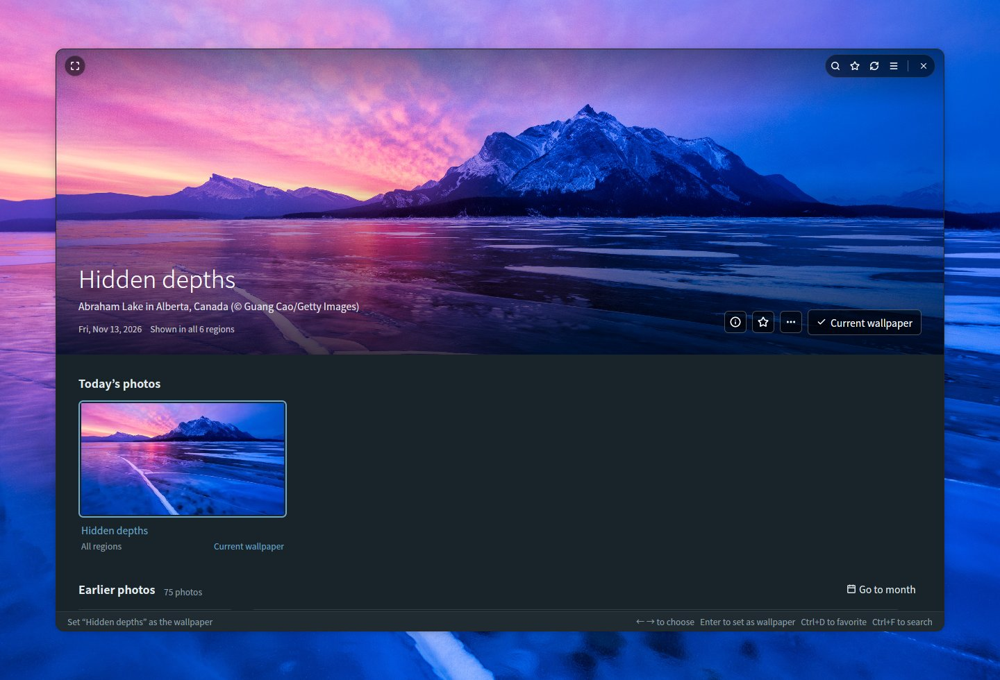
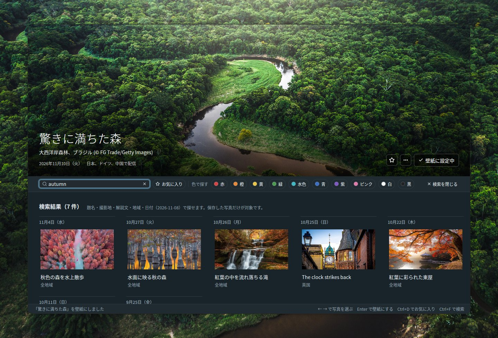
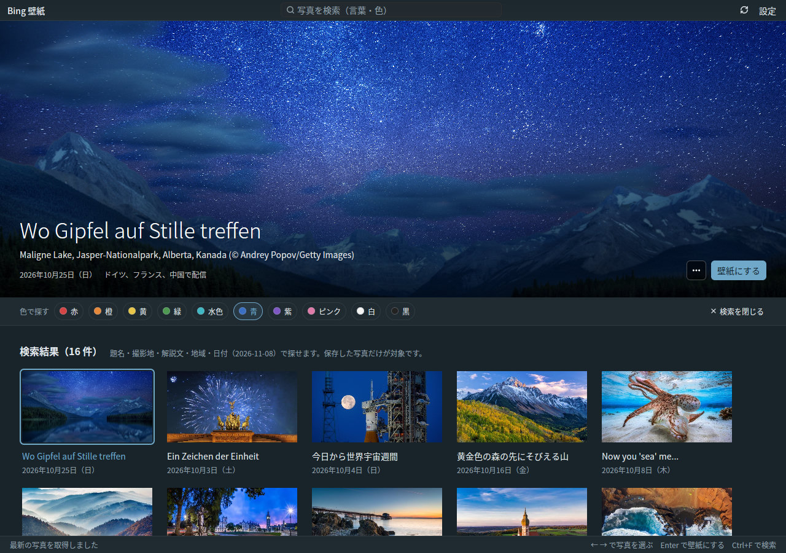

# Bing Wallpaper Manager

[English](README.md) | **日本語**

Bing の日替わり写真を見比べて、GNOME の壁紙にする Ubuntu 用のデスクトップアプリです。Rust と [GPUI](https://gpui.rs)、[gpui-kit](https://gpui-kit.com) で作っています。



## 機能

- **ダッシュボード**: 選んだ写真を上部に大きく表示し、その下に「今日の写真」と「過去の写真」（日付ごと）を並べます。大きな写真は上部に固定され、一覧をスクロールすると細い帯になり、写真を選ぶと元の広さに戻ります。写真の切り替えは、新しい画像の読み込みが終わってから、ゆっくり重ねて切り替わります
- **今日の写真**: 6 地域（日本・米国・英国・ドイツ・フランス・中国）の最新を、同じ写真ごとにまとめて配信地域を添えます
- **壁紙にする**: GNOME の壁紙（ライト／ダーク両方）に設定します。今の壁紙には「壁紙に設定中」と表示されます
- **過去の写真**: Bing 公式 API で 15 日前までを取得します。さらに古い写真は、一覧の末尾の「さらに古い写真を読み込む」で、有志のアーカイブ（[Bing-Wallpaper-Archive](https://github.com/npanuhin/Bing-Wallpaper-Archive)）から約 1 か月分ずつ読み込めます（米国は 2010 年から、ほかの地域は 2024 年 4 月から）。古い写真はサムネイルだけを保存し、壁紙用の画像は「壁紙にする」ときにダウンロードします
- **検索**（Ctrl+F）: 保存した写真を探せます
  - 言葉で探す: 題名・撮影地・解説文・配信地域・日付（`2026-11-08` など）から探します。保存した全言語の見出しと解説文が対象なので、「ペンギン」「penguin」「Pinguin」のどれでも見つかります
  - 色で探す: 赤・橙・黄・緑・水色・青・紫・ピンク・白・黒から選ぶと、その色を多く含む写真から順に並びます。言葉と組み合わせることもできます
  - Escape で検索を閉じます
- **壁紙の表示方法**: 写真とモニターの縦横比が違うときの合わせ方を、モニターの比率でのプレビューを見ながら選べます（画面いっぱいに拡大／写真全体を表示／引き伸ばす／中央に元の大きさで表示／複数のモニターにまたがる）
- **写真の操作**: 写真を右クリック、または大きな写真の「…」から「壁紙にする」「画像を開く」「フォルダで表示」ができます
- **設定ダイアログ**（右上の「設定」、Ctrl+,）: 一般（言語・テーマ）／壁紙（表示方法）／保存先／このアプリについて（バージョン・ライセンス・使用ライブラリ）
- **多言語対応**: 日本語・英語・中国語（簡体字／繁体字）・韓国語・ドイツ語・フランス語・スペイン語・イタリア語・ポルトガル語・ロシア語の 11 言語。自動のときは OS の言語（`LANG`）に合わせます。写真の見出しと説明は、その言語の地域で配信されたものを優先して表示します
- **テーマ**: システムに合わせる／ライト／ダーク
- **キーボード操作**: ←→ で写真を選ぶ、Enter で壁紙にする、F5 / Ctrl+R で更新、Ctrl+F で検索、Ctrl+, で設定
- **コマンドライン**: `--apply` で GUI を開かずに今日の写真を壁紙にできます

## 検索

**Ctrl+F**（またはタイトルバーの検索欄をクリック）で、保存した写真を探せます。検索中は一覧が条件に合う写真だけになり、写真をクリックすると上部に大きく表示されます。Escape で元の一覧に戻ります。

### 言葉で探す

題名・撮影地・解説文・配信地域・日付（`2026-11-08` など）に含まれる言葉で探します。写真の見出しと解説文は配信されたすべての言語で保存しているので、言語をまたいで見つかります。下の画像は、日本語表示のまま英語の `autumn` で探した例です。日本の題名「秋色の森を水上散歩」などの写真が見つかっています。



### 色で探す

赤・橙・黄・緑・水色・青・紫・ピンク・白・黒の 10 色から選ぶと、その色を多く含む写真から順に並びます。色の割合は、各写真のサムネイルから裏で計算しています。言葉と組み合わせて「mountain ＋ 青」のように探すこともできます。



## 使用している技術

画面は、次の 2 つのオープンソースプロジェクトを使って作っています。

- **[GPUI](https://gpui.rs)**: [Zed Industries](https://zed.dev) がエディタ Zed のために開発している、GPU で描画する UI フレームワーク（[ソース](https://github.com/zed-industries/zed)、Apache-2.0）。このアプリは crates.io で `gpui-pre` として公開されているスナップショットを使っています
- **[gpui-kit](https://gpui-kit.com)**: [Longbridge](https://github.com/longbridge) による GPUI 用の部品集とツールキット（[ソース](https://github.com/longbridge/gpui-kit)、Apache-2.0）。ボタン・ダイアログ・メニュー・入力欄・ドロップダウン・スクロールバー・タイトルバー・テーマは、その `gpui-component` と `gpui-base` を使っています

両プロジェクトに感謝します。そのほかのライブラリは [THIRD_PARTY_LICENSES.md](THIRD_PARTY_LICENSES.md) にまとめています。

## インストール

### 動作環境

- GNOME デスクトップの Ubuntu（Ubuntu 26.04 で開発。Wayland と X11 のどちらでも動きます）。壁紙は GNOME の `gsettings` で設定します
- Vulkan に対応したグラフィックスドライバー（通常の Ubuntu デスクトップには入っています）

### 1. ビルドに必要なパッケージを入れる

```sh
sudo apt install git curl build-essential
```

フォント処理のライブラリの一部を C からビルドするため、C コンパイラ（`build-essential`）が必要です。

### 2. Rust を入れる

[rustup](https://rustup.rs) で最新の stable の Rust を入れます。Ubuntu 26.04 に含まれる Rust（1.93）は古く、GPUI をビルドできません。

```sh
curl --proto '=https' --tlsv1.2 -sSf https://sh.rustup.rs | sh -s -- -y
source "$HOME/.cargo/env"   # または新しいターミナルを開く
```

PATH の `cargo` を Ubuntu 標準のままにしておきたい場合も、そのままビルドできます。`.cargo/config.toml` で cargo が `scripts/rustc-stable` を使うようにしてあり、これが rustup の stable の rustc を探して実行します（rustup が無ければ PATH 上の `rustc` を使います）。

### 3. ソースを取得する

```sh
git clone https://github.com/TomoyukiNakama/bing-wallpaper-manager.git
cd bing-wallpaper-manager
```

### 4. ビルドしてインストールする

```sh
scripts/install.sh
```

リリース版をビルドし、アプリ・アイコン・デスクトップ項目を `~/.local` に入れます。GNOME のアプリ一覧に「Bing 壁紙」が出ます（すぐに出ないときは、一度ログアウトしてログインし直してください）。`~/.local/bin` が PATH に入っていれば、ターミナルから `bing-wallpaper-manager` でも起動できます。初回のビルドは依存ライブラリをすべてダウンロードしてコンパイルするため、数分かかります。

別の場所に入れるときは、`PREFIX=/opt/bing-wallpaper scripts/install.sh` のように `PREFIX` を指定します。

### 更新する

```sh
git pull
scripts/install.sh
```

`scripts/install.sh` は毎回ビルドしてから入れるので、`git pull` のあとに実行すれば新しい版になります。

### アンインストール

```sh
scripts/install.sh --uninstall
```

アプリ・アイコン・デスクトップ項目を削除します。設定（`~/.config/bing-wallpaper-manager/`）と保存した写真（保存先のフォルダ）は残るので、不要なら手で削除してください。

### インストールせずに動かす

```sh
cargo run --release
```

## 保存先

保存先は「設定」の「保存先」で変えられます（既定は `~/Pictures/BingWallpaper`、日本語環境では `~/ピクチャ/BingWallpaper`）。設定は `~/.config/bing-wallpaper-manager/config.json` に保存されます。
同じ写真は地域や配信日が違っても 1 枚だけ保存し、保存済みの画像は再ダウンロードしません。

```text
<保存先>/
  20261108_OHR.Foo_UHD.jpg              壁紙用の画像（UHD）
  .bing-wallpaper/meta/OHR.Foo.json     見出し・解説文・配信地域・色の割合などのメタデータ
  .bing-wallpaper/thumbs/OHR.Foo.jpg    サムネイル (640x360)
  .bing-wallpaper/previews/OHR.Foo.jpg  古い写真を大きく表示するための中サイズ (1920x1080)
```

## コマンドラインで使う

```sh
bing-wallpaper-manager --apply              # ja-JP の今日の写真を壁紙にする
bing-wallpaper-manager --apply --mkt en-US  # 地域を指定
```

### 毎日自動で更新する（systemd user timer）

`~/.config/systemd/user/bing-wallpaper.service`:

```ini
[Unit]
Description=Set Bing wallpaper
After=network-online.target

[Service]
Type=oneshot
ExecStart=%h/.local/bin/bing-wallpaper-manager --apply
```

`~/.config/systemd/user/bing-wallpaper.timer`:

```ini
[Unit]
Description=Daily Bing wallpaper

[Timer]
OnStartupSec=1min
OnCalendar=*-*-* 09:05
Persistent=true

[Install]
WantedBy=timers.target
```

タイマーは `scripts/install.sh` で入れたアプリ（`~/.local/bin/bing-wallpaper-manager`）を実行します。

```sh
systemctl --user daemon-reload
systemctl --user enable --now bing-wallpaper.timer
```

## 開発

### 見た目の確認（スクリーンショット）

仮想の Wayland ディスプレイ（sway の headless モード）でアプリを動かし、PNG を撮ります。
今のデスクトップ・設定・保存先・壁紙には触れません（撮影用の設定と画像は `target/screenshot-fixture/` に置かれます）。

```sh
sudo apt install sway grim          # 初回のみ
cargo build --release
scripts/screenshot.sh target/shot.png            # 既定: 15 秒待って 1440x960 で撮影
BWM_THEME=dark BWM_LANG=de scripts/screenshot.sh target/dark.png 10 1280x1300
```

`BWM_THEME=light|dark` で配色を、`BWM_LANG=de` などで表示言語を固定できます（通常の起動でも使えます）。

`ACTIONS` にクリック・右クリック・スクロール・キー入力・文字入力を書くと、撮影前に操作できます。仮想マウスと仮想キーボードには `tools/vpointer`（初回に自動でビルド）を使います。

```sh
ACTIONS=$'key ctrl-f\ntype penguin\nsleep 3\nshot target/step1.png' \
  scripts/screenshot.sh target/step2.png 10 1280x1000
```

### 翻訳

文言は `locales/<言語>.yml` にあります（`ja`、`en`、`zh-CN`、`zh-TW`、`ko`、`de`、`fr`、`es`、`it`、`pt-BR`、`ru`）。

- 値の差し込みは `%{count}` の形で書きます
- すべてのファイルに同じキーが必要です（`cargo test` で確認されます）。訳が無いキーは英語で表示されます
- 言語を追加するときは、`locales/` にファイルを足し、`src/i18n.rs` の `Language` に追加します

### 構成

| ファイル | 役割 |
| --- | --- |
| `src/main.rs` | ダッシュボード UI と CLI |
| `src/bing.rs` | Bing の HPImageArchive API、画像ダウンロード |
| `src/archive.rs` | 有志のアーカイブからの古い写真と解説文 |
| `src/library.rs` | 保存先への写真の保管と読み込み |
| `src/search.rs` | 言葉と色での検索 |
| `src/colors.rs` | 写真の色の割合の解析 |
| `src/settings.rs` | 設定ダイアログ |
| `src/config.rs` | 設定ファイル |
| `src/theme.rs` | 配色（ライト／ダーク）とフォント |
| `src/i18n.rs` | 表示言語の切り替え・日付の書式（文言は `tr!("キー")` で参照） |
| `src/wallpaper.rs` | `gsettings` による GNOME の壁紙設定 |
| `locales/*.yml` | 翻訳ファイル（rust-i18n でビルド時に埋め込み） |
| `src/third_party.tsv` / `THIRD_PARTY_LICENSES.md` | 使用ライブラリの一覧（`scripts/gen-third-party.py` で生成） |
| `assets/icons/` | アプリのアイコン（SVG と、`scripts/render-icon.py` で作る PNG） |
| `assets/bing-wallpaper-manager.desktop` | デスクトップ項目（`scripts/install.sh` が入れる） |
| `scripts/rustc-stable` | cargo が使う rustc を rustup の stable から選ぶ（「ビルド」参照） |
| `scripts/screenshot.sh` | 仮想ディスプレイでのスクリーンショット撮影 |
| `tools/vpointer/` | 撮影時に操作を送る仮想マウス・キーボード（別プロジェクト） |

## ライセンス

[MIT License](LICENSE-MIT) と [Apache License 2.0](LICENSE-APACHE) のどちらかを選んで利用できます（MIT OR Apache-2.0）。使用しているライブラリの一覧は [THIRD_PARTY_LICENSES.md](THIRD_PARTY_LICENSES.md) にあります（依存を変えたら `python3 scripts/gen-third-party.py` で作り直す）。

写真の著作権は各撮影者・配信元に帰属します。このアプリは Microsoft とは関係ありません。
