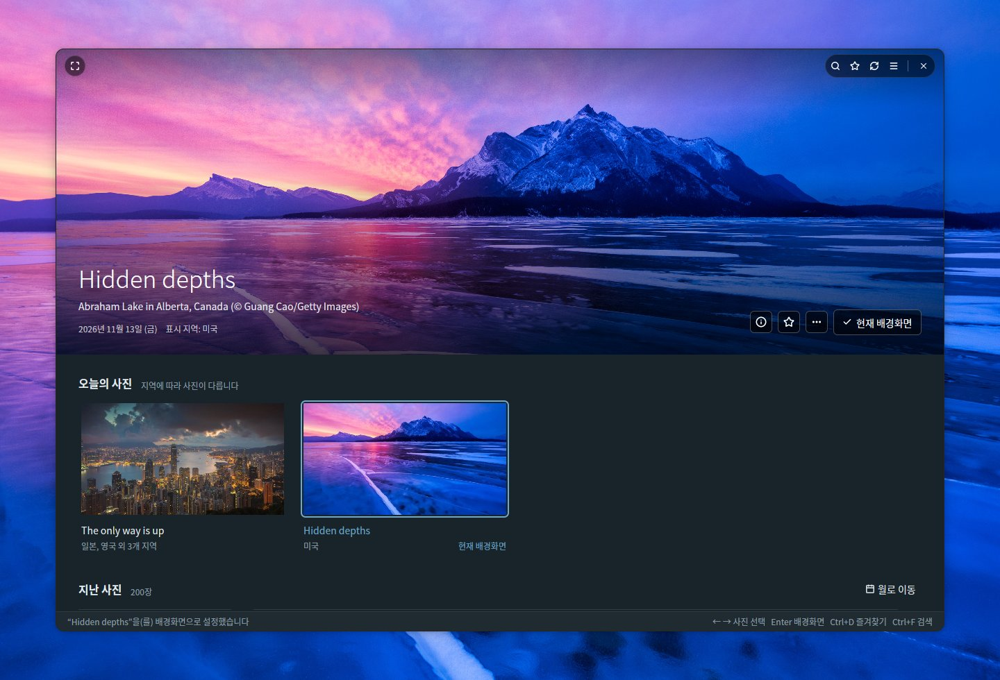
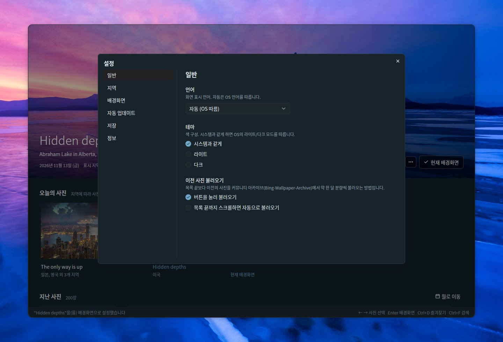
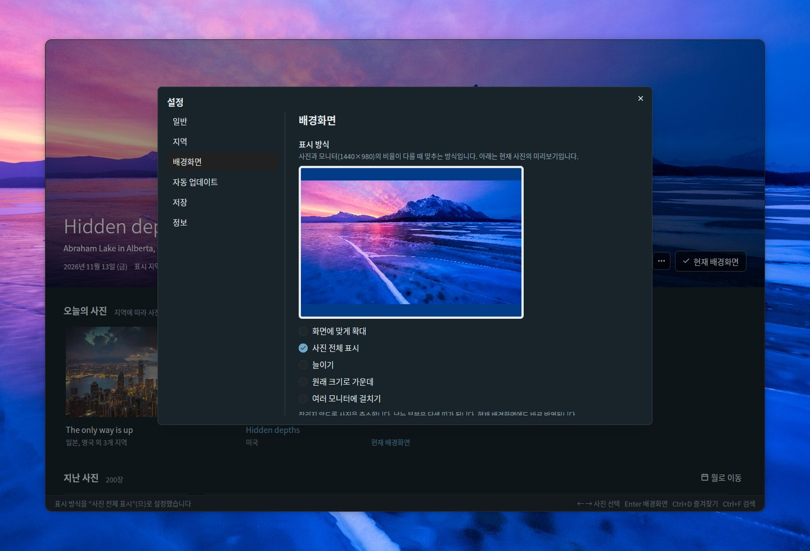
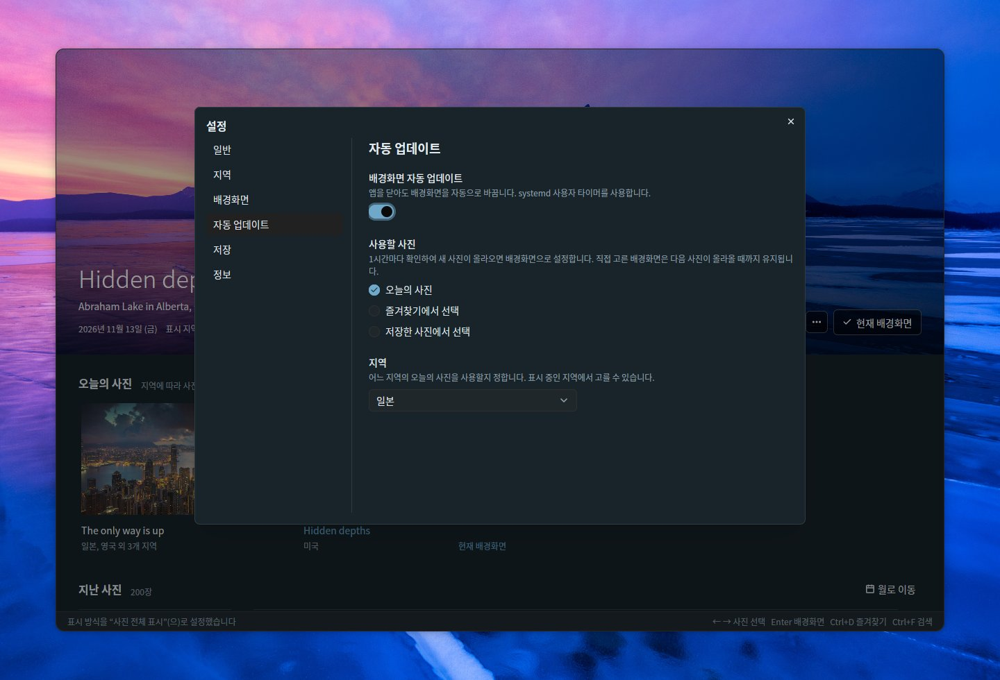
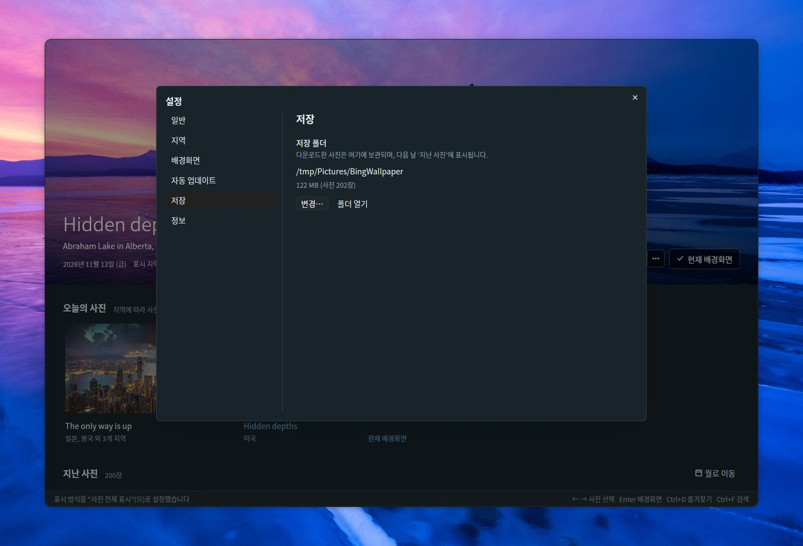
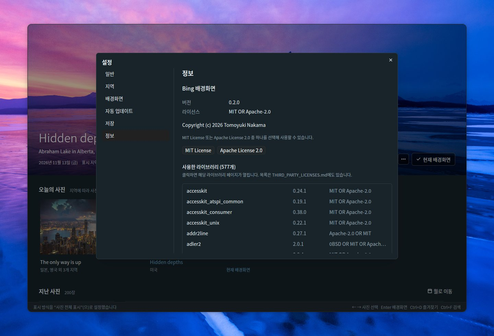

# Bing Wallpaper Manager

[English](README.md) | [日本語](README.ja.md) | [简体中文](README.zh-CN.md) | [繁體中文](README.zh-TW.md) | **한국어** | [Deutsch](README.de.md) | [Français](README.fr.md) | [Español](README.es.md) | [Italiano](README.it.md) | [Português (Brasil)](README.pt-BR.md) | [Русский](README.ru.md)

Bing의 오늘의 사진을 둘러보고 GNOME 배경화면으로 설정할 수 있는 Ubuntu용 데스크톱 앱입니다. Rust, [GPUI](https://gpui.rs), [gpui-kit](https://gpui-kit.com)으로 만들었습니다.



고른 사진은 테두리가 없고 모서리가 둥근 창의 위쪽을 가득 채웁니다. 사진 위에 마우스를 올리면 제목 표시줄이 나타나고, 배경화면으로 설정하면 *현재 배경화면*으로 표시됩니다.

## 기능

- **대시보드**: 선택한 사진을 위쪽에 크게 보여 주고, 그 아래에 *오늘의 사진*과 *지난 사진*(날짜별로 묶음)이 나옵니다. 큰 사진은 목록 위에 고정되어 있다가 스크롤하면 가는 띠로 줄어들고, 사진을 고르거나 띠를 클릭하면 다시 펼쳐집니다. 사진을 바꾸면 새 이미지를 불러온 뒤 부드럽게 교차 전환됩니다
- **테두리 없는 창**: 모서리가 둥글고, 큰 사진이 창의 맨 위까지 닿습니다. 제목 표시줄(검색, 즐겨찾기, 새로 고침, 설정, 전체 화면, 창 버튼)은 마우스가 사진 위에 있을 때만 사진 위에 나타납니다. 사진을 드래그하면 창이 이동하고, 위쪽 가장자리를 두 번 클릭하면 최대화됩니다
- **오늘의 사진**: 선택한 지역의 최신 사진을 사진별로 묶어, 그 사진을 보여 주는 지역과 함께 표시합니다. 기본으로 여섯 지역(일본, 미국, 영국, 독일, 프랑스, 중국)이 켜져 있고, 캐나다(영어/프랑스어), 인도, 스페인, 이탈리아, 브라질은 설정에서 켤 수 있습니다. 앱을 열어 두면 1시간마다 새 사진을 확인합니다
- **배경화면으로 설정**: GNOME 배경화면을 라이트와 다크 스타일 모두에 설정합니다. 현재 배경화면에는 *현재 배경화면*이라고 표시됩니다
- **즐겨찾기**: ☆ 버튼, 오른쪽 클릭 메뉴 또는 Ctrl+D로 사진을 즐겨찾기에 넣습니다. 즐겨찾기한 사진에는 ★ 배지가 붙고, 제목 표시줄의 ★ 버튼을 누르면 즐겨찾기만 표시됩니다(검색과 함께 쓸 수 있습니다)
- **지난 사진**: 저장한 사진은 스크롤하는 대로 계속 불러옵니다. 공식 Bing API는 15일 전까지만 제공합니다. 그보다 이전 사진은 목록 끝의 *이전 사진 불러오기*로 커뮤니티 아카이브([Bing-Wallpaper-Archive](https://github.com/npanuhin/Bing-Wallpaper-Archive), 미국은 2010년부터, 다른 지역은 2024년 4월부터)에서 약 한 달 분량씩 불러옵니다. 설정 → 일반 → *이전 사진 불러오기*에서 버튼을 누르는 대신 목록 끝까지 스크롤하면 자동으로 불러오게 할 수 있습니다. 이전 사진은 썸네일만 저장하고, 전체 이미지는 배경화면으로 설정할 때 다운로드합니다
- **검색**(Ctrl+F): 저장한 사진에서 찾습니다
  - 단어로 찾기: 제목, 장소, 설명, 지역, 날짜(예: `2026-11-08`). 제목과 설명은 제공되는 모든 언어로 저장되므로 “penguin”, “Pinguin”, “ペンギン” 모두 같은 사진을 찾습니다
  - 색으로 찾기: 빨강, 주황, 노랑, 초록, 하늘색, 파랑, 보라, 분홍, 흰색, 검정 중에서 고르면 그 색이 많은 사진부터 나열합니다. 단어와 함께 쓸 수 있습니다
  - Escape를 누르면 검색을 닫습니다
- **표시 방식**: 사진과 모니터의 비율이 다를 때 맞추는 방식을 모니터 비율의 미리보기를 보면서 고릅니다(화면에 맞게 확대, 사진 전체 표시, 늘이기, 원래 크기로 가운데, 여러 모니터에 걸치기)
- **사진 정보**(큰 사진의 ⓘ, Ctrl+I): 사진의 제목, 장소, 날짜, 지역, Bing의 설명을 보여 주는 옆 패널입니다. *Bing에서 찾아보기*와 *제목과 촬영지 복사*도 있습니다
- **사진 작업**: 사진을 오른쪽 클릭하거나 큰 사진의 *…* 버튼을 누르면 배경화면으로 설정, 즐겨찾기에 추가, 사진 정보 보기, Bing에서 찾아보기, 제목과 촬영지 복사, 이미지 열기, 폴더에서 보기, 삭제를 할 수 있습니다
- **월로 이동**: 지난 사진의 원하는 달로 바로 이동합니다
- **삭제**(Delete 키): 확인을 거친 뒤 사진을 폴더에서 삭제합니다. 삭제한 사진은 다시 다운로드하지 않습니다
- **자동 업데이트**: 설정의 스위치를 켜면 앱을 닫아도 배경화면이 자동으로 바뀝니다. 매일 새로 올라오는 오늘의 사진으로 바꾸거나, 원하는 간격으로 즐겨찾기나 저장한 사진 중 다른 사진으로 바꿉니다
- **설정**(오른쪽 위의 ☰, Ctrl+,): 일반(언어, 테마, 이전 사진을 불러오는 방법), 지역, 배경화면(표시 방식), 자동 업데이트, 저장(폴더와 디스크 사용량), 정보(버전, 라이선스, 사용한 라이브러리)
- **11개 언어**: 일본어, 영어, 중국어(간체/번체), 한국어, 독일어, 프랑스어, 스페인어, 이탈리아어, 포르투갈어, 러시아어. *자동 (OS 따름)* 옵션은 OS 언어(`LANG`)를 따릅니다. 사진의 제목과 설명은 선택한 언어를 쓰는 지역에 표시된 것을 우선합니다
- **테마**: 시스템과 같게, 라이트, 다크
- **키보드**: ← →로 사진 선택, Enter로 배경화면 설정, Ctrl+D로 즐겨찾기 추가/제거, Ctrl+I로 사진 정보, Delete로 삭제, Home / End로 가장 최신 또는 가장 오래된 사진으로 이동, Page Up / Page Down으로 한 화면씩 스크롤, F5 / Ctrl+R로 새로 고침, Ctrl+F로 검색, Ctrl+,로 설정, F11로 전체 화면
- **명령줄**: `--apply`는 창을 열지 않고 오늘의 사진(`--random`을 붙이면 저장한 사진)을 배경화면으로 설정합니다
- **창은 하나만**: 앱을 다시 실행하면 두 번째 창을 여는 대신 열려 있는 창을 앞으로 가져오고, 창은 마지막으로 닫았을 때의 크기로 열립니다

## 둘러보기

목록을 스크롤하면 큰 사진이 가는 띠로 줄어들어 사진을 볼 공간이 넓어집니다. 사진을 고르거나 띠를 클릭하면 다시 펼쳐집니다. 지난 사진은 날짜별로 묶여 있고, 즐겨찾기에는 ★ 배지가 붙습니다. 사진을 오른쪽 클릭하면(큰 사진에서는 *…* 버튼) 배경화면으로 설정, 즐겨찾기에 추가, 사진 정보 보기, Bing에서 찾아보기, 제목과 촬영지 복사, 이미지 열기, 폴더에서 보기, 삭제를 할 수 있습니다.


### 월로 이동

두 달 이상의 사진이 모이면 *지난 사진* 오른쪽의 **월로 이동**에 저장된 달이 나열됩니다(여러 해에 걸쳐 있으면 연도별로 묶입니다). 하나를 고르면 목록이 그 달의 첫 사진으로 스크롤됩니다.


### 사진 삭제

사진의 메뉴에서 **삭제…** 항목을 고르거나, 위쪽에 표시된 사진에 대해 Delete 키를 누릅니다. 확인하면 이미지와 썸네일, 상세 정보가 사진 폴더에서 삭제됩니다. 삭제한 사진은 기억해 두므로 새로 고치거나 이전 사진을 불러와도 되돌아오지 않습니다. 오늘의 사진과 현재 배경화면은 삭제할 수 없습니다.


## 사진 정보

큰 사진의 **ⓘ** 버튼을 클릭하면(또는 **Ctrl+I**를 누르거나 사진의 메뉴에서 *사진 정보*를 고르면) 사진의 제목, 장소와 저작권 표시, 날짜, 그 사진을 보여 준 지역, 그리고 사용 중인 언어로 된 Bing의 설명(있는 경우)이 담긴 패널이 열립니다. 최근 사진의 설명은 사진과 함께 가져오고, 이전 사진의 설명은 커뮤니티 아카이브에서 가져옵니다. *Bing에서 찾아보기*는 그 사진에 대한 Bing 페이지를 브라우저에서 열고, *제목과 촬영지 복사*는 제목과 촬영지를 클립보드에 넣습니다. Escape를 누르면 패널이 닫힙니다.


## 검색

**Ctrl+F**를 누르면(또는 제목 표시줄의 🔍 버튼을 클릭하면) 저장한 사진을 검색할 수 있습니다. 검색 중에는 목록에 조건에 맞는 사진만 표시됩니다. 사진을 클릭하면 위쪽에 크게 표시되고, Escape를 누르면 원래 화면으로 돌아갑니다.

### 단어로 찾기

사진의 제목, 장소, 설명, 지역, 날짜(예: `2026-11-08`)에 들어 있는 단어를 입력합니다. 제목과 설명은 사진이 표시된 모든 언어로 저장되고 커뮤니티 아카이브의 더 긴 설명도 검색 대상이므로, 한 언어의 단어로 다른 지역에 표시된 사진도 찾을 수 있습니다.


### 색으로 찾기

열 가지 색(빨강, 주황, 노랑, 초록, 하늘색, 파랑, 보라, 분홍, 흰색, 검정) 중 하나를 고르면 그 색이 가장 많은 사진부터 나열합니다. 색의 비율은 각 사진의 썸네일을 바탕으로 백그라운드에서 계산합니다. 단어와 색은 함께 쓸 수 있습니다(예: “mountain” + 파랑).


## 설정

제목 표시줄 오른쪽 위의 **☰** 버튼을 누르거나 **Ctrl+,** 키를 눌러 설정을 엽니다. 변경한 내용은 바로 적용되고, Escape를 누르면 대화 상자가 닫힙니다. 페이지 목록은 왼쪽에 있습니다.

### 일반

- **언어**: 화면 표시 언어입니다. *자동 (OS 따름)* 옵션은 OS 언어를 따릅니다
- **테마**: 시스템과 같게, 라이트, 다크
- **이전 사진 불러오기**: 목록 끝보다 이전의 사진을 커뮤니티 아카이브에서 약 한 달 분량씩 불러오는 방법입니다
  - *버튼을 눌러 불러오기*: 목록 끝의 *이전 사진 불러오기*를 누릅니다
  - *목록 끝까지 스크롤하면 자동으로 불러오기*: 목록 끝까지 스크롤하면(또는 End를 누르면) 다음 한 달 분량을 자동으로 불러옵니다. 버튼은 불러오기에 실패했을 때만 나타나므로 다시 시도할 수 있습니다



### 지역

Bing은 지역마다 다른 사진과 제목, 설명을 보여 줍니다. 대시보드가 어느 지역의 사진을 가져올지 고릅니다. 일본, 미국, 영국, 독일, 프랑스, 중국이 기본으로 켜져 있고, 캐나다(영어), 캐나다(프랑스어), 인도, 스페인, 이탈리아, 브라질을 추가할 수 있습니다. 적어도 한 지역은 항상 켜져 있습니다. Bing이 전 세계 공통 사진만 보여 주는 지역은 목록에 없습니다.


### 배경화면

사진의 비율이 모니터와 다를 때 맞추는 방식을 고릅니다. 화면에 맞게 확대, 사진 전체 표시, 늘이기, 원래 크기로 가운데, 여러 모니터에 걸치기 중에서 고를 수 있습니다. 미리보기는 모니터의 비율과 위쪽에 표시된 사진을 사용하며, *사진 전체 표시*에서는 남는 부분이 GNOME이 쓰는 배경색으로 채워집니다. 현재 배경화면에도 바로 반영됩니다.



### 자동 업데이트

스위치를 켜면 앱을 닫아도 배경화면이 자동으로 바뀝니다. 사용할 사진을 고릅니다.

- **오늘의 사진**: 1시간마다(그리고 로그인한 직후에) 확인하여, 선택한 지역에 새 사진이 올라오면 배경화면으로 설정합니다. 직접 고른 배경화면은 다음 사진이 올라올 때까지 유지됩니다
- **즐겨찾기에서 선택**: 30분마다, 1시간마다, 3시간마다, 6시간마다 또는 매일, 즐겨찾기 중에서 매번 다른 사진을 고릅니다
- **저장한 사진에서 선택**: 위와 같지만 저장한 모든 사진 중에서 고릅니다. 오래된 사진은 선택될 때 다운로드합니다

스위치를 켜면 이 앱을 `--apply`로 실행하는 systemd 사용자 타이머(`~/.config/systemd/user/bing-wallpaper-manager.timer`와 `.service`)가 만들어지고, 끄면 타이머가 제거됩니다. 타이머는 앱을 현재 위치에서 실행하므로, 앱을 옮겼다면 스위치를 껐다가 다시 켜세요.



### 저장

사진을 보관하는 폴더와 디스크 사용량, 사진 수를 보여 줍니다. *변경…* 버튼으로 다른 폴더를 고르고, *폴더 열기*로 파일 관리자에서 폴더를 엽니다. 폴더에 저장되는 내용은 [파일](#파일)을 참고하세요.



### 정보

버전, 라이선스(MIT 또는 Apache 2.0, 각각의 전문을 읽는 버튼 포함), 사용한 라이브러리 목록입니다. 라이브러리를 클릭하면 해당 페이지가 열립니다.



## 사용한 기술

사용자 인터페이스는 다음 두 오픈 소스 프로젝트를 바탕으로 만들었습니다.

- **[GPUI](https://gpui.rs)** — [Zed Industries](https://zed.dev)가 Zed 에디터를 위해 개발한 GPU 가속 UI 프레임워크입니다([소스](https://github.com/zed-industries/zed), Apache-2.0). 이 앱은 crates.io에 `gpui-pre`로 공개된 스냅샷을 사용합니다
- **[gpui-kit](https://gpui-kit.com)** — [Longbridge](https://github.com/longbridge)가 만든 GPUI용 컴포넌트 라이브러리이자 툴킷입니다([소스](https://github.com/longbridge/gpui-kit), Apache-2.0). 버튼, 대화 상자, 메뉴, 입력란, 선택 상자, 스크롤 막대, 제목 표시줄, 테마 기능은 이 프로젝트의 `gpui-component`와 `gpui-base` 크레이트에서 가져왔습니다

두 프로젝트에 감사드립니다. 그 밖의 라이브러리는 모두 [THIRD_PARTY_LICENSES.md](THIRD_PARTY_LICENSES.md)에 정리되어 있습니다.

## 설치

### 요구 사항

- GNOME 데스크톱을 쓰는 Ubuntu(Ubuntu 26.04에서 개발, Wayland와 X11 지원). 배경화면은 GNOME의 `gsettings`로 설정합니다
- Vulkan을 지원하는 그래픽 드라이버(일반적인 Ubuntu 데스크톱 설치에 포함되어 있습니다)

### 빌드된 바이너리 (x86_64)

각 [릴리스](https://github.com/TomoyukiNakama/bing-wallpaper-manager/releases/latest)에는 Ubuntu 26.04 이상(glibc 2.43 이상)용으로 빌드된 패키지가 있습니다. `bing-wallpaper-manager-<버전>-x86_64-linux.tar.gz`를 다운로드하여 `~/.local`에 풉니다.

```sh
tar -xzf bing-wallpaper-manager-*-x86_64-linux.tar.gz -C ~/.local --strip-components=1
```

소스에서 직접 빌드하려면 아래 순서를 따르세요.

### 1. 빌드 도구 설치

```sh
sudo apt install git curl build-essential
```

글꼴 라이브러리 중 하나를 C 소스에서 빌드하므로 C 컴파일러(`build-essential`)가 필요합니다.

### 2. Rust 설치

[rustup](https://rustup.rs)으로 최신 stable Rust를 설치합니다. Ubuntu 26.04에 포함된 Rust(1.93)는 GPUI를 빌드하기에는 너무 오래되었습니다.

```sh
curl --proto '=https' --tlsv1.2 -sSf https://sh.rustup.rs | sh -s -- -y
source "$HOME/.cargo/env"   # 또는 새 터미널 열기
```

PATH에 Ubuntu의 `cargo`를 그대로 두고 싶다면 그래도 괜찮습니다. `.cargo/config.toml`이 cargo가 `scripts/rustc-stable`을 쓰도록 지정하고, 이 스크립트가 rustup stable 툴체인의 rustc를 실행합니다(rustup이 설치되어 있지 않으면 PATH의 `rustc`를 사용합니다).

### 3. 소스 가져오기

```sh
git clone https://github.com/TomoyukiNakama/bing-wallpaper-manager.git
cd bing-wallpaper-manager
```

### 4. 빌드 및 설치

```sh
scripts/install.sh
```

릴리스 버전을 빌드하고 앱과 아이콘, 데스크톱 항목을 `~/.local` 아래에 설치합니다. 그러면 GNOME 앱 목록에 *Bing 배경화면*이 나타나고(바로 보이지 않으면 로그아웃했다가 다시 로그인하세요), `~/.local/bin`이 PATH에 있으면 터미널에서 `bing-wallpaper-manager`로 실행할 수도 있습니다. 첫 빌드는 모든 의존성을 다운로드하고 컴파일하므로 몇 분이 걸립니다.

다른 위치에 설치하려면 `PREFIX`를 지정합니다. 예: `PREFIX=/opt/bing-wallpaper scripts/install.sh`.

### 업데이트

```sh
git pull
scripts/install.sh
```

`scripts/install.sh`는 설치하기 전에 항상 다시 빌드하므로, `git pull` 후에 다시 실행하면 새 버전이 설치됩니다.

### 제거

```sh
scripts/install.sh --uninstall
```

앱과 아이콘, 데스크톱 항목을 제거합니다. 설정(`~/.config/bing-wallpaper-manager/`)과 저장한 사진(저장 폴더)은 그대로 남으므로, 더 필요하지 않으면 직접 삭제하세요.

### 설치하지 않고 실행

```sh
cargo run --release
```

## 파일

저장 폴더는 *설정 → 저장*에서 고릅니다(기본값: `~/Pictures/BingWallpaper` 또는 현지화된 사진 폴더). 설정은 `~/.config/bing-wallpaper-manager/config.json`에, 앱이 기억하는 상태(창 크기 등)는 같은 폴더의 `state.json`에 저장됩니다.
같은 사진은 여러 지역이나 다른 날짜에 표시되어도 한 번만 저장하며, 저장한 이미지는 다시 다운로드하지 않습니다.

```text
<저장 폴더>/
  20261108_OHR.Foo_UHD.jpg              배경화면용 이미지 (UHD)
  .bing-wallpaper/meta/OHR.Foo.json     메타데이터: 제목, 설명, 지역, 색의 비율
  .bing-wallpaper/thumbs/OHR.Foo.jpg    썸네일 (640x360)
  .bing-wallpaper/previews/OHR.Foo.jpg  이전 사진을 크게 보여 주기 위한 중간 크기 이미지 (1920x1080)
  .bing-wallpaper/deleted.txt           삭제한 사진 (다시 다운로드하지 않기 위한 기록)
```

## 명령줄

```sh
bing-wallpaper-manager --apply                       # 오늘의 사진을 배경화면으로 설정
bing-wallpaper-manager --apply --mkt en-US           # 지역 지정
bing-wallpaper-manager --apply --if-new              # 지난번과 같은 사진이면 아무것도 하지 않음
bing-wallpaper-manager --apply --random              # 저장한 사진 중 하나를 무작위로 설정
bing-wallpaper-manager --apply --random --favorites  # 즐겨찾기 중 하나를 무작위로 설정
```

`--mkt`를 생략하면 *자동 업데이트*에서 고른 지역(없으면 표시 중인 첫 번째 지역)을 사용합니다. 로그인 직후처럼 네트워크가 아직 연결되지 않았을 때는 `--apply`가 몇 번 다시 시도한 뒤에 포기합니다.

### 매일 업데이트

**설정** → **자동 업데이트**에서 스위치를 켜면([자동 업데이트](#자동-업데이트) 참고) systemd 사용자 타이머가 자동으로 설정됩니다. 상태는 다음과 같이 확인합니다.

```sh
systemctl --user list-timers bing-wallpaper-manager.timer
journalctl --user -u bing-wallpaper-manager.service
```

이전 버전에서 `bing-wallpaper.timer`를 직접 만들었다면 두 타이머가 함께 실행되지 않도록 비활성화하세요: `systemctl --user disable --now bing-wallpaper.timer`.

## 개발

### 스크린샷

`scripts/screenshot.sh`는 가상 Wayland 디스플레이(headless 모드의 sway)에서 앱을 실행하고 PNG를 저장합니다.
사용 중인 데스크톱, 설정, 저장 폴더, 배경화면, systemd 타이머는 건드리지 않습니다(스크린샷용 데이터는 `target/screenshot-fixture/`에 있습니다).

```sh
sudo apt install sway grim          # 처음 한 번만
cargo build --release
scripts/screenshot.sh target/shot.png            # 기본값: 15초 대기, 1440x960
BWM_THEME=dark BWM_LANG=de scripts/screenshot.sh target/dark.png 10 1280x1300
```

`BWM_THEME=light|dark`는 테마를, `BWM_LANG=de`(등)는 언어를 고정합니다. 둘 다 일반 실행에서도 쓸 수 있습니다.
`FLOAT=1280x840`은 창을 화면에 가득 채우지 않고 띄워서 보여 주고(둥근 모서리와 창 버튼 확인용), `BG=<이미지>`는 그 뒤에 데스크톱 배경으로 이미지를 깝니다.

스크린샷을 찍기 전에 조작하려면 클릭, 오른쪽 클릭, 드래그, 스크롤, 키 입력, 문자 입력을 `ACTIONS`에 적습니다. 입력은 `tools/vpointer`의 가상 마우스와 키보드로 보냅니다(처음 사용할 때 자동으로 빌드됩니다).

```sh
ACTIONS=$'key ctrl-f\ntype penguin\nsleep 3\nshot target/step1.png' \
  scripts/screenshot.sh target/step2.png 10 1280x1000
```

`docs/`의 이미지는 이 방법으로 다크 테마에서 찍어 품질 85의 JPEG로 저장한 것입니다. 메인 스크린샷과 설정의 각 페이지는 모든 언어로 있습니다(`docs/<이름>.<언어>.jpg`, 영어는 접미사 없음). 나머지 이미지는 영어와 일본어로 찍었고, 다른 언어의 README는 영어 이미지를 사용합니다. 예:

```sh
BG=target/screenshot-fixture/store/20261112_OHR.AbrahamCanada_UHD.jpg FLOAT=1280x840 BWM_LANG=en BWM_THEME=dark \
  ACTIONS=$'click 583 660\nsleep 1.5\nkey enter\nsleep 2\nclick 720 250\nsleep 1.5' \
  scripts/screenshot.sh target/main.png 12 1440x980
```

### 릴리스 패키지

`scripts/package-release.sh`는 릴리스 버전을 빌드하고, 바이너리, 아이콘, 데스크톱 항목, 라이선스 파일(포함된 모든 라이브러리의 라이선스 전문 포함)을 담은 `target/dist/bing-wallpaper-manager-<버전>-x86_64-linux.tar.gz`(와 `.sha256`)를 만듭니다. 버전은 `Cargo.toml`에서 가져옵니다.

### 번역

문자열은 `locales/<언어>.yml`에 있습니다(`ja`, `en`, `zh-CN`, `zh-TW`, `ko`, `de`, `fr`, `es`, `it`, `pt-BR`, `ru`).

- 자리 표시자는 `%{count}` 형식으로 씁니다
- 모든 파일에 같은 키가 있어야 합니다(`cargo test`가 확인합니다). 번역이 없으면 영어로 표시됩니다
- 언어를 추가하려면 `locales/` 아래에 파일을 추가하고 `src/i18n.rs`의 `Language`에 항목을 추가합니다
- README는 모든 언어로 있습니다(영어는 `README.md`, 그 밖의 언어는 `README.<언어>.md`). 기능을 바꾸면 모두 업데이트합니다

### 구성

| 파일 | 역할 |
| --- | --- |
| `src/main.rs` | 대시보드 UI와 CLI |
| `src/bing.rs` | Bing HPImageArchive API와 다운로드 |
| `src/archive.rs` | 커뮤니티 아카이브의 이전 사진과 설명 |
| `src/library.rs` | 저장 폴더에 사진 저장 및 불러오기 |
| `src/search.rs` | 단어와 색으로 검색 |
| `src/colors.rs` | 사진의 색 비율 분석 |
| `src/settings.rs` | 설정 대화 상자 |
| `src/info.rs` | 사진 정보 패널 |
| `src/schedule.rs` | 자동 업데이트 (systemd 사용자 타이머) |
| `src/single.rs` | 창을 하나만 유지 (다시 실행하면 기존 창을 앞으로 가져옴) |
| `src/config.rs` | 설정 파일 |
| `src/theme.rs` | 색(라이트 / 다크)과 글꼴 |
| `src/i18n.rs` | 언어 전환과 날짜 형식 (문자열은 `tr!("key")`로 참조) |
| `src/wallpaper.rs` | `gsettings`로 GNOME 배경화면 설정 |
| `locales/*.yml` | 번역 (rust-i18n으로 빌드할 때 포함) |
| `src/third_party.tsv` / `THIRD_PARTY_LICENSES.md` | 사용한 라이브러리 (`scripts/gen-third-party.py`로 생성) |
| `assets/icons/` | 앱 아이콘 (SVG, 그리고 `scripts/render-icon.py`로 만든 PNG) |
| `assets/bing-wallpaper-manager.desktop` | 데스크톱 항목 (`scripts/install.sh`가 설치) |
| `scripts/rustc-stable` | cargo가 쓸 rustc를 rustup의 stable에서 고름 (‘2. Rust 설치’ 참고) |
| `scripts/screenshot.sh` | 가상 디스플레이에서 스크린샷 촬영 |
| `tools/vpointer/` | 스크린샷용 가상 마우스와 키보드 (별도 크레이트) |

## 라이선스

[MIT License](LICENSE-MIT) 또는 [Apache License 2.0](LICENSE-APACHE) 중 원하는 것을 선택해 사용할 수 있습니다(MIT OR Apache-2.0). 사용한 라이브러리는 [THIRD_PARTY_LICENSES.md](THIRD_PARTY_LICENSES.md)에 정리되어 있습니다(의존성을 바꾼 뒤에는 `python3 scripts/gen-third-party.py`로 다시 생성합니다).

사진의 저작권은 각 사진작가와 제공자에게 있습니다. 이 앱은 Microsoft와 관련이 없습니다.
