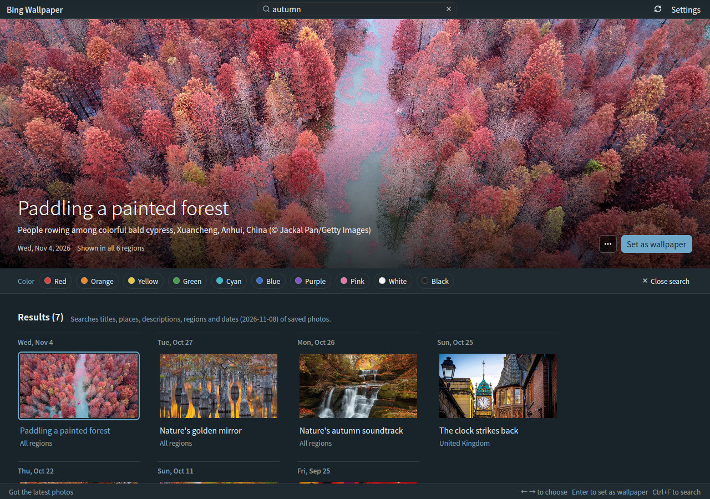
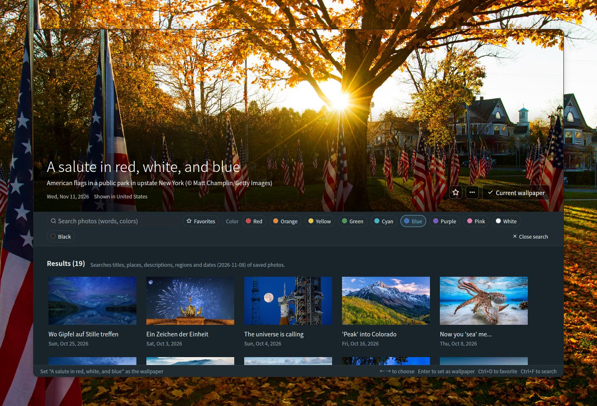

# Bing Wallpaper Manager

**English** | [日本語](README.ja.md)

A desktop app for Ubuntu that lets you browse Bing’s daily photos and set them as your GNOME wallpaper. Built with Rust, [GPUI](https://gpui.rs) and [gpui-kit](https://gpui-kit.com).


## Features

- **Dashboard**: the selected photo is shown large at the top, with *Today’s photos* and *Earlier photos* (grouped by date) below. The large photo stays pinned above the list, shrinks to a slim bar while you scroll, and expands again when you pick a photo. Switching photos crossfades smoothly once the new image has loaded
- **Frameless window**: rounded corners, with the large photo reaching the top edge. The title bar (search, favorites, refresh, settings, full screen and the window buttons) appears over the photo only while the mouse is on it; drag the photo to move the window, double-click the top edge to maximize
- **Today’s photos**: the latest photo from six regions (Japan, United States, United Kingdom, Germany, France, China), grouped by photo with the regions that show it
- **Set as wallpaper**: sets the GNOME wallpaper for both light and dark styles. The current wallpaper is marked *Current wallpaper*
- **Favorites**: mark photos with the ☆ button, the right-click menu or Ctrl+D; favorites get a ★ badge, and the ★ button in the title bar shows only your favorites (can be combined with search)
- **Earlier photos**: saved photos load continuously as you scroll. The official Bing API goes back 15 days. For older photos, *Load older photos* at the end of the list loads about a month at a time from a community archive ([Bing-Wallpaper-Archive](https://github.com/npanuhin/Bing-Wallpaper-Archive); the US since 2010, other regions since April 2024). Older photos are saved as thumbnails only; the full image is downloaded when you set it as the wallpaper
- **Search** (Ctrl+F) through saved photos
  - By words: titles, places, descriptions, regions and dates (such as `2026-11-08`). Titles and descriptions are saved in every available language, so “penguin”, “Pinguin” and “ペンギン” all find the same photo
  - By color: pick red, orange, yellow, green, cyan, blue, purple, pink, white or black to list photos with the most of that color first. Can be combined with words
  - Press Escape to close the search
- **Fit**: choose how the photo fits when its shape differs from the monitor, with a preview in the monitor’s proportions (zoom, show the whole photo, stretch, center at original size, span across monitors)
- **Photo actions**: right-click a photo or use the *…* button on the large photo to set it as the wallpaper, open the image, or show it in its folder
- **Settings** (☰ at the top right, Ctrl+,): General (language, theme), Wallpaper (fit), Storage, and About (version, license, libraries used)
- **11 languages**: Japanese, English, Chinese (Simplified / Traditional), Korean, German, French, Spanish, Italian, Portuguese and Russian. *Automatic* follows the OS language (`LANG`). Photo titles and descriptions prefer the version shown in a region that uses the selected language
- **Theme**: match the system, light or dark
- **Keyboard**: ← → to choose a photo, Enter to set it as the wallpaper, Ctrl+D to add or remove a favorite, F5 / Ctrl+R to refresh, Ctrl+F to search, Ctrl+, for settings, F11 for full screen
- **Command line**: `--apply` sets today’s photo as the wallpaper without opening the window

## Search

Press **Ctrl+F** (or click the 🔍 button in the title bar) to search the photos you have saved. While searching, the list shows only the matching photos; click one to see it large at the top, or press Escape to go back.

### By words

Type any word from a photo’s title, place, description, region or date (such as `2026-11-08`). Titles and descriptions are saved in every language the photo was shown in, and the longer descriptions from the community archive are searched too, so a word in one language also finds photos shown in other regions.



### By color

Pick one of ten colors (red, orange, yellow, green, cyan, blue, purple, pink, white, black) to list the photos that contain the most of that color first. The color shares are computed from each photo’s thumbnail in the background. Words and a color can be combined, for example “mountain” + blue.



## Built with

The user interface is built on these two open-source projects:

- **[GPUI](https://gpui.rs)** — the GPU-accelerated UI framework developed by [Zed Industries](https://zed.dev) for the Zed editor ([source](https://github.com/zed-industries/zed), Apache-2.0). This app uses the snapshot published on crates.io as `gpui-pre`
- **[gpui-kit](https://gpui-kit.com)** — a component library and toolkit for GPUI by [Longbridge](https://github.com/longbridge) ([source](https://github.com/longbridge/gpui-kit), Apache-2.0). The buttons, dialogs, menus, inputs, selects, scrollbars, title bar and theming come from its `gpui-component` and `gpui-base` crates

Thanks to both projects. All other libraries are listed in [THIRD_PARTY_LICENSES.md](THIRD_PARTY_LICENSES.md).

## Installation

### Requirements

- Ubuntu with the GNOME desktop (developed on Ubuntu 26.04; Wayland and X11). The wallpaper is set through GNOME’s `gsettings`
- A graphics driver with Vulkan support (included in a normal Ubuntu desktop install)

### Prebuilt binary (x86_64)

Each [release](https://github.com/TomoyukiNakama/bing-wallpaper-manager/releases/latest) has a prebuilt package for Ubuntu 26.04 or newer (glibc 2.43+). Download `bing-wallpaper-manager-<version>-x86_64-linux.tar.gz` and extract it into `~/.local`:

```sh
tar -xzf bing-wallpaper-manager-*-x86_64-linux.tar.gz -C ~/.local --strip-components=1
```

To build from source instead, follow the steps below.

### 1. Install the build tools

```sh
sudo apt install git curl build-essential
```

A C compiler (`build-essential`) is needed because one of the font libraries is built from C sources.

### 2. Install Rust

Install the current stable Rust with [rustup](https://rustup.rs). The Rust packaged with Ubuntu 26.04 (1.93) is too old for GPUI.

```sh
curl --proto '=https' --tlsv1.2 -sSf https://sh.rustup.rs | sh -s -- -y
source "$HOME/.cargo/env"   # or open a new terminal
```

If you prefer to keep Ubuntu’s own `cargo` on your PATH, that works too: `.cargo/config.toml` points cargo at `scripts/rustc-stable`, which runs the rustc of your rustup stable toolchain (and falls back to the `rustc` on your PATH when rustup is not installed).

### 3. Get the source

```sh
git clone https://github.com/TomoyukiNakama/bing-wallpaper-manager.git
cd bing-wallpaper-manager
```

### 4. Build and install

```sh
scripts/install.sh
```

This builds the release version and installs the app, its icon and a desktop entry under `~/.local`. *Bing Wallpaper* then appears in the GNOME app grid (log out and back in if it does not show up right away), and `bing-wallpaper-manager` can be started from a terminal if `~/.local/bin` is on your PATH. The first build downloads and compiles all dependencies and takes several minutes.

To install somewhere else, set `PREFIX`, for example `PREFIX=/opt/bing-wallpaper scripts/install.sh`.

### Update

```sh
git pull
scripts/install.sh
```

`scripts/install.sh` always rebuilds before installing, so running it again after `git pull` installs the new version.

### Uninstall

```sh
scripts/install.sh --uninstall
```

This removes the app, icon and desktop entry. Your settings (`~/.config/bing-wallpaper-manager/`) and saved photos (the storage folder) are kept; delete them yourself if you no longer need them.

### Run without installing

```sh
cargo run --release
```

## Storage

Choose the storage folder under *Settings → Storage* (default: `~/Pictures/BingWallpaper`, or the localized Pictures folder). Settings are saved to `~/.config/bing-wallpaper-manager/config.json`.
A photo is saved only once even if it is shown in several regions or on different days, and saved images are never downloaded again.

```text
<storage folder>/
  20261108_OHR.Foo_UHD.jpg              Wallpaper image (UHD)
  .bing-wallpaper/meta/OHR.Foo.json     Metadata: titles, descriptions, regions, color shares
  .bing-wallpaper/thumbs/OHR.Foo.jpg    Thumbnail (640x360)
  .bing-wallpaper/previews/OHR.Foo.jpg  Medium-size image for showing older photos large (1920x1080)
```

## Command line

```sh
bing-wallpaper-manager --apply              # Set today's ja-JP photo as the wallpaper
bing-wallpaper-manager --apply --mkt en-US  # Choose the region
```

### Update every day (systemd user timer)

`~/.config/systemd/user/bing-wallpaper.service`:

```ini
[Unit]
Description=Set Bing wallpaper
After=network-online.target

[Service]
Type=oneshot
ExecStart=%h/.local/bin/bing-wallpaper-manager --apply
```

`~/.config/systemd/user/bing-wallpaper.timer`:

```ini
[Unit]
Description=Daily Bing wallpaper

[Timer]
OnStartupSec=1min
OnCalendar=*-*-* 09:05
Persistent=true

[Install]
WantedBy=timers.target
```

The timer runs the app installed by `scripts/install.sh` (`~/.local/bin/bing-wallpaper-manager`).

```sh
systemctl --user daemon-reload
systemctl --user enable --now bing-wallpaper.timer
```

## Development

### Screenshots

`scripts/screenshot.sh` runs the app on a virtual Wayland display (sway in headless mode) and saves a PNG.
It does not touch your desktop, settings, storage folder or wallpaper (screenshot data lives in `target/screenshot-fixture/`).

```sh
sudo apt install sway grim          # first time only
cargo build --release
scripts/screenshot.sh target/shot.png            # default: wait 15 s, 1440x960
BWM_THEME=dark BWM_LANG=de scripts/screenshot.sh target/dark.png 10 1280x1300
```

`BWM_THEME=light|dark` fixes the theme and `BWM_LANG=de` (etc.) fixes the language; both also work in a normal launch.

Put clicks, right-clicks, scrolling, keys and typing in `ACTIONS` to interact before the screenshot. Input is sent through a virtual mouse and keyboard in `tools/vpointer` (built automatically on first use).

```sh
ACTIONS=$'key ctrl-f\ntype penguin\nsleep 3\nshot target/step1.png' \
  scripts/screenshot.sh target/step2.png 10 1280x1000
```

### Release packages

`scripts/package-release.sh` builds the release version and creates `target/dist/bing-wallpaper-manager-<version>-x86_64-linux.tar.gz` (and its `.sha256`) with the binary, icons, desktop entry and license files, including the license texts of all bundled libraries. The version comes from `Cargo.toml`.

### Translations

Strings live in `locales/<language>.yml` (`ja`, `en`, `zh-CN`, `zh-TW`, `ko`, `de`, `fr`, `es`, `it`, `pt-BR`, `ru`).

- Write placeholders as `%{count}`
- Every file must have the same keys (`cargo test` checks this). Missing translations fall back to English
- To add a language, add a file under `locales/` and a variant to `Language` in `src/i18n.rs`

### Layout

| File | Role |
| --- | --- |
| `src/main.rs` | Dashboard UI and CLI |
| `src/bing.rs` | Bing HPImageArchive API and downloads |
| `src/archive.rs` | Older photos and descriptions from the community archive |
| `src/library.rs` | Saving and loading photos in the storage folder |
| `src/search.rs` | Search by words and colors |
| `src/colors.rs` | Color share analysis of photos |
| `src/settings.rs` | Settings dialog |
| `src/config.rs` | Settings file |
| `src/theme.rs` | Colors (light / dark) and font |
| `src/i18n.rs` | Language switching and date formats (strings are referenced with `tr!("key")`) |
| `src/wallpaper.rs` | Setting the GNOME wallpaper with `gsettings` |
| `locales/*.yml` | Translations (embedded at build time with rust-i18n) |
| `src/third_party.tsv` / `THIRD_PARTY_LICENSES.md` | Libraries used (generated by `scripts/gen-third-party.py`) |
| `assets/icons/` | App icon (SVG, and PNGs rendered by `scripts/render-icon.py`) |
| `assets/bing-wallpaper-manager.desktop` | Desktop entry (installed by `scripts/install.sh`) |
| `scripts/rustc-stable` | Picks the rustup stable rustc for cargo (see Build) |
| `scripts/screenshot.sh` | Screenshots on a virtual display |
| `tools/vpointer/` | Virtual mouse and keyboard for screenshots (separate crate) |

## License

Licensed under either the [MIT License](LICENSE-MIT) or the [Apache License 2.0](LICENSE-APACHE), at your option (MIT OR Apache-2.0). Libraries used are listed in [THIRD_PARTY_LICENSES.md](THIRD_PARTY_LICENSES.md) (regenerate with `python3 scripts/gen-third-party.py` after changing dependencies).

Photos are copyrighted by their photographers and providers. This app is not affiliated with Microsoft.
