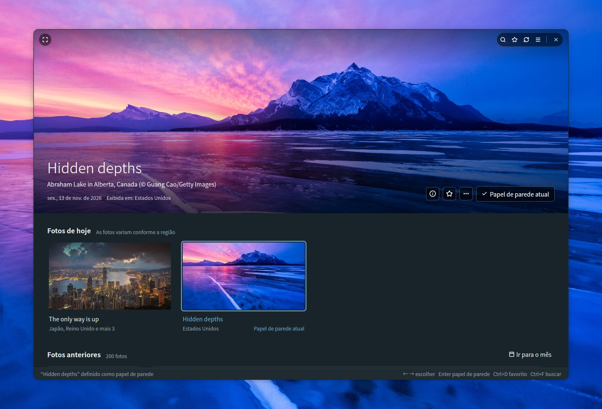
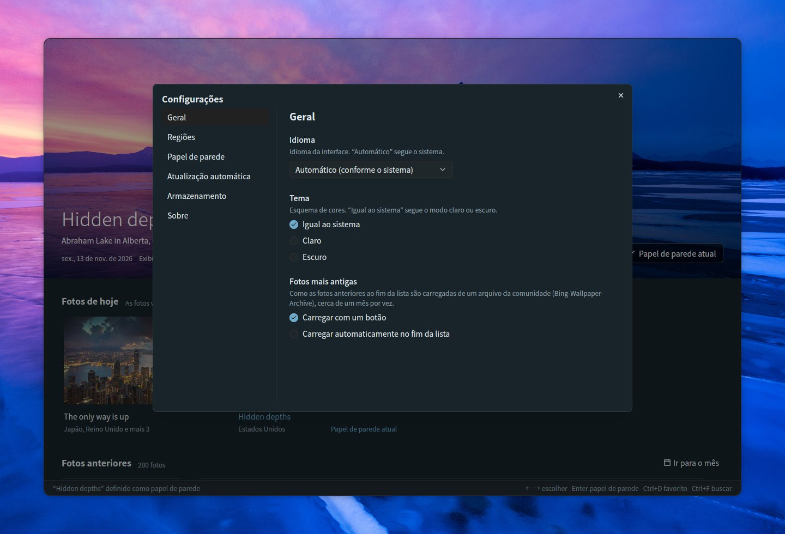
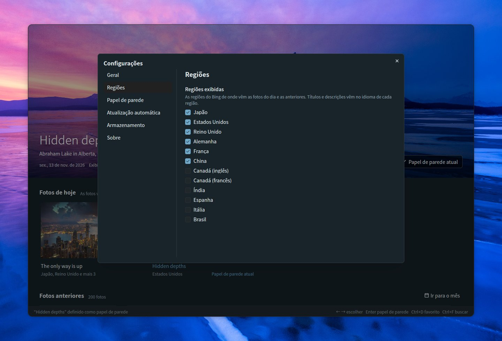
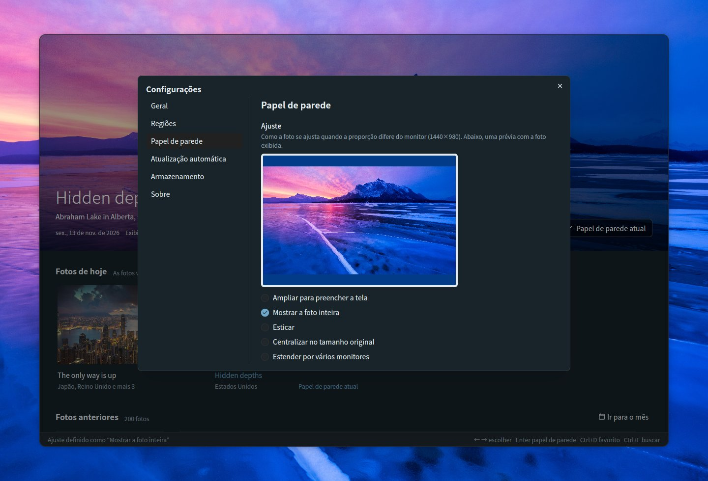
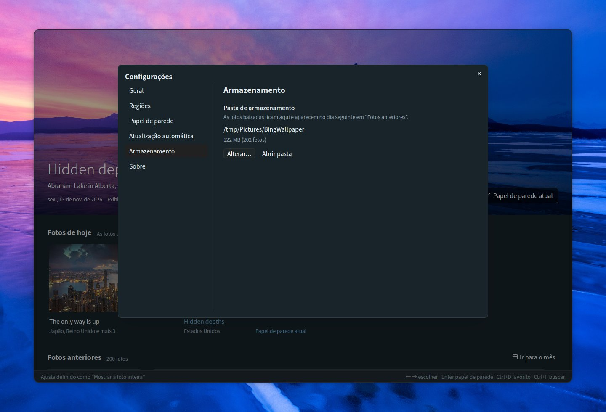
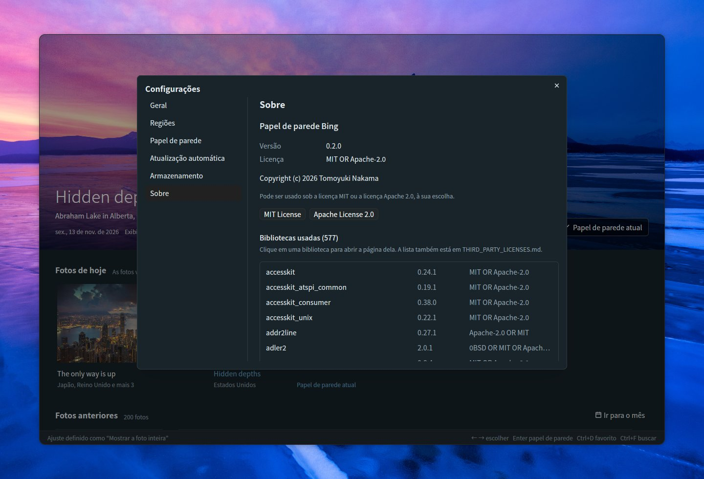

# Bing Wallpaper Manager

[English](README.md) | [日本語](README.ja.md) | [简体中文](README.zh-CN.md) | [繁體中文](README.zh-TW.md) | [한국어](README.ko.md) | [Deutsch](README.de.md) | [Français](README.fr.md) | [Español](README.es.md) | [Italiano](README.it.md) | **Português (Brasil)** | [Русский](README.ru.md)

Um aplicativo de desktop para Ubuntu que permite navegar pelas fotos diárias do Bing e defini-las como papel de parede do GNOME. Feito com Rust, [GPUI](https://gpui.rs) e [gpui-kit](https://gpui-kit.com).



A foto que você escolhe ocupa o topo de uma janela sem moldura e de cantos arredondados. Passe o mouse sobre ela para exibir a barra de título; defina-a como papel de parede e ela fica marcada como *Papel de parede atual*.

## Recursos

- **Painel**: a foto selecionada aparece em tamanho grande no topo, com *Fotos de hoje* e *Fotos anteriores* (agrupadas por data) logo abaixo. A foto grande fica fixa acima da lista, encolhe para uma barra fina enquanto você rola e volta a se expandir quando você escolhe uma foto ou clica na barra. A troca de fotos é feita com uma transição suave assim que a nova imagem é carregada
- **Janela sem moldura**: cantos arredondados, com a foto grande chegando até a borda superior. A barra de título (busca, favoritos, atualização, configurações, tela cheia e os botões da janela) aparece sobre a foto somente enquanto o mouse está nela; arraste a foto para mover a janela e clique duas vezes na borda superior para maximizar
- **Fotos de hoje**: a foto mais recente das regiões que você escolher, agrupadas por foto com as regiões que a exibem. Seis regiões vêm ativadas por padrão (Japão, Estados Unidos, Reino Unido, Alemanha, França, China); Canadá (inglês / francês), Índia, Espanha, Itália e Brasil podem ser ativadas nas configurações. Enquanto o aplicativo fica aberto, ele verifica a cada hora se há novas fotos
- **Definir como papel de parede**: define o papel de parede do GNOME para os estilos claro e escuro. O papel de parede em uso fica marcado como *Papel de parede atual*
- **Favoritos**: marque fotos com o botão ☆, o menu de contexto ou Ctrl+D; os favoritos ganham um selo ★, e o botão ★ da barra de título mostra somente os favoritos (pode ser combinado com a busca)
- **Fotos anteriores**: as fotos salvas são carregadas continuamente conforme você rola. A API oficial do Bing vai até 15 dias atrás. Para fotos mais antigas, *Carregar fotos mais antigas*, no fim da lista, carrega cerca de um mês por vez de um arquivo da comunidade ([Bing-Wallpaper-Archive](https://github.com/npanuhin/Bing-Wallpaper-Archive); EUA desde 2010, outras regiões desde abril de 2024). Em Configurações → Geral → *Fotos mais antigas*, você pode fazer com que elas sejam carregadas automaticamente quando a rolagem chega ao fim da lista, em vez de pressionar o botão. As fotos mais antigas são salvas apenas como miniaturas; a imagem completa é baixada quando você a define como papel de parede
- **Busca** (Ctrl+F) nas fotos salvas
  - Por palavras: títulos, locais, descrições, regiões e datas (como `2026-11-08`). Títulos e descrições são salvos em todos os idiomas disponíveis, de modo que “penguin”, “Pinguin” e “ペンギン” encontram a mesma foto
  - Por cor: escolha vermelho, laranja, amarelo, verde, ciano, azul, roxo, rosa, branco ou preto para listar primeiro as fotos com mais dessa cor. Pode ser combinada com palavras
  - Pressione Esc para fechar a busca
- **Ajuste**: escolha como a foto se ajusta quando a proporção dela difere da do monitor, com uma prévia nas proporções do monitor (ampliar para preencher a tela, mostrar a foto inteira, esticar, centralizar no tamanho original, estender por vários monitores)
- **Informações da foto** (ⓘ na foto grande, Ctrl+I): um painel lateral com o título, o local, a data, as regiões e a descrição da foto fornecida pelo Bing, além de *Pesquisar no Bing* e *Copiar título e local*
- **Ações da foto**: clique com o botão direito em uma foto ou use o botão *…* da foto grande para defini-la como papel de parede, adicioná-la aos favoritos, ver as informações dela, pesquisá-la no Bing, copiar o título e o local, abrir a imagem, mostrá-la na pasta ou excluí-la
- **Ir para o mês**: pule direto para um mês das fotos anteriores
- **Excluir** (tecla Delete): remove uma foto da pasta após uma confirmação; fotos excluídas não são baixadas de novo
- **Atualização automática**: uma chave nas configurações troca o papel de parede para você mesmo com o aplicativo fechado — para cada nova foto do dia ou para um favorito ou uma foto salva diferente, no intervalo que você escolher
- **Configurações** (☰ no canto superior direito, Ctrl+,): Geral (idioma, tema, como as fotos mais antigas são carregadas), Regiões, Papel de parede (ajuste), Atualização automática, Armazenamento (pasta e uso do disco) e Sobre (versão, licença, bibliotecas usadas)
- **11 idiomas**: japonês, inglês, chinês (simplificado / tradicional), coreano, alemão, francês, espanhol, italiano, português e russo. *Automático* segue o idioma do sistema (`LANG`). Para os títulos e as descrições das fotos, a preferência é pela versão exibida em uma região que usa o idioma selecionado
- **Tema**: igual ao sistema, claro ou escuro
- **Teclado**: ← → para escolher uma foto, Enter para defini-la como papel de parede, Ctrl+D para adicionar ou remover um favorito, Ctrl+I para as informações da foto, Delete para excluir, Home / End para pular para as fotos mais recentes ou mais antigas, Page Up / Page Down para rolar uma tela por vez, F5 / Ctrl+R para atualizar, Ctrl+F para buscar, Ctrl+, para as configurações, F11 para tela cheia
- **Linha de comando**: `--apply` define a foto do dia (ou, com `--random`, uma foto salva) como papel de parede sem abrir a janela
- **Uma única janela**: iniciar o aplicativo de novo traz a janela aberta para a frente em vez de abrir uma segunda, e a janela abre no tamanho em que você a deixou

## Navegação

Role a lista e a foto grande encolhe para uma barra fina, deixando mais espaço para as fotos; escolha uma foto ou clique na barra para expandi-la de novo. As fotos anteriores são agrupadas por data, e os favoritos levam um selo ★. Clique com o botão direito em qualquer foto (ou use *…* na foto grande) para defini-la como papel de parede, adicioná-la aos favoritos, ver as informações dela, pesquisá-la no Bing, copiar o título e o local, abrir a imagem, mostrá-la na pasta ou excluí-la.


### Ir para o mês

Quando você tem fotos de mais de um mês, **Ir para o mês**, à direita de *Fotos anteriores*, lista os meses salvos (agrupados por ano quando há vários anos). Escolha um e a lista rola até a primeira foto desse mês.


### Excluir uma foto

Escolha **Excluir…** no menu de uma foto ou pressione a tecla Delete para a foto exibida no topo. Depois da confirmação, a imagem, a miniatura e os dados dela são removidos da pasta de fotos. As fotos excluídas ficam registradas, então atualizar ou carregar fotos mais antigas não as traz de volta. As fotos de hoje e o papel de parede atual não podem ser excluídos.


## Informações da foto

Clique em **ⓘ** na foto grande (ou pressione **Ctrl+I**, ou escolha *Informações da foto* no menu de uma foto) para abrir um painel com o título, o local e o crédito da foto, a data, as regiões que a exibiram e a descrição do Bing no seu idioma, quando houver. As descrições das fotos recentes são obtidas junto com as fotos; as das fotos mais antigas vêm do arquivo da comunidade. *Pesquisar no Bing* abre no navegador a página do Bing sobre a foto, e *Copiar título e local* os coloca na área de transferência. Pressione Esc para fechar o painel.


## Busca

Pressione **Ctrl+F** (ou clique no botão 🔍 da barra de título) para buscar nas fotos salvas. Durante a busca, a lista mostra somente as fotos correspondentes; clique em uma para vê-la em tamanho grande no topo ou pressione Esc para voltar.

### Por palavras

Digite qualquer palavra do título, do local, da descrição, da região ou da data de uma foto (como `2026-11-08`). Títulos e descrições são salvos em todos os idiomas em que a foto foi exibida, e as descrições mais longas do arquivo da comunidade também entram na busca, de modo que uma palavra em um idioma também encontra fotos exibidas em outras regiões.


### Por cor

Escolha uma das dez cores (vermelho, laranja, amarelo, verde, ciano, azul, roxo, rosa, branco, preto) para listar primeiro as fotos que mais contêm essa cor. As proporções das cores são calculadas em segundo plano a partir da miniatura de cada foto. Palavras e uma cor podem ser combinadas, por exemplo “mountain” + azul.


## Configurações

Abra as configurações com **☰** no canto superior direito da barra de título ou pressione **Ctrl+,**. As alterações valem na hora, e Esc fecha a caixa de diálogo. As páginas ficam listadas à esquerda.

### Geral

- **Idioma**: o idioma da interface. *Automático* segue o sistema
- **Tema**: igual ao sistema, claro ou escuro
- **Fotos mais antigas**: como as fotos anteriores ao fim da lista são carregadas do arquivo da comunidade, cerca de um mês por vez
  - *Carregar com um botão*: pressione *Carregar fotos mais antigas* no fim da lista
  - *Carregar automaticamente no fim da lista*: rolar até o fim (ou pressionar End) carrega o mês seguinte sozinho. O botão só aparece se o carregamento falhar, para que você possa tentar de novo



### Regiões

O Bing exibe fotos, títulos e descrições diferentes em cada região. Escolha de quais regiões o painel obtém fotos: Japão, Estados Unidos, Reino Unido, Alemanha, França e China vêm ativadas por padrão, e é possível adicionar Canadá (inglês), Canadá (francês), Índia, Espanha, Itália e Brasil. Pelo menos uma região fica sempre ativada. As regiões em que o Bing exibe apenas a foto mundial não são listadas.



### Papel de parede

Quando a proporção da foto difere da do monitor, escolha como ela se ajusta: ampliar para preencher a tela, mostrar a foto inteira, esticar, centralizar no tamanho original ou estender por vários monitores. A prévia usa as proporções do seu monitor e a foto exibida no topo; com *Mostrar a foto inteira*, o espaço restante é preenchido com a cor de fundo usada pelo GNOME. O papel de parede atual é atualizado na hora.



### Atualização automática

Ative a chave para que o papel de parede mude sozinho, mesmo com o aplicativo fechado. Escolha o que usar:

- **Foto do dia**: verifica a cada hora (e pouco depois do login) e aplica a nova foto quando ela é publicada, para a região que você escolher. Um papel de parede escolhido por você fica até a próxima foto chegar
- **Dos favoritos**: escolhe um favorito diferente a cada vez, a cada 30 minutos, 1 hora, 3 horas, 6 horas ou 1 dia
- **Das fotos salvas**: o mesmo, entre tudo o que você salvou. As fotos mais antigas são baixadas quando escolhidas

A chave cria um temporizador de usuário do systemd (`~/.config/systemd/user/bing-wallpaper-manager.timer` e `.service`) que executa este aplicativo com `--apply`, e desativá-la remove o temporizador. O temporizador executa o aplicativo no local em que ele está agora; portanto, desative e ative a chave de novo se você mover o aplicativo.


### Armazenamento

Mostra a pasta em que as fotos são guardadas, quanto espaço em disco elas ocupam e quantas são. *Alterar…* escolhe outra pasta, e *Abrir pasta* a abre no gerenciador de arquivos. Consulte [Arquivos](#arquivos) para saber o que é armazenado nela.



### Sobre

A versão, a licença (MIT ou Apache 2.0, com botões para ler cada uma) e a lista de bibliotecas usadas. Clique em uma biblioteca para abrir a página dela.



## Feito com

A interface do usuário é construída sobre estes dois projetos de código aberto:

- **[GPUI](https://gpui.rs)** — o framework de interface acelerado por GPU desenvolvido pela [Zed Industries](https://zed.dev) para o editor Zed ([código-fonte](https://github.com/zed-industries/zed), Apache-2.0). Este aplicativo usa o snapshot publicado no crates.io como `gpui-pre`
- **[gpui-kit](https://gpui-kit.com)** — uma biblioteca de componentes e kit de ferramentas para GPUI da [Longbridge](https://github.com/longbridge) ([código-fonte](https://github.com/longbridge/gpui-kit), Apache-2.0). Os botões, as caixas de diálogo, os menus, os campos de entrada, as listas de seleção, as barras de rolagem, a barra de título e os temas vêm dos crates `gpui-component` e `gpui-base`

Agradecimentos aos dois projetos. Todas as outras bibliotecas estão listadas em [THIRD_PARTY_LICENSES.md](THIRD_PARTY_LICENSES.md).

## Instalação

### Requisitos

- Ubuntu com o ambiente GNOME (desenvolvido no Ubuntu 26.04; Wayland e X11). O papel de parede é definido por meio do `gsettings` do GNOME
- Um driver gráfico com suporte a Vulkan (incluído em uma instalação normal do Ubuntu para desktop)

### Binário pré-compilado (x86_64)

Cada [versão](https://github.com/TomoyukiNakama/bing-wallpaper-manager/releases/latest) traz um pacote pré-compilado para o Ubuntu 26.04 ou mais recente (glibc 2.43+). Baixe `bing-wallpaper-manager-<version>-x86_64-linux.tar.gz` e extraia-o em `~/.local`:

```sh
tar -xzf bing-wallpaper-manager-*-x86_64-linux.tar.gz -C ~/.local --strip-components=1
```

Para compilar a partir do código-fonte, siga os passos abaixo.

### 1. Instale as ferramentas de compilação

```sh
sudo apt install git curl build-essential
```

Um compilador C (`build-essential`) é necessário porque uma das bibliotecas de fontes é compilada a partir de código C.

### 2. Instale o Rust

Instale a versão estável atual do Rust com o [rustup](https://rustup.rs). O Rust empacotado com o Ubuntu 26.04 (1.93) é antigo demais para o GPUI.

```sh
curl --proto '=https' --tlsv1.2 -sSf https://sh.rustup.rs | sh -s -- -y
source "$HOME/.cargo/env"   # ou abra um novo terminal
```

Se você preferir manter o `cargo` do próprio Ubuntu no PATH, isso também funciona: o `.cargo/config.toml` aponta o cargo para `scripts/rustc-stable`, que executa o rustc da toolchain estável do rustup (e recorre ao `rustc` do PATH quando o rustup não está instalado).

### 3. Obtenha o código-fonte

```sh
git clone https://github.com/TomoyukiNakama/bing-wallpaper-manager.git
cd bing-wallpaper-manager
```

### 4. Compile e instale

```sh
scripts/install.sh
```

Isso compila a versão de release e instala o aplicativo, o ícone e uma entrada de desktop em `~/.local`. *Papel de parede Bing* passa então a aparecer na grade de aplicativos do GNOME (encerre a sessão e entre de novo se ele não aparecer de imediato), e `bing-wallpaper-manager` pode ser iniciado em um terminal se `~/.local/bin` estiver no PATH. A primeira compilação baixa e compila todas as dependências e leva vários minutos.

Para instalar em outro lugar, defina `PREFIX`, por exemplo `PREFIX=/opt/bing-wallpaper scripts/install.sh`.

### Atualização

```sh
git pull
scripts/install.sh
```

`scripts/install.sh` sempre recompila antes de instalar, então executá-lo de novo depois de `git pull` instala a nova versão.

### Desinstalação

```sh
scripts/install.sh --uninstall
```

Isso remove o aplicativo, o ícone e a entrada de desktop. Suas configurações (`~/.config/bing-wallpaper-manager/`) e as fotos salvas (a pasta de armazenamento) são mantidas; exclua-as você mesmo se não precisar mais delas.

### Executar sem instalar

```sh
cargo run --release
```

## Arquivos

Escolha a pasta de armazenamento em *Configurações → Armazenamento* (padrão: `~/Pictures/BingWallpaper`, ou a pasta Imagens no idioma do sistema). As configurações são salvas em `~/.config/bing-wallpaper-manager/config.json`, e o que o aplicativo memoriza (como o tamanho da janela) em `state.json`, na mesma pasta.
Uma foto é salva uma única vez, mesmo que seja exibida em várias regiões ou em dias diferentes, e as imagens salvas nunca são baixadas de novo.

```text
<pasta de armazenamento>/
  20261108_OHR.Foo_UHD.jpg              Imagem do papel de parede (UHD)
  .bing-wallpaper/meta/OHR.Foo.json     Metadados: títulos, descrições, regiões, proporções das cores
  .bing-wallpaper/thumbs/OHR.Foo.jpg    Miniatura (640x360)
  .bing-wallpaper/previews/OHR.Foo.jpg  Imagem de tamanho médio para exibir fotos mais antigas em tamanho grande (1920x1080)
  .bing-wallpaper/deleted.txt           Fotos que você excluiu (para que não sejam baixadas de novo)
```

## Linha de comando

```sh
bing-wallpaper-manager --apply                       # define a foto do dia como papel de parede
bing-wallpaper-manager --apply --mkt en-US           # escolhe a região
bing-wallpaper-manager --apply --if-new              # não faz nada se for a mesma foto da última vez
bing-wallpaper-manager --apply --random              # define uma foto salva ao acaso
bing-wallpaper-manager --apply --random --favorites  # define um favorito ao acaso
```

Sem `--mkt`, é usada a região escolhida em *Atualização automática* (ou a primeira região exibida). Se a rede ainda não estiver disponível, por exemplo logo após o login, `--apply` tenta mais algumas vezes antes de desistir.

### Atualizar todos os dias

Ative a chave em **Configurações** → **Atualização automática** (consulte [Atualização automática](#atualização-automática)); ela configura o temporizador de usuário do systemd para você. Para verificá-lo:

```sh
systemctl --user list-timers bing-wallpaper-manager.timer
journalctl --user -u bing-wallpaper-manager.service
```

Se você criou `bing-wallpaper.timer` manualmente com uma versão anterior, desative-o para que os dois não sejam executados ao mesmo tempo: `systemctl --user disable --now bing-wallpaper.timer`.

## Desenvolvimento

### Capturas de tela

`scripts/screenshot.sh` executa o aplicativo em uma tela Wayland virtual (sway em modo headless) e salva um PNG.
Ele não toca na sua área de trabalho, nas configurações, na pasta de armazenamento, no papel de parede nem nos temporizadores do systemd (os dados das capturas ficam em `target/screenshot-fixture/`).

```sh
sudo apt install sway grim          # somente na primeira vez
cargo build --release
scripts/screenshot.sh target/shot.png            # padrão: espera de 15 s, 1440x960
BWM_THEME=dark BWM_LANG=de scripts/screenshot.sh target/dark.png 10 1280x1300
```

`BWM_THEME=light|dark` fixa o tema e `BWM_LANG=de` (etc.) fixa o idioma; os dois também funcionam em uma execução normal.
`FLOAT=1280x840` mostra a janela flutuando em vez de ocupar a tela inteira (para conferir os cantos arredondados e os botões da janela), e `BG=<imagem>` coloca uma imagem atrás dela como plano de fundo da área de trabalho.

Coloque cliques, cliques com o botão direito, arrastos, rolagens, teclas e digitação em `ACTIONS` para interagir antes da captura. A entrada é enviada por um mouse e um teclado virtuais em `tools/vpointer` (compilado automaticamente no primeiro uso).

```sh
ACTIONS=$'key ctrl-f\ntype penguin\nsleep 3\nshot target/step1.png' \
  scripts/screenshot.sh target/step2.png 10 1280x1000
```

As imagens em `docs/` são feitas dessa forma com o tema escuro e salvas em JPEG com qualidade 85. A captura principal e as páginas de configurações existem em todos os idiomas (`docs/<nome>.<idioma>.jpg`; o inglês não tem sufixo); as outras imagens são feitas em inglês e em japonês, e os READMEs dos demais idiomas usam as em inglês. Por exemplo:

```sh
BG=target/screenshot-fixture/store/20261112_OHR.AbrahamCanada_UHD.jpg FLOAT=1280x840 BWM_LANG=en BWM_THEME=dark \
  ACTIONS=$'click 583 660\nsleep 1.5\nkey enter\nsleep 2\nclick 720 250\nsleep 1.5' \
  scripts/screenshot.sh target/main.png 12 1440x980
```

### Pacotes de release

`scripts/package-release.sh` compila a versão de release e cria `target/dist/bing-wallpaper-manager-<version>-x86_64-linux.tar.gz` (e o respectivo `.sha256`) com o binário, os ícones, a entrada de desktop e os arquivos de licença, incluindo os textos das licenças de todas as bibliotecas incluídas. A versão vem do `Cargo.toml`.

### Traduções

Os textos ficam em `locales/<idioma>.yml` (`ja`, `en`, `zh-CN`, `zh-TW`, `ko`, `de`, `fr`, `es`, `it`, `pt-BR`, `ru`).

- Escreva os marcadores de substituição como `%{count}`
- Todos os arquivos devem ter as mesmas chaves (`cargo test` verifica isso). Traduções ausentes recorrem ao inglês
- Para adicionar um idioma, adicione um arquivo em `locales/` e uma variante a `Language` em `src/i18n.rs`
- O README existe em todos os idiomas (`README.md` em inglês, `README.<idioma>.md` para os demais). Quando um recurso mudar, atualize todos eles

### Estrutura

| Arquivo | Função |
| --- | --- |
| `src/main.rs` | Interface do painel e CLI |
| `src/bing.rs` | API HPImageArchive do Bing e downloads |
| `src/archive.rs` | Fotos mais antigas e descrições do arquivo da comunidade |
| `src/library.rs` | Salvamento e carregamento de fotos na pasta de armazenamento |
| `src/search.rs` | Busca por palavras e cores |
| `src/colors.rs` | Análise das proporções de cores das fotos |
| `src/settings.rs` | Caixa de diálogo de configurações |
| `src/info.rs` | Painel de informações da foto |
| `src/schedule.rs` | Atualização automática (temporizador de usuário do systemd) |
| `src/single.rs` | Mantém uma única janela (uma segunda execução a traz para a frente) |
| `src/config.rs` | Arquivo de configurações |
| `src/theme.rs` | Cores (claro / escuro) e fonte |
| `src/i18n.rs` | Troca de idioma e formatos de data (os textos são referenciados com `tr!("key")`) |
| `src/wallpaper.rs` | Definição do papel de parede do GNOME com `gsettings` |
| `locales/*.yml` | Traduções (incorporadas na compilação com rust-i18n) |
| `src/third_party.tsv` / `THIRD_PARTY_LICENSES.md` | Bibliotecas usadas (gerado por `scripts/gen-third-party.py`) |
| `assets/icons/` | Ícone do aplicativo (SVG e PNGs gerados por `scripts/render-icon.py`) |
| `assets/bing-wallpaper-manager.desktop` | Entrada de desktop (instalada por `scripts/install.sh`) |
| `scripts/rustc-stable` | Escolhe o rustc estável do rustup para o cargo (consulte “2. Instale o Rust”) |
| `scripts/screenshot.sh` | Capturas de tela em uma tela virtual |
| `tools/vpointer/` | Mouse e teclado virtuais para as capturas de tela (crate separado) |

## Licença

Licenciado sob a [licença MIT](LICENSE-MIT) ou a [licença Apache 2.0](LICENSE-APACHE), à sua escolha (MIT OR Apache-2.0). As bibliotecas usadas estão listadas em [THIRD_PARTY_LICENSES.md](THIRD_PARTY_LICENSES.md) (gere a lista de novo com `python3 scripts/gen-third-party.py` depois de alterar as dependências).

Os direitos autorais das fotos pertencem aos respectivos fotógrafos e fornecedores. Este aplicativo não é afiliado à Microsoft.
