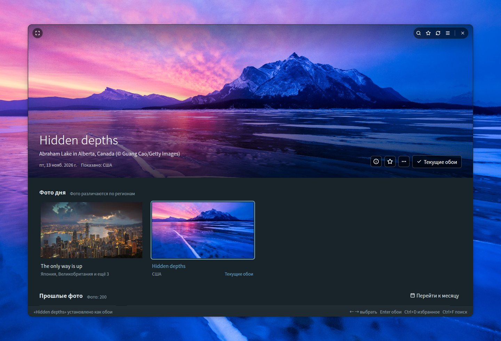
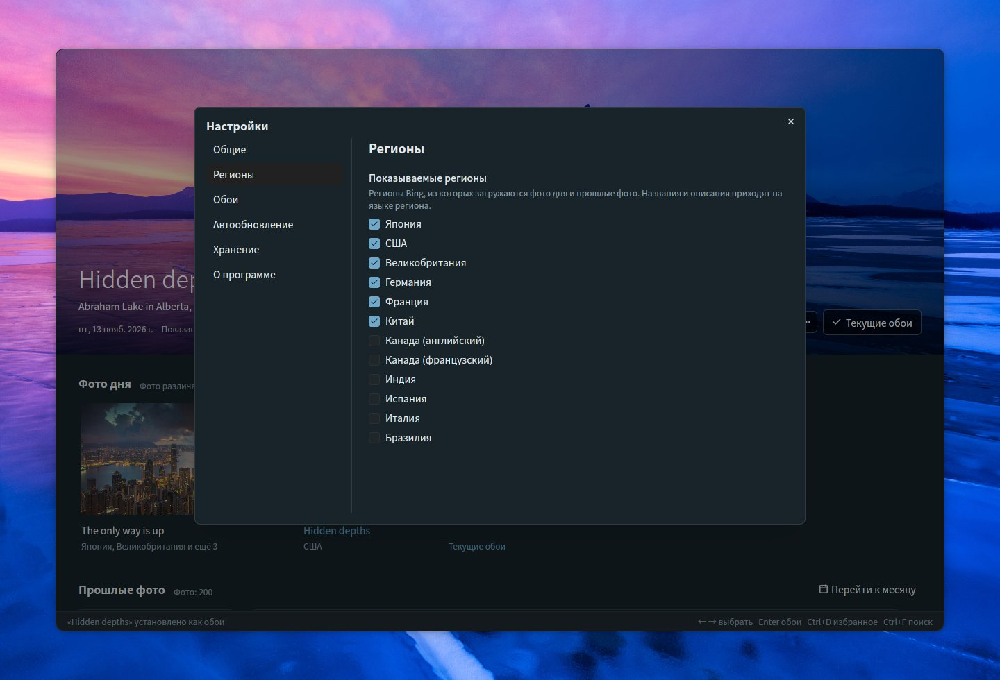
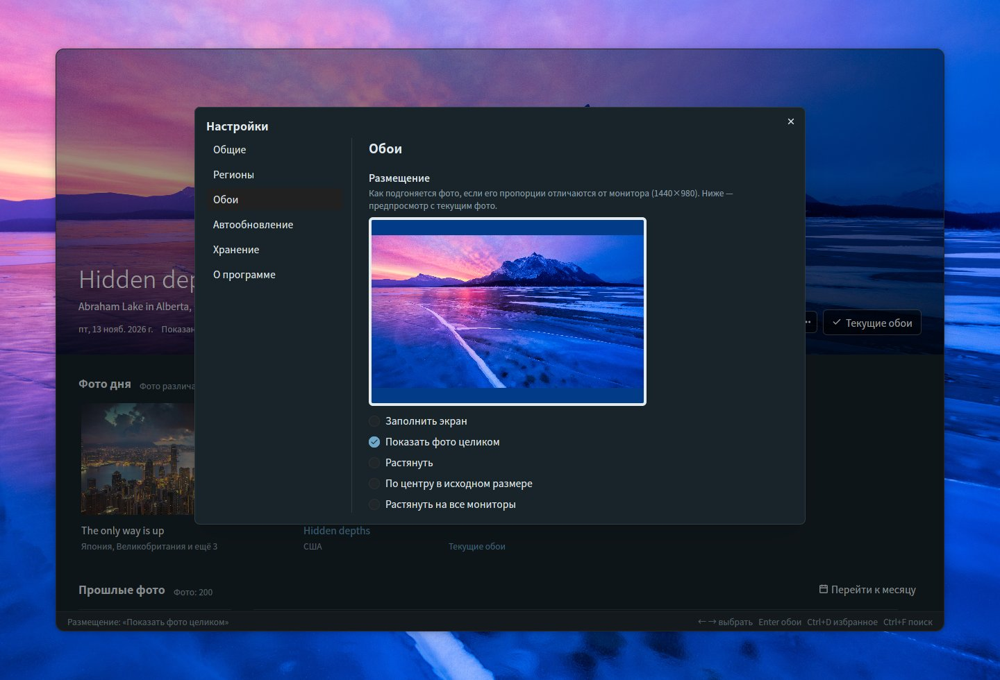
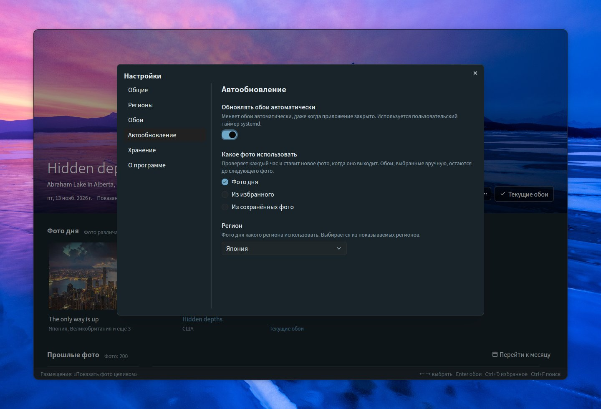
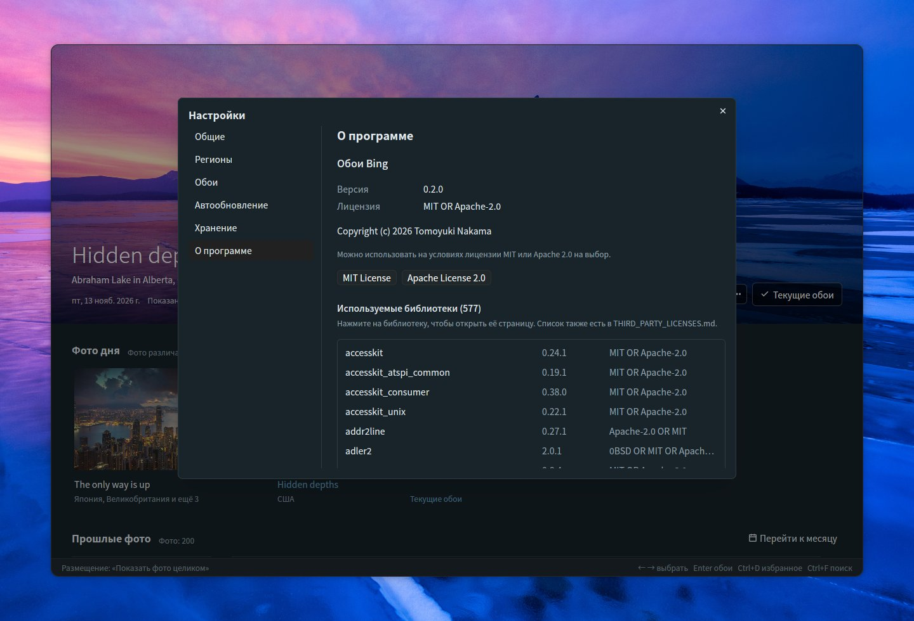

# Bing Wallpaper Manager

[English](README.md) | [日本語](README.ja.md) | [简体中文](README.zh-CN.md) | [繁體中文](README.zh-TW.md) | [한국어](README.ko.md) | [Deutsch](README.de.md) | [Français](README.fr.md) | [Español](README.es.md) | [Italiano](README.it.md) | [Português (Brasil)](README.pt-BR.md) | **Русский**

Настольное приложение для Ubuntu, в котором можно просматривать ежедневные фото Bing и ставить их обоями рабочего стола GNOME. Написано на Rust с использованием [GPUI](https://gpui.rs) и [gpui-kit](https://gpui-kit.com).



Выбранное фото занимает верхнюю часть окна без рамки со скруглёнными углами. Наведите на него указатель, чтобы появился заголовок окна; сделайте фото обоями — и оно получит отметку *Текущие обои*.

## Возможности

- **Главный экран**: выбранное фото показано крупно вверху, под ним — *Фото дня* и *Прошлые фото* (сгруппированы по датам). Большое фото закреплено над списком, при прокрутке сжимается в узкую полосу и снова разворачивается, когда вы выбираете фото или нажимаете на полосу. Фото сменяются плавным переходом, как только загрузится новое изображение
- **Окно без рамки**: скруглённые углы, большое фото доходит до верхнего края. Заголовок окна (поиск, избранное, обновление, настройки, полноэкранный режим и кнопки окна) появляется поверх фото, только пока на нём находится указатель мыши; перетаскивайте фото, чтобы переместить окно, и дважды щёлкните по верхнему краю, чтобы развернуть его
- **Фото дня**: свежие фото из выбранных вами регионов, сгруппированные по фото с указанием регионов, где оно показывается. По умолчанию включены шесть регионов (Япония, США, Великобритания, Германия, Франция, Китай); Канаду (английский / французский), Индию, Испанию, Италию и Бразилию можно включить в настройках. Пока приложение открыто, оно каждый час проверяет, не появились ли новые фото
- **Сделать обоями**: устанавливает обои GNOME и для светлого, и для тёмного стиля. Текущие обои получают отметку *Текущие обои*
- **Избранное**: отмечайте фото кнопкой ☆, через контекстное меню или сочетанием Ctrl+D; избранные фото получают значок ★, а кнопка ★ в заголовке окна показывает только избранное (можно сочетать с поиском)
- **Прошлые фото**: сохранённые фото подгружаются по мере прокрутки. Официальный API Bing отдаёт фото за последние 15 дней. Более старые фото загружает кнопка *Загрузить более старые фото* в конце списка — примерно по месяцу за раз из архива сообщества ([Bing-Wallpaper-Archive](https://github.com/npanuhin/Bing-Wallpaper-Archive); США — с 2010 года, остальные регионы — с апреля 2024 года). В разделе Настройки → Общие → *Более старые фото* можно включить автоматическую загрузку при прокрутке до конца списка, чтобы не нажимать кнопку. Старые фото сохраняются только в виде миниатюр; полное изображение скачивается, когда вы делаете его обоями
- **Поиск** (Ctrl+F) по сохранённым фото
  - По словам: названия, места, описания, регионы и даты (например, `2026-11-08`). Названия и описания сохраняются на всех доступных языках, поэтому «penguin», «Pinguin» и «ペンギン» находят одно и то же фото
  - По цвету: выберите красный, оранжевый, жёлтый, зелёный, голубой, синий, фиолетовый, розовый, белый или чёрный, и первыми будут показаны фото, где этого цвета больше всего. Можно сочетать со словами
  - Нажмите Escape, чтобы закрыть поиск
- **Размещение**: выберите, как размещать фото, если его пропорции отличаются от монитора, с предпросмотром в пропорциях монитора (заполнить экран, показать фото целиком, растянуть, по центру в исходном размере, растянуть на все мониторы)
- **Сведения о фото** (ⓘ на большом фото, Ctrl+I): боковая панель с названием, местом, датой, регионами и описанием фото от Bing, а также командами *Найти в Bing* и *Копировать название и место*
- **Действия с фото**: щёлкните фото правой кнопкой мыши или нажмите кнопку *…* на большом фото, чтобы сделать его обоями, добавить в избранное, посмотреть сведения, найти в Bing, скопировать название и место, открыть изображение, показать его в папке или удалить
- **Перейти к месяцу**: быстрый переход к нужному месяцу в прошлых фото
- **Удалить** (клавиша Delete): удаляет фото из папки после подтверждения; удалённые фото не скачиваются повторно
- **Автообновление**: переключатель в настройках меняет обои за вас, даже когда приложение закрыто, — на каждое новое фото дня либо на другое избранное или сохранённое фото с выбранным интервалом
- **Настройки** (☰ справа вверху, Ctrl+,): Общие (язык, тема, способ загрузки более старых фото), Регионы, Обои (размещение), Автообновление, Хранение (папка и занятое место) и О программе (версия, лицензия, используемые библиотеки)
- **11 языков**: японский, английский, китайский (упрощённый / традиционный), корейский, немецкий, французский, испанский, итальянский, португальский и русский. *Автоматически* — как в системе (`LANG`). Для названий и описаний фото предпочитается вариант, показанный в регионе с выбранным языком
- **Тема**: как в системе, светлая или тёмная
- **Клавиатура**: ← → — выбрать фото, Enter — сделать его обоями, Ctrl+D — добавить в избранное или убрать из него, Ctrl+I — сведения о фото, Delete — удалить, Home / End — перейти к самым новым или самым старым фото, Page Up / Page Down — прокрутить на один экран, F5 / Ctrl+R — обновить, Ctrl+F — поиск, Ctrl+, — настройки, F11 — полноэкранный режим
- **Командная строка**: `--apply` ставит обоями фото дня (а с `--random` — одно из сохранённых фото), не открывая окно
- **Одно окно**: повторный запуск приложения не открывает второе окно, а выводит уже открытое на передний план; окно открывается в том размере, в каком вы его оставили

## Просмотр

При прокрутке списка большое фото сжимается в узкую полосу, оставляя больше места для фото; выберите фото или нажмите на полосу, чтобы снова его развернуть. Прошлые фото сгруппированы по датам, а избранные отмечены значком ★. Щёлкните любое фото правой кнопкой мыши (или нажмите *…* на большом фото), чтобы сделать его обоями, добавить в избранное, посмотреть сведения, найти в Bing, скопировать название и место, открыть изображение, показать его в папке или удалить.


### Перейти к месяцу

Когда у вас есть фото больше чем за один месяц, кнопка **Перейти к месяцу** справа от заголовка *Прошлые фото* показывает список сохранённых месяцев (сгруппированных по годам, если лет несколько). Выберите месяц — и список прокрутится к его первому фото.


### Удаление фото

Выберите **Удалить…** в меню фото или нажмите клавишу Delete, чтобы удалить фото, показанное вверху. После подтверждения изображение, его миниатюра и данные о нём удаляются из папки с фото. Удалённые фото запоминаются, поэтому обновление и загрузка более старых фото их не возвращают. Фото дня и текущие обои удалить нельзя.


## Сведения о фото

Нажмите **ⓘ** на большом фото (или **Ctrl+I**, или выберите *Сведения о фото* в меню фото), чтобы открыть панель с названием, местом съёмки и автором, датой, регионами, где показывалось фото, и описанием от Bing на вашем языке, если оно есть. Описания недавних фото загружаются вместе с самими фото, а описания более старых берутся из архива сообщества. *Найти в Bing* открывает в браузере страницу Bing об этом фото, а *Копировать название и место* помещает их в буфер обмена. Нажмите Escape, чтобы закрыть панель.


## Поиск

Нажмите **Ctrl+F** (или кнопку 🔍 в заголовке окна), чтобы искать по сохранённым фото. Во время поиска в списке остаются только подходящие фото; нажмите на любое, чтобы увидеть его крупно вверху, или нажмите Escape, чтобы вернуться.

### По словам

Введите любое слово из названия, места, описания, региона или даты фото (например, `2026-11-08`). Названия и описания сохраняются на всех языках, на которых показывалось фото, а поиск ведётся и по более подробным описаниям из архива сообщества, поэтому слово на одном языке находит и фото, показанные в других регионах.


### По цвету

Выберите один из десяти цветов (красный, оранжевый, жёлтый, зелёный, голубой, синий, фиолетовый, розовый, белый, чёрный), и первыми будут показаны фото, где этого цвета больше всего. Доли цветов вычисляются в фоновом режиме по миниатюре каждого фото. Слова и цвет можно сочетать, например «mountain» + синий.


## Настройки

Откройте настройки кнопкой **☰** справа вверху в заголовке окна или нажмите **Ctrl+,**. Изменения применяются сразу, а Escape закрывает диалог. Страницы перечислены слева.

### Общие

- **Язык**: язык интерфейса. *Автоматически* — как в системе
- **Тема**: как в системе, светлая или тёмная
- **Более старые фото**: как загружать из архива сообщества фото старше конца списка — примерно по месяцу за раз
  - *Загружать по кнопке*: нажмите *Загрузить более старые фото* в конце списка
  - *Загружать автоматически в конце списка*: при прокрутке до конца (или нажатии End) следующий месяц загружается сам. Кнопка появляется, только если загрузка не удалась, чтобы можно было повторить попытку


### Регионы

В разных регионах Bing показывает разные фото, названия и описания. Выберите, из каких регионов главный экран получает фото: по умолчанию включены Япония, США, Великобритания, Германия, Франция и Китай, а Канаду (английский), Канаду (французский), Индию, Испанию, Италию и Бразилию можно добавить. Хотя бы один регион всегда остаётся включённым. Регионы, где Bing показывает только общемировое фото, в список не входят.



### Обои

Если пропорции фото отличаются от монитора, выберите, как его разместить: заполнить экран, показать фото целиком, растянуть, расположить по центру в исходном размере или растянуть на все мониторы. В предпросмотре используются пропорции вашего монитора и фото, показанное вверху; в режиме *Показать фото целиком* свободное место заливается цветом фона, который использует GNOME. Текущие обои обновляются сразу.



### Автообновление

Включите переключатель, чтобы обои менялись сами, даже когда приложение закрыто. Выберите, что использовать:

- **Фото дня**: проверяет каждый час (и вскоре после входа в систему) и ставит новое фото, когда оно выходит, для выбранного вами региона. Обои, выбранные вручную, остаются до появления следующего фото
- **Из избранного**: каждый раз выбирает другое избранное фото — каждые 30 минут, каждый час, каждые 3 часа, каждые 6 часов или каждый день
- **Из сохранённых фото**: то же самое, но из всех сохранённых фото. Старые фото скачиваются в момент выбора

Переключатель создаёт пользовательский таймер systemd (`~/.config/systemd/user/bing-wallpaper-manager.timer` и `.service`), который запускает это приложение с `--apply`, а при выключении таймер удаляется. Таймер запускает приложение из того места, где оно находится сейчас, поэтому, если вы переместите приложение, выключите и снова включите переключатель.



### Хранение

Показывает папку, где хранятся фото, сколько места на диске они занимают и сколько их всего. *Изменить…* выбирает другую папку, а *Открыть папку* открывает её в файловом менеджере. О том, что в ней хранится, см. в разделе [Файлы](#файлы).


### О программе

Версия, лицензия (MIT или Apache 2.0, с кнопками для чтения каждой) и список используемых библиотек. Нажмите на библиотеку, чтобы открыть её страницу.



## На чём построено

Пользовательский интерфейс построен на двух проектах с открытым исходным кодом:

- **[GPUI](https://gpui.rs)** — фреймворк для интерфейсов с ускорением на GPU, разработанный [Zed Industries](https://zed.dev) для редактора Zed ([исходный код](https://github.com/zed-industries/zed), Apache-2.0). Приложение использует снимок, опубликованный на crates.io под именем `gpui-pre`
- **[gpui-kit](https://gpui-kit.com)** — библиотека компонентов и набор инструментов для GPUI от [Longbridge](https://github.com/longbridge) ([исходный код](https://github.com/longbridge/gpui-kit), Apache-2.0). Кнопки, диалоги, меню, поля ввода, выпадающие списки, полосы прокрутки, заголовок окна и темы взяты из её крейтов `gpui-component` и `gpui-base`

Спасибо обоим проектам. Все остальные библиотеки перечислены в [THIRD_PARTY_LICENSES.md](THIRD_PARTY_LICENSES.md).

## Установка

### Требования

- Ubuntu с рабочим столом GNOME (разрабатывается на Ubuntu 26.04; Wayland и X11). Обои устанавливаются через `gsettings` из GNOME
- Графический драйвер с поддержкой Vulkan (входит в обычную установку Ubuntu для рабочего стола)

### Готовая сборка (x86_64)

К каждому [релизу](https://github.com/TomoyukiNakama/bing-wallpaper-manager/releases/latest) прилагается готовый пакет для Ubuntu 26.04 и новее (glibc 2.43+). Скачайте `bing-wallpaper-manager-<version>-x86_64-linux.tar.gz` и распакуйте его в `~/.local`:

```sh
tar -xzf bing-wallpaper-manager-*-x86_64-linux.tar.gz -C ~/.local --strip-components=1
```

Чтобы собрать приложение из исходного кода, выполните шаги ниже.

### 1. Установите инструменты сборки

```sh
sudo apt install git curl build-essential
```

Компилятор C (`build-essential`) нужен потому, что одна из библиотек для работы со шрифтами собирается из исходного кода на C.

### 2. Установите Rust

Установите актуальную стабильную версию Rust с помощью [rustup](https://rustup.rs). Rust из репозиториев Ubuntu 26.04 (1.93) слишком стар для GPUI.

```sh
curl --proto '=https' --tlsv1.2 -sSf https://sh.rustup.rs | sh -s -- -y
source "$HOME/.cargo/env"   # или откройте новый терминал
```

Если вы предпочитаете оставить в PATH `cargo` из Ubuntu, это тоже работает: `.cargo/config.toml` указывает cargo на `scripts/rustc-stable`, который запускает rustc из стабильного набора инструментов rustup (а если rustup не установлен, использует `rustc` из PATH).

### 3. Получите исходный код

```sh
git clone https://github.com/TomoyukiNakama/bing-wallpaper-manager.git
cd bing-wallpaper-manager
```

### 4. Соберите и установите

```sh
scripts/install.sh
```

Скрипт собирает релизную версию и устанавливает приложение, его значок и ярлык для рабочего стола в `~/.local`. После этого *Обои Bing* появятся в сетке приложений GNOME (если этого не произошло сразу, выйдите из системы и войдите снова), а `bing-wallpaper-manager` можно будет запускать из терминала, если `~/.local/bin` есть в PATH. При первой сборке скачиваются и компилируются все зависимости, это занимает несколько минут.

Чтобы установить приложение в другое место, задайте `PREFIX`, например `PREFIX=/opt/bing-wallpaper scripts/install.sh`.

### Обновление

```sh
git pull
scripts/install.sh
```

`scripts/install.sh` всегда пересобирает приложение перед установкой, поэтому повторный запуск после `git pull` устанавливает новую версию.

### Удаление

```sh
scripts/install.sh --uninstall
```

Команда удаляет приложение, значок и ярлык для рабочего стола. Настройки (`~/.config/bing-wallpaper-manager/`) и сохранённые фото (папка хранения) остаются; удалите их сами, если они больше не нужны.

### Запуск без установки

```sh
cargo run --release
```

## Файлы

Папка хранения выбирается в разделе *Настройки → Хранение* (по умолчанию `~/Pictures/BingWallpaper` или локализованная папка «Изображения»). Настройки сохраняются в `~/.config/bing-wallpaper-manager/config.json`, а то, что приложение запоминает (например, размер окна), — в `state.json` в той же папке.
Фото сохраняется только один раз, даже если оно показывается в нескольких регионах или в разные дни, а сохранённые изображения никогда не скачиваются повторно.

```text
<папка хранения>/
  20261108_OHR.Foo_UHD.jpg              Изображение для обоев (UHD)
  .bing-wallpaper/meta/OHR.Foo.json     Метаданные: названия, описания, регионы, доли цветов
  .bing-wallpaper/thumbs/OHR.Foo.jpg    Миниатюра (640x360)
  .bing-wallpaper/previews/OHR.Foo.jpg  Изображение среднего размера для крупного показа старых фото (1920x1080)
  .bing-wallpaper/deleted.txt           Удалённые вами фото (чтобы не скачивать их повторно)
```

## Командная строка

```sh
bing-wallpaper-manager --apply                       # сделать обоями фото дня
bing-wallpaper-manager --apply --mkt en-US           # выбрать регион
bing-wallpaper-manager --apply --if-new              # ничего не делать, если фото то же, что в прошлый раз
bing-wallpaper-manager --apply --random              # поставить случайное сохранённое фото
bing-wallpaper-manager --apply --random --favorites  # поставить случайное фото из избранного
```

Без `--mkt` используется регион, выбранный в разделе *Автообновление* (или первый из показываемых регионов). Если сеть ещё недоступна, например сразу после входа в систему, `--apply` делает несколько повторных попыток, прежде чем сдаться.

### Ежедневное обновление

Включите переключатель в разделе **Настройки** → **Автообновление** (см. [Автообновление](#автообновление)): он сам настроит пользовательский таймер systemd. Чтобы проверить его работу:

```sh
systemctl --user list-timers bing-wallpaper-manager.timer
journalctl --user -u bing-wallpaper-manager.service
```

Если в одной из прежних версий вы вручную создали `bing-wallpaper.timer`, отключите его, чтобы не работали оба таймера: `systemctl --user disable --now bing-wallpaper.timer`.

## Разработка

### Снимки экрана

`scripts/screenshot.sh` запускает приложение на виртуальном дисплее Wayland (sway в режиме headless) и сохраняет PNG.
Скрипт не затрагивает ваш рабочий стол, настройки, папку хранения, обои и таймеры systemd (данные для снимков лежат в `target/screenshot-fixture/`).

```sh
sudo apt install sway grim          # только в первый раз
cargo build --release
scripts/screenshot.sh target/shot.png            # по умолчанию: ожидание 15 с, 1440x960
BWM_THEME=dark BWM_LANG=de scripts/screenshot.sh target/dark.png 10 1280x1300
```

`BWM_THEME=light|dark` задаёт тему, а `BWM_LANG=de` (и т. д.) — язык; обе переменные работают и при обычном запуске.
`FLOAT=1280x840` показывает окно плавающим, а не во весь экран (чтобы проверить скруглённые углы и кнопки окна), а `BG=<изображение>` помещает за ним изображение в качестве фона рабочего стола.

Чтобы выполнить действия перед снимком, перечислите в `ACTIONS` щелчки, щелчки правой кнопкой, перетаскивания, прокрутку, клавиши и ввод текста. Ввод передаётся через виртуальные мышь и клавиатуру из `tools/vpointer` (собирается автоматически при первом использовании).

```sh
ACTIONS=$'key ctrl-f\ntype penguin\nsleep 3\nshot target/step1.png' \
  scripts/screenshot.sh target/step2.png 10 1280x1000
```

Изображения в `docs/` сняты таким способом в тёмной теме и сохранены в JPEG с качеством 85. Основной снимок и страницы настроек есть на всех языках (`docs/<имя>.<язык>.jpg`; у английского суффикса нет); остальные изображения сняты на английском и японском, а в README на других языках используются английские. Например:

```sh
BG=target/screenshot-fixture/store/20261112_OHR.AbrahamCanada_UHD.jpg FLOAT=1280x840 BWM_LANG=en BWM_THEME=dark \
  ACTIONS=$'click 583 660\nsleep 1.5\nkey enter\nsleep 2\nclick 720 250\nsleep 1.5' \
  scripts/screenshot.sh target/main.png 12 1440x980
```

### Релизные пакеты

`scripts/package-release.sh` собирает релизную версию и создаёт `target/dist/bing-wallpaper-manager-<version>-x86_64-linux.tar.gz` (и его `.sha256`) с исполняемым файлом, значками, ярлыком для рабочего стола и файлами лицензий, включая тексты лицензий всех входящих в сборку библиотек. Версия берётся из `Cargo.toml`.

### Переводы

Строки хранятся в `locales/<язык>.yml` (`ja`, `en`, `zh-CN`, `zh-TW`, `ko`, `de`, `fr`, `es`, `it`, `pt-BR`, `ru`).

- Подстановки записывайте в виде `%{count}`
- Во всех файлах должны быть одни и те же ключи (это проверяет `cargo test`). Вместо отсутствующих переводов используется английский текст
- Чтобы добавить язык, добавьте файл в `locales/` и вариант в `Language` в `src/i18n.rs`
- README есть на всех языках (`README.md` на английском, `README.<язык>.md` для остальных). При изменении функций обновляйте их все

### Структура

| Файл | Назначение |
| --- | --- |
| `src/main.rs` | Интерфейс главного экрана и CLI |
| `src/bing.rs` | API Bing HPImageArchive и загрузка файлов |
| `src/archive.rs` | Более старые фото и описания из архива сообщества |
| `src/library.rs` | Сохранение и загрузка фото в папке хранения |
| `src/search.rs` | Поиск по словам и цветам |
| `src/colors.rs` | Анализ долей цветов на фото |
| `src/settings.rs` | Диалог настроек |
| `src/info.rs` | Панель сведений о фото |
| `src/schedule.rs` | Автообновление (пользовательский таймер systemd) |
| `src/single.rs` | Единственное окно (повторный запуск выводит его на передний план) |
| `src/config.rs` | Файл настроек |
| `src/theme.rs` | Цвета (светлая / тёмная тема) и шрифт |
| `src/i18n.rs` | Переключение языка и форматы дат (на строки ссылаются через `tr!("key")`) |
| `src/wallpaper.rs` | Установка обоев GNOME через `gsettings` |
| `locales/*.yml` | Переводы (встраиваются при сборке с помощью rust-i18n) |
| `src/third_party.tsv` / `THIRD_PARTY_LICENSES.md` | Используемые библиотеки (генерируется скриптом `scripts/gen-third-party.py`) |
| `assets/icons/` | Значок приложения (SVG и PNG, созданные скриптом `scripts/render-icon.py`) |
| `assets/bing-wallpaper-manager.desktop` | Ярлык для рабочего стола (устанавливается скриптом `scripts/install.sh`) |
| `scripts/rustc-stable` | Выбирает стабильный rustc из rustup для cargo (см. «2. Установите Rust») |
| `scripts/screenshot.sh` | Снимки экрана на виртуальном дисплее |
| `tools/vpointer/` | Виртуальные мышь и клавиатура для снимков экрана (отдельный крейт) |

## Лицензия

Распространяется на условиях [лицензии MIT](LICENSE-MIT) или [лицензии Apache 2.0](LICENSE-APACHE) — на ваш выбор (MIT OR Apache-2.0). Используемые библиотеки перечислены в [THIRD_PARTY_LICENSES.md](THIRD_PARTY_LICENSES.md) (после изменения зависимостей список нужно сгенерировать заново командой `python3 scripts/gen-third-party.py`).

Авторские права на фото принадлежат их фотографам и поставщикам. Приложение не связано с Microsoft.
