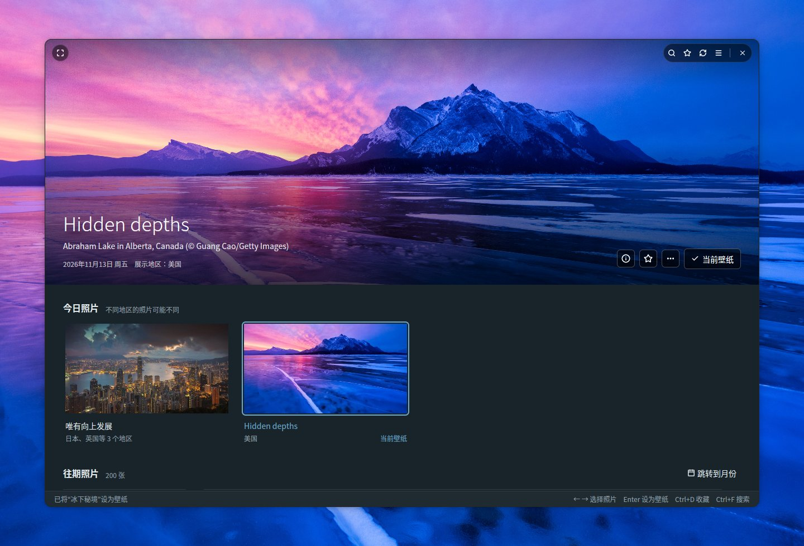
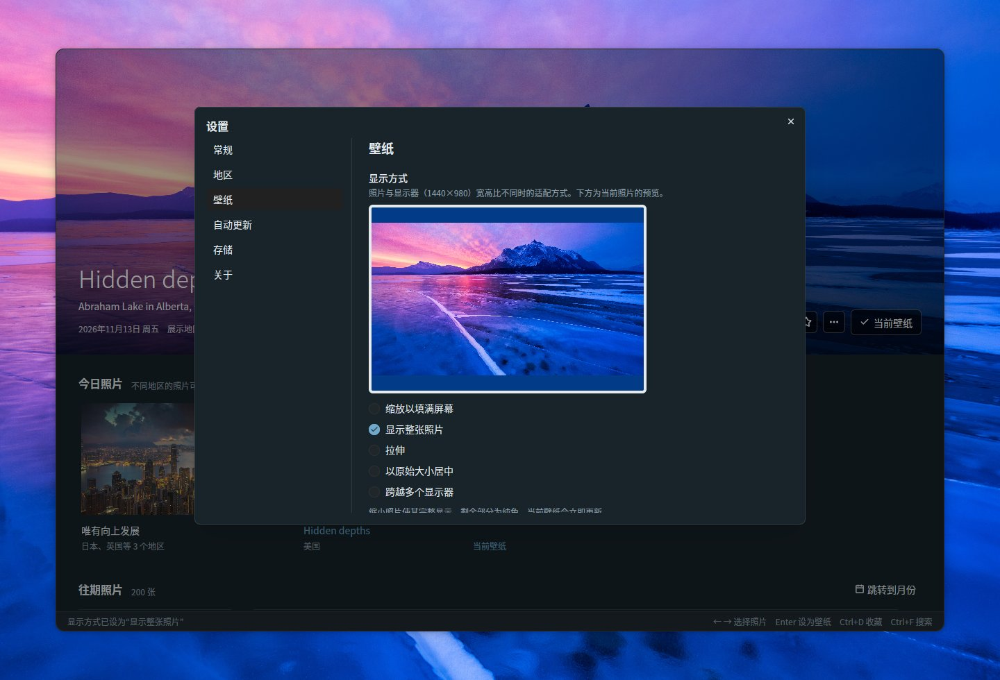
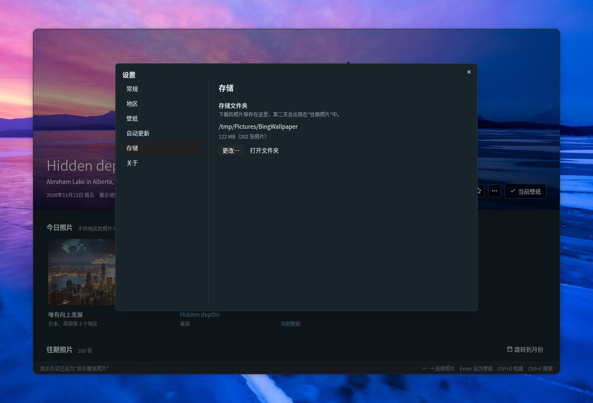
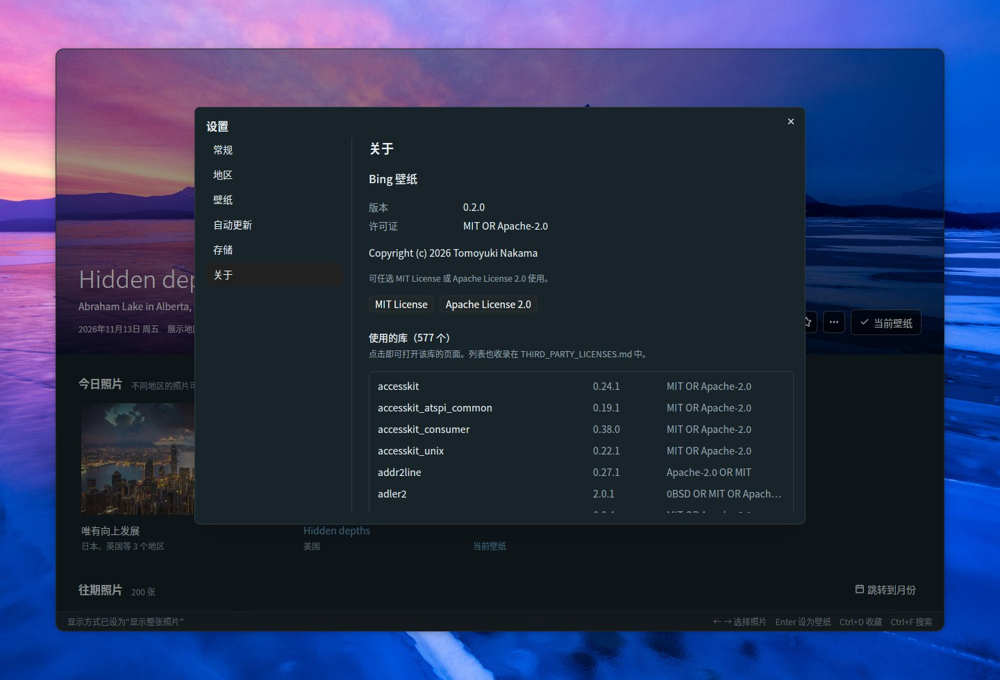

# Bing Wallpaper Manager

[English](README.md) | [日本語](README.ja.md) | **简体中文** | [繁體中文](README.zh-TW.md) | [한국어](README.ko.md) | [Deutsch](README.de.md) | [Français](README.fr.md) | [Español](README.es.md) | [Italiano](README.it.md) | [Português (Brasil)](README.pt-BR.md) | [Русский](README.ru.md)

一款适用于 Ubuntu 的桌面应用，可以浏览 Bing 的每日照片，并将其设为 GNOME 壁纸。使用 Rust、[GPUI](https://gpui.rs) 和 [gpui-kit](https://gpui-kit.com) 构建。



选中的照片会铺满无边框圆角窗口的上部。把鼠标移到照片上即可显示标题栏；设为壁纸后，照片上会标注*当前壁纸*。

## 功能

- **仪表板**：选中的照片以大图显示在上方，下面是*今日照片*和*往期照片*（按日期分组）。大图固定在列表上方，滚动时会收起为一条细栏，选择照片或点击细栏后重新展开。切换照片时，新图片加载完成后会平滑地交叉淡入
- **无边框窗口**：窗口为圆角，大图一直延伸到窗口顶端。标题栏（搜索、收藏、刷新、设置、全屏和窗口按钮）只在鼠标位于照片上时叠加显示；拖动照片可移动窗口，双击顶部边缘可最大化
- **今日照片**：显示所选地区的最新照片，并按照片归并，标出展示该照片的地区。默认开启六个地区（日本、美国、英国、德国、法国、中国）；加拿大（英语 / 法语）、印度、西班牙、意大利和巴西可在设置中开启。应用保持打开时，每小时检查一次新照片
- **设为壁纸**：同时设置 GNOME 浅色和深色样式的壁纸。当前的壁纸会标注*当前壁纸*
- **收藏**：通过 ☆ 按钮、右键菜单或 Ctrl+D 收藏照片；收藏的照片带有 ★ 标记，点击标题栏的 ★ 按钮可只显示收藏（可与搜索组合使用）
- **往期照片**：已保存的照片会随着滚动持续加载。官方 Bing API 只能回溯 15 天。更早的照片可通过列表末尾的*加载更早的照片*从社区存档（[Bing-Wallpaper-Archive](https://github.com/npanuhin/Bing-Wallpaper-Archive)；美国自 2010 年起，其他地区自 2024 年 4 月起）加载，每次约一个月。在设置 → 常规 → *更早的照片*中，可以改为滚动到列表末尾时自动加载，而不必点击按钮。更早的照片只保存缩略图，设为壁纸时才会下载完整图片
- **搜索**（Ctrl+F）：在已保存的照片中搜索
  - 按关键词：标题、地点、说明、地区和日期（如 `2026-11-08`）。标题和说明会以所有可用的语言保存，因此“penguin”“Pinguin”和“ペンギン”都能找到同一张照片
  - 按颜色：选择红、橙、黄、绿、青、蓝、紫、粉、白或黑，该颜色占比最高的照片排在最前。可与关键词组合使用
  - 按 Escape 关闭搜索
- **显示方式**：照片与显示器的宽高比不同时，可对照按显示器比例绘制的预览选择适配方式（缩放以填满屏幕、显示整张照片、拉伸、以原始大小居中、跨越多个显示器）
- **照片信息**（大图上的 ⓘ，Ctrl+I）：侧边面板，显示照片的标题、地点、日期、地区和 Bing 的说明，另有*在 Bing 上查看*和*复制标题和拍摄地*
- **照片操作**：右键点击照片，或使用大图上的 *…* 按钮，可以将其设为壁纸、添加到收藏、查看照片信息、在 Bing 上查看、复制标题和拍摄地、打开图片、在文件夹中显示或删除
- **跳转到月份**：直接跳转到往期照片中的某个月份
- **删除**（Delete 键）：确认后从文件夹中删除照片；已删除的照片不会再次下载
- **自动更新**：打开设置中的开关后，即使应用已关闭也会自动更换壁纸——可以换成每天新发布的今日照片，也可以按您选择的间隔换成另一张收藏或已保存的照片
- **设置**（右上角的 ☰，Ctrl+,）：常规（语言、主题、更早照片的加载方式）、地区、壁纸（显示方式）、自动更新、存储（文件夹和磁盘占用）以及关于（版本、许可证、使用的库）
- **11 种语言**：日语、英语、中文（简体 / 繁体）、韩语、德语、法语、西班牙语、意大利语、葡萄牙语和俄语。*自动（跟随系统）* 会跟随操作系统的语言（`LANG`）。照片的标题和说明优先采用使用所选语言的地区所展示的版本
- **主题**：跟随系统、浅色或深色
- **键盘**：← → 选择照片，Enter 设为壁纸，Ctrl+D 添加或取消收藏，Ctrl+I 查看照片信息，Delete 删除，Home / End 跳到最新或最早的照片，Page Up / Page Down 每次滚动一屏，F5 / Ctrl+R 刷新，Ctrl+F 搜索，Ctrl+, 打开设置，F11 全屏
- **命令行**：`--apply` 无需打开窗口即可将今日照片（加上 `--random` 则为一张已保存的照片）设为壁纸
- **单一窗口**：再次启动应用时不会打开第二个窗口，而是把已打开的窗口带到前台；窗口会以上次关闭时的大小打开

## 浏览

滚动列表时，大图会收起为一条细栏，为照片腾出更多空间；选择照片或点击细栏即可重新展开。往期照片按日期分组，收藏的照片带有 ★ 标记。右键点击任意照片（或使用大图上的 *…* 按钮），可以将其设为壁纸、添加到收藏、查看照片信息、在 Bing 上查看、复制标题和拍摄地、打开图片、在文件夹中显示或删除。


### 跳转到月份

保存的照片超过一个月份后，*往期照片*右侧的**跳转到月份**会列出已保存的月份（跨多个年份时按年份分组）。选择其中一个，列表就会滚动到该月的第一张照片。


### 删除照片

在照片的菜单中选择 **删除…**，或者对上方显示的照片按 Delete 键。确认后，图片、缩略图和详细信息会从照片文件夹中删除。应用会记住已删除的照片，因此刷新或加载更早的照片时不会把它们重新取回。今日照片和当前壁纸无法删除。


## 照片信息

点击大图上的 **ⓘ**（或按 **Ctrl+I**，或在照片的菜单中选择*照片信息*）可打开一个面板，显示照片的标题、地点和版权信息、日期、展示过它的地区，以及您所用语言的 Bing 说明（如果有）。近期照片的说明会随照片一起获取；更早照片的说明来自社区存档。*在 Bing 上查看*会在浏览器中打开 Bing 上介绍这张照片的页面，*复制标题和拍摄地*会将标题和拍摄地复制到剪贴板。按 Escape 关闭面板。


## 搜索

按 **Ctrl+F**（或点击标题栏中的 🔍 按钮）可搜索已保存的照片。搜索时，列表只显示符合条件的照片；点击其中一张可在上方查看大图，按 Escape 则返回。

### 按关键词

输入照片的标题、地点、说明、地区或日期（如 `2026-11-08`）中的任意词语。标题和说明会以照片展示过的每种语言保存，社区存档中更长的说明也在搜索范围内，因此用一种语言的词语也能找到在其他地区展示的照片。


### 按颜色

从十种颜色（红、橙、黄、绿、青、蓝、紫、粉、白、黑）中选择一种，该颜色占比最高的照片会排在最前。颜色占比是在后台根据每张照片的缩略图计算的。关键词和颜色可以组合使用，例如“mountain”+ 蓝。


## 设置

点击标题栏右上角的 **☰**，或按 **Ctrl+,** 打开设置。更改会立即生效，按 Escape 关闭对话框。各页面列在左侧。

### 常规

- **语言**：界面显示语言。*自动（跟随系统）* 会跟随操作系统
- **主题**：跟随系统、浅色或深色
- **更早的照片**：从社区存档加载列表末尾之前的照片的方式，每次约一个月
  - *点击按钮加载*：点击列表末尾的*加载更早的照片*
  - *滚动到列表末尾时自动加载*：滚动到末尾（或按 End）时会自动加载下一个月的照片。只有加载失败时才会出现按钮，以便重试


### 地区

Bing 在不同地区展示的照片、标题和说明各不相同。在这里选择仪表板从哪些地区获取照片：日本、美国、英国、德国、法国和中国默认开启，还可以添加加拿大（英语）、加拿大（法语）、印度、西班牙、意大利和巴西。至少要保留一个地区。Bing 只展示全球通用照片的地区不在列表中。


### 壁纸

照片与显示器的宽高比不同时，选择适配方式：缩放以填满屏幕、显示整张照片、拉伸、以原始大小居中或跨越多个显示器。预览采用您显示器的比例和上方显示的照片；选择*显示整张照片*时，剩余部分会以 GNOME 使用的背景色填充。当前壁纸会立即更新。



### 自动更新

打开开关后，即使应用已关闭，壁纸也会自动更换。选择要使用的照片：

- **今日照片**：每小时（以及登录后不久）检查一次，所选地区有新照片发布时将其设为壁纸。您自己选择的壁纸会保留到下一张照片发布为止
- **从收藏中选择**：每 30 分钟、每小时、每 3 小时、每 6 小时或每天，从收藏中选一张不同的照片
- **从已保存的照片中选择**：同上，但从所有已保存的照片中选择。较早的照片会在选中时下载

打开开关会创建一个 systemd 用户定时器（`~/.config/systemd/user/bing-wallpaper-manager.timer` 和 `.service`），由它以 `--apply` 运行本应用；关闭开关则会移除定时器。定时器会从应用当前所在的位置运行它，因此移动应用后请把开关关闭再重新打开。


### 存储

显示保存照片的文件夹、占用的磁盘空间和照片数量。*更改…* 可以选择其他文件夹，*打开文件夹*会在文件管理器中打开它。其中保存的内容参见[文件](#文件)。



### 关于

版本、许可证（MIT 或 Apache 2.0，各有按钮可阅读全文）以及使用的库的列表。点击某个库即可打开它的页面。



## 构建基础

用户界面基于以下两个开源项目构建：

- **[GPUI](https://gpui.rs)** —— [Zed Industries](https://zed.dev) 为 Zed 编辑器开发的 GPU 加速 UI 框架（[源代码](https://github.com/zed-industries/zed)，Apache-2.0）。本应用使用发布在 crates.io 上的快照 `gpui-pre`
- **[gpui-kit](https://gpui-kit.com)** —— [Longbridge](https://github.com/longbridge) 为 GPUI 开发的组件库和工具包（[源代码](https://github.com/longbridge/gpui-kit)，Apache-2.0）。按钮、对话框、菜单、输入框、下拉选择框、滚动条、标题栏和主题功能均来自它的 `gpui-component` 和 `gpui-base` crate

感谢这两个项目。其他所有库都列在 [THIRD_PARTY_LICENSES.md](THIRD_PARTY_LICENSES.md) 中。

## 安装

### 系统要求

- 使用 GNOME 桌面的 Ubuntu（在 Ubuntu 26.04 上开发；支持 Wayland 和 X11）。壁纸通过 GNOME 的 `gsettings` 设置
- 支持 Vulkan 的显卡驱动（普通的 Ubuntu 桌面安装已包含）

### 预构建的二进制文件（x86_64）

每个[发行版本](https://github.com/TomoyukiNakama/bing-wallpaper-manager/releases/latest)都提供适用于 Ubuntu 26.04 或更高版本（glibc 2.43+）的预构建软件包。下载 `bing-wallpaper-manager-<版本>-x86_64-linux.tar.gz` 并解压到 `~/.local`：

```sh
tar -xzf bing-wallpaper-manager-*-x86_64-linux.tar.gz -C ~/.local --strip-components=1
```

如果想从源代码构建，请按以下步骤操作。

### 1. 安装构建工具

```sh
sudo apt install git curl build-essential
```

其中一个字体库需要从 C 源代码构建，因此需要 C 编译器（`build-essential`）。

### 2. 安装 Rust

使用 [rustup](https://rustup.rs) 安装最新的 stable 版 Rust。Ubuntu 26.04 自带的 Rust（1.93）对 GPUI 来说太旧。

```sh
curl --proto '=https' --tlsv1.2 -sSf https://sh.rustup.rs | sh -s -- -y
source "$HOME/.cargo/env"   # 或者打开一个新终端
```

如果想在 PATH 中保留 Ubuntu 自带的 `cargo`，也没有问题：`.cargo/config.toml` 让 cargo 使用 `scripts/rustc-stable`，该脚本会运行 rustup stable 工具链中的 rustc（未安装 rustup 时则改用 PATH 中的 `rustc`）。

### 3. 获取源代码

```sh
git clone https://github.com/TomoyukiNakama/bing-wallpaper-manager.git
cd bing-wallpaper-manager
```

### 4. 构建并安装

```sh
scripts/install.sh
```

该脚本会构建发布版本，并将应用、图标和桌面项安装到 `~/.local` 下。之后 *Bing 壁纸*会出现在 GNOME 的应用列表中（如果没有马上出现，请注销后重新登录）；如果 `~/.local/bin` 在 PATH 中，还可以在终端中用 `bing-wallpaper-manager` 启动。首次构建需要下载并编译所有依赖，要花几分钟。

要安装到其他位置，请设置 `PREFIX`，例如 `PREFIX=/opt/bing-wallpaper scripts/install.sh`。

### 更新

```sh
git pull
scripts/install.sh
```

`scripts/install.sh` 在安装前总会重新构建，因此在 `git pull` 之后再运行一次就会安装新版本。

### 卸载

```sh
scripts/install.sh --uninstall
```

该命令会移除应用、图标和桌面项。您的设置（`~/.config/bing-wallpaper-manager/`）和已保存的照片（存储文件夹）会保留；如果不再需要，请自行删除。

### 不安装直接运行

```sh
cargo run --release
```

## 文件

在*设置 → 存储*中选择存储文件夹（默认：`~/Pictures/BingWallpaper`，或本地化的“图片”文件夹）。设置保存在 `~/.config/bing-wallpaper-manager/config.json` 中，应用记住的状态（如窗口大小）保存在同一文件夹的 `state.json` 中。
同一张照片即使在多个地区或不同日期展示，也只保存一次；已保存的图片不会再次下载。

```text
<存储文件夹>/
  20261108_OHR.Foo_UHD.jpg              壁纸图片（UHD）
  .bing-wallpaper/meta/OHR.Foo.json     元数据：标题、说明、地区、颜色占比
  .bing-wallpaper/thumbs/OHR.Foo.jpg    缩略图（640x360）
  .bing-wallpaper/previews/OHR.Foo.jpg  用于以大图显示更早照片的中等尺寸图片（1920x1080）
  .bing-wallpaper/deleted.txt           已删除的照片（用于避免再次下载）
```

## 命令行

```sh
bing-wallpaper-manager --apply                       # 将今日照片设为壁纸
bing-wallpaper-manager --apply --mkt en-US           # 指定地区
bing-wallpaper-manager --apply --if-new              # 与上次是同一张照片则不操作
bing-wallpaper-manager --apply --random              # 随机选一张已保存的照片
bing-wallpaper-manager --apply --random --favorites  # 随机选一张收藏的照片
```

不指定 `--mkt` 时，使用在*自动更新*中选择的地区（否则使用显示的第一个地区）。如果网络尚未就绪（例如刚登录时），`--apply` 会重试几次后才放弃。

### 每天更新

在**设置** → **自动更新**中打开开关（参见[自动更新](#自动更新)），应用会为您设置好 systemd 用户定时器。可用以下命令查看其状态：

```sh
systemctl --user list-timers bing-wallpaper-manager.timer
journalctl --user -u bing-wallpaper-manager.service
```

如果您曾在早期版本中手动创建过 `bing-wallpaper.timer`，请将其禁用，以免两个定时器同时运行：`systemctl --user disable --now bing-wallpaper.timer`。

## 开发

### 截图

`scripts/screenshot.sh` 会在虚拟 Wayland 显示器（headless 模式的 sway）上运行应用并保存 PNG。
它不会触及您的桌面、设置、存储文件夹、壁纸或 systemd 定时器（截图用的数据位于 `target/screenshot-fixture/`）。

```sh
sudo apt install sway grim          # 仅首次需要
cargo build --release
scripts/screenshot.sh target/shot.png            # 默认：等待 15 秒，1440x960
BWM_THEME=dark BWM_LANG=de scripts/screenshot.sh target/dark.png 10 1280x1300
```

`BWM_THEME=light|dark` 用于固定主题，`BWM_LANG=de`（等）用于固定语言；两者在正常启动时同样有效。
`FLOAT=1280x840` 让窗口浮动显示而不是铺满屏幕（用于检查圆角和窗口按钮），`BG=<图片>` 则在窗口后面放一张图片作为桌面背景。

把点击、右键点击、拖动、滚动、按键和文字输入写进 `ACTIONS`，即可在截图前进行操作。输入通过 `tools/vpointer` 中的虚拟鼠标和键盘发送（首次使用时自动构建）。

```sh
ACTIONS=$'key ctrl-f\ntype penguin\nsleep 3\nshot target/step1.png' \
  scripts/screenshot.sh target/step2.png 10 1280x1000
```

`docs/` 中的图片就是用这种方式在深色主题下截取的，并保存为质量 85 的 JPEG。主截图和各设置页面每种语言都有一份（`docs/<名称>.<语言>.jpg`；英语不带后缀）；其余图片以英语和日语截取，其他语言的 README 使用英语的图片。例如：

```sh
BG=target/screenshot-fixture/store/20261112_OHR.AbrahamCanada_UHD.jpg FLOAT=1280x840 BWM_LANG=en BWM_THEME=dark \
  ACTIONS=$'click 583 660\nsleep 1.5\nkey enter\nsleep 2\nclick 720 250\nsleep 1.5' \
  scripts/screenshot.sh target/main.png 12 1440x980
```

### 发布包

`scripts/package-release.sh` 会构建发布版本，并生成 `target/dist/bing-wallpaper-manager-<版本>-x86_64-linux.tar.gz`（及其 `.sha256`），其中包含二进制文件、图标、桌面项和许可证文件，以及所有内含库的许可证全文。版本号取自 `Cargo.toml`。

### 翻译

字符串位于 `locales/<语言>.yml`（`ja`、`en`、`zh-CN`、`zh-TW`、`ko`、`de`、`fr`、`es`、`it`、`pt-BR`、`ru`）。

- 占位符写作 `%{count}`
- 每个文件必须包含相同的键（由 `cargo test` 检查）。缺少的翻译会回退为英语
- 要添加语言，请在 `locales/` 下添加一个文件，并在 `src/i18n.rs` 的 `Language` 中添加一个变体
- README 每种语言都有一份（英语为 `README.md`，其他语言为 `README.<语言>.md`）。功能有变化时，请全部更新

### 代码结构

| 文件 | 作用 |
| --- | --- |
| `src/main.rs` | 仪表板界面和 CLI |
| `src/bing.rs` | Bing HPImageArchive API 和下载 |
| `src/archive.rs` | 来自社区存档的更早照片和说明 |
| `src/library.rs` | 在存储文件夹中保存和读取照片 |
| `src/search.rs` | 按关键词和颜色搜索 |
| `src/colors.rs` | 照片的颜色占比分析 |
| `src/settings.rs` | 设置对话框 |
| `src/info.rs` | 照片信息面板 |
| `src/schedule.rs` | 自动更新（systemd 用户定时器） |
| `src/single.rs` | 保持单一窗口（再次启动时把已有窗口带到前台） |
| `src/config.rs` | 设置文件 |
| `src/theme.rs` | 配色（浅色 / 深色）和字体 |
| `src/i18n.rs` | 语言切换和日期格式（字符串通过 `tr!("key")` 引用） |
| `src/wallpaper.rs` | 通过 `gsettings` 设置 GNOME 壁纸 |
| `locales/*.yml` | 翻译（构建时由 rust-i18n 嵌入） |
| `src/third_party.tsv` / `THIRD_PARTY_LICENSES.md` | 使用的库（由 `scripts/gen-third-party.py` 生成） |
| `assets/icons/` | 应用图标（SVG，以及由 `scripts/render-icon.py` 渲染的 PNG） |
| `assets/bing-wallpaper-manager.desktop` | 桌面项（由 `scripts/install.sh` 安装） |
| `scripts/rustc-stable` | 为 cargo 选用 rustup 的 stable rustc（参见“2. 安装 Rust”） |
| `scripts/screenshot.sh` | 在虚拟显示器上截图 |
| `tools/vpointer/` | 截图用的虚拟鼠标和键盘（独立的 crate） |

## 许可证

可任选 [MIT License](LICENSE-MIT) 或 [Apache License 2.0](LICENSE-APACHE) 使用（MIT OR Apache-2.0）。使用的库列在 [THIRD_PARTY_LICENSES.md](THIRD_PARTY_LICENSES.md) 中（更改依赖后请用 `python3 scripts/gen-third-party.py` 重新生成）。

照片的版权归其摄影师和提供方所有。本应用与 Microsoft 没有任何关联。
