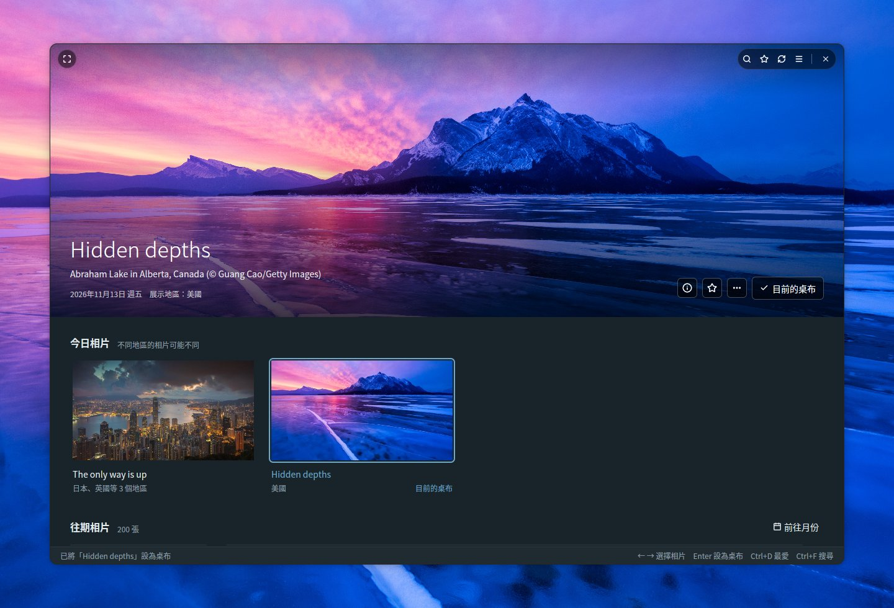
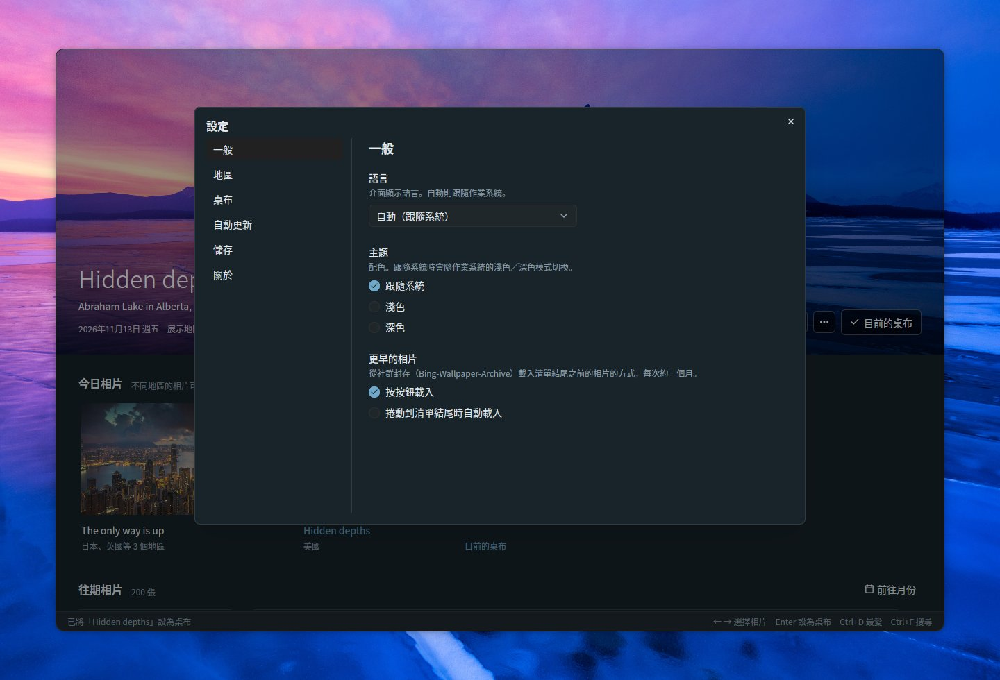
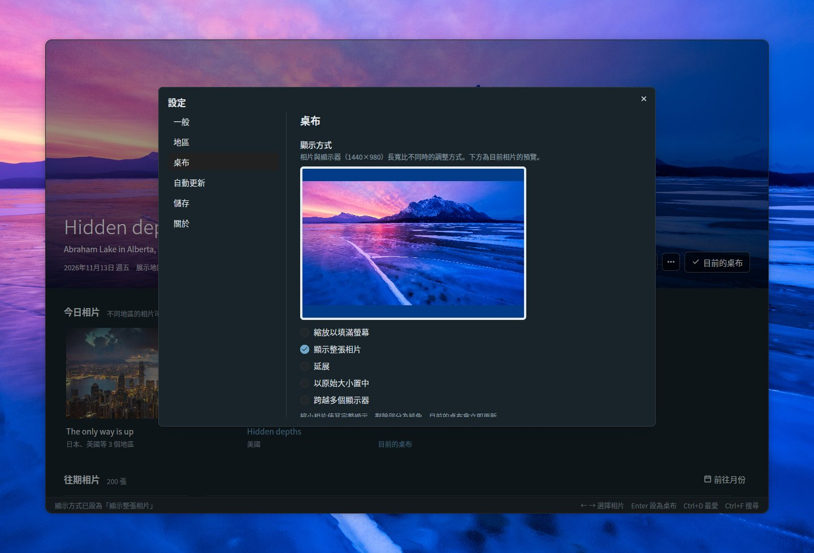
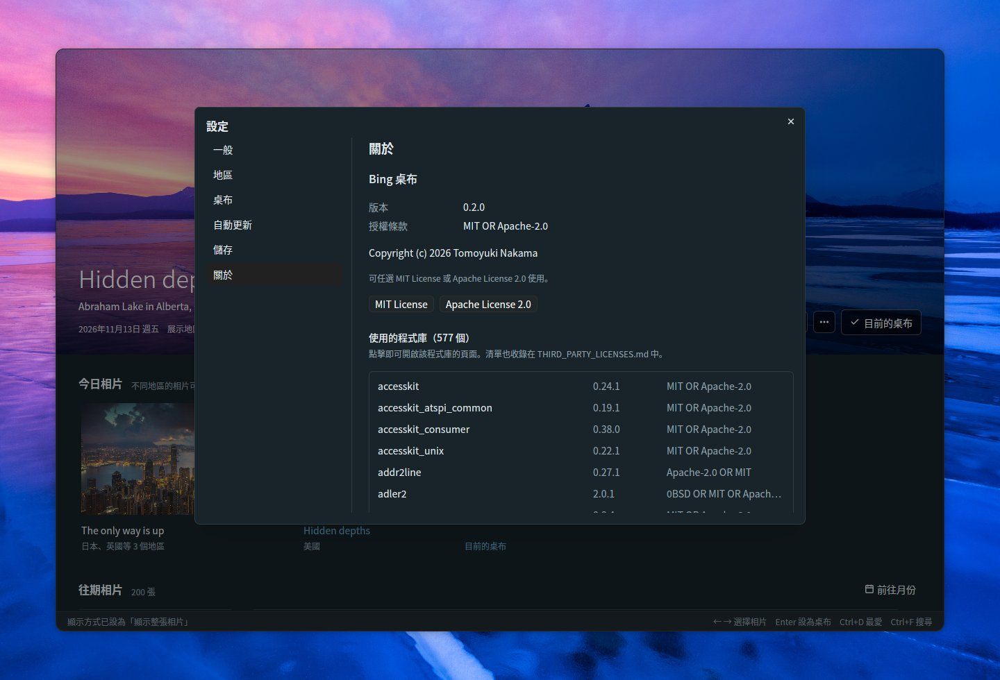

# Bing Wallpaper Manager

[English](README.md) | [日本語](README.ja.md) | [简体中文](README.zh-CN.md) | **繁體中文** | [한국어](README.ko.md) | [Deutsch](README.de.md) | [Français](README.fr.md) | [Español](README.es.md) | [Italiano](README.it.md) | [Português (Brasil)](README.pt-BR.md) | [Русский](README.ru.md)

一款適用於 Ubuntu 的桌面應用程式，可以瀏覽 Bing 的每日相片，並將其設為 GNOME 桌布。使用 Rust、[GPUI](https://gpui.rs) 和 [gpui-kit](https://gpui-kit.com) 打造。



選取的相片會佔滿無邊框圓角視窗的上半部。把滑鼠移到相片上就會顯示標題列；設為桌布後，相片上會標示*目前的桌布*。

## 功能

- **儀表板**：選取的相片以大圖顯示在上方，下面是*今日相片*和*往期相片*（依日期分組）。大圖固定在清單上方，捲動時會收合成一條細列，選取相片或點擊細列後再次展開。切換相片時，新圖片載入完成後會平順地交叉淡入
- **無邊框視窗**：視窗為圓角，大圖一路延伸到視窗頂端。標題列（搜尋、最愛、重新整理、設定、全螢幕和視窗按鈕）只在滑鼠位於相片上時疊在相片上顯示；拖曳相片可移動視窗，按兩下頂端邊緣可最大化
- **今日相片**：顯示所選地區的最新相片，並依相片歸併，標出展示該相片的地區。預設開啟六個地區（日本、美國、英國、德國、法國、中國）；加拿大（英文／法文）、印度、西班牙、義大利和巴西可在設定中開啟。應用程式保持開啟時，每小時檢查一次新相片
- **設為桌布**：同時設定 GNOME 淺色和深色樣式的桌布。目前的桌布會標示*目前的桌布*
- **最愛**：透過 ☆ 按鈕、右鍵選單或 Ctrl+D 將相片加入最愛；最愛的相片帶有 ★ 標記，點擊標題列的 ★ 按鈕可只顯示最愛（可與搜尋搭配使用）
- **往期相片**：已儲存的相片會隨著捲動持續載入。官方 Bing API 只能回溯 15 天。更早的相片可透過清單結尾的*載入更早的相片*從社群封存（[Bing-Wallpaper-Archive](https://github.com/npanuhin/Bing-Wallpaper-Archive)；美國自 2010 年起，其他地區自 2024 年 4 月起）載入，每次約一個月。在設定 → 一般 → *更早的相片*中，可以改為捲動到清單結尾時自動載入，而不必按按鈕。更早的相片只儲存縮圖，設為桌布時才會下載完整圖片
- **搜尋**（Ctrl+F）：在已儲存的相片中搜尋
  - 依關鍵字：標題、地點、說明、地區和日期（如 `2026-11-08`）。標題和說明會以所有可用的語言儲存，因此「penguin」、「Pinguin」和「ペンギン」都能找到同一張相片
  - 依顏色：選擇紅、橙、黃、綠、青、藍、紫、粉紅、白或黑，該顏色佔比最高的相片排在最前面。可與關鍵字搭配使用
  - 按 Escape 關閉搜尋
- **顯示方式**：相片與顯示器的長寬比不同時，可對照依顯示器比例繪製的預覽選擇調整方式（縮放以填滿螢幕、顯示整張相片、延展、以原始大小置中、跨越多個顯示器）
- **相片資訊**（大圖上的 ⓘ，Ctrl+I）：側邊面板，顯示相片的標題、地點、日期、地區和 Bing 的說明，另有*在 Bing 上查看*和*複製標題和拍攝地*
- **相片操作**：在相片上按右鍵，或使用大圖上的 *…* 按鈕，可以將其設為桌布、加入最愛、查看相片資訊、在 Bing 上查看、複製標題和拍攝地、開啟圖片、在資料夾中顯示或刪除
- **前往月份**：直接跳到往期相片中的某個月份
- **刪除**（Delete 鍵）：確認後從資料夾中刪除相片；已刪除的相片不會再次下載
- **自動更新**：開啟設定中的開關後，即使應用程式已關閉也會自動更換桌布——可以換成每天新發布的今日相片，也可以依您選擇的間隔換成另一張最愛或已儲存的相片
- **設定**（右上角的 ☰，Ctrl+,）：一般（語言、主題、更早相片的載入方式）、地區、桌布（顯示方式）、自動更新、儲存（資料夾和磁碟用量）以及關於（版本、授權條款、使用的程式庫）
- **11 種語言**：日文、英文、中文（簡體／繁體）、韓文、德文、法文、西班牙文、義大利文、葡萄牙文和俄文。*自動（跟隨系統）* 會跟隨作業系統的語言（`LANG`）。相片的標題和說明優先採用使用所選語言的地區所展示的版本
- **主題**：跟隨系統、淺色或深色
- **鍵盤**：← → 選擇相片，Enter 設為桌布，Ctrl+D 加入或移除最愛，Ctrl+I 查看相片資訊，Delete 刪除，Home / End 跳到最新或最早的相片，Page Up / Page Down 每次捲動一個畫面，F5 / Ctrl+R 重新整理，Ctrl+F 搜尋，Ctrl+, 開啟設定，F11 全螢幕
- **命令列**：`--apply` 不必開啟視窗就能將今日相片（加上 `--random` 則為一張已儲存的相片）設為桌布
- **單一視窗**：再次啟動應用程式時不會開啟第二個視窗，而是把已開啟的視窗帶到最上層；視窗會以上次關閉時的大小開啟

## 瀏覽

捲動清單時，大圖會收合成一條細列，為相片騰出更多空間；選取相片或點擊細列即可再次展開。往期相片依日期分組，最愛的相片帶有 ★ 標記。在任一張相片上按右鍵（或使用大圖上的 *…* 按鈕），可以將其設為桌布、加入最愛、查看相片資訊、在 Bing 上查看、複製標題和拍攝地、開啟圖片、在資料夾中顯示或刪除。


### 前往月份

儲存的相片超過一個月份後，*往期相片*右側的**前往月份**會列出已儲存的月份（跨多個年份時依年份分組）。選擇其中一個，清單就會捲動到該月的第一張相片。


### 刪除相片

在相片的選單中選擇 **刪除…**，或者對上方顯示的相片按 Delete 鍵。確認後，圖片、縮圖和詳細資料會從相片資料夾中刪除。應用程式會記住已刪除的相片，因此重新整理或載入更早的相片時不會把它們再抓回來。今日相片和目前的桌布無法刪除。


## 相片資訊

點擊大圖上的 **ⓘ**（或按 **Ctrl+I**，或在相片的選單中選擇*相片資訊*）可開啟一個面板，顯示相片的標題、地點和版權資訊、日期、展示過它的地區，以及您所用語言的 Bing 說明（如果有）。近期相片的說明會隨相片一起取得；更早相片的說明來自社群封存。*在 Bing 上查看*會在瀏覽器中開啟 Bing 上介紹這張相片的頁面，*複製標題和拍攝地*會將標題和拍攝地複製到剪貼簿。按 Escape 關閉面板。


## 搜尋

按 **Ctrl+F**（或點擊標題列中的 🔍 按鈕）可搜尋已儲存的相片。搜尋時，清單只顯示符合條件的相片；點擊其中一張可在上方查看大圖，按 Escape 則返回。

### 依關鍵字

輸入相片的標題、地點、說明、地區或日期（如 `2026-11-08`）中的任何字詞。標題和說明會以相片展示過的每種語言儲存，社群封存中較長的說明也在搜尋範圍內，因此用一種語言的字詞也能找到在其他地區展示的相片。


### 依顏色

從十種顏色（紅、橙、黃、綠、青、藍、紫、粉紅、白、黑）中選擇一種，該顏色佔比最高的相片會排在最前面。顏色佔比是在背景根據每張相片的縮圖計算的。關鍵字和顏色可以搭配使用，例如「mountain」+ 藍。


## 設定

點擊標題列右上角的 **☰**，或按 **Ctrl+,** 開啟設定。變更會立即生效，按 Escape 關閉對話方塊。各頁面列在左側。

### 一般

- **語言**：介面顯示語言。*自動（跟隨系統）* 會跟隨作業系統
- **主題**：跟隨系統、淺色或深色
- **更早的相片**：從社群封存載入清單結尾之前的相片的方式，每次約一個月
  - *按按鈕載入*：按清單結尾的*載入更早的相片*
  - *捲動到清單結尾時自動載入*：捲動到結尾（或按 End）時會自動載入下一個月的相片。只有載入失敗時才會出現按鈕，方便重試



### 地區

Bing 在不同地區展示的相片、標題和說明各不相同。在這裡選擇儀表板從哪些地區取得相片：日本、美國、英國、德國、法國和中國預設開啟，還可以加入加拿大（英文）、加拿大（法文）、印度、西班牙、義大利和巴西。至少要保留一個地區。Bing 只展示全球通用相片的地區不在清單中。


### 桌布

相片與顯示器的長寬比不同時，選擇調整方式：縮放以填滿螢幕、顯示整張相片、延展、以原始大小置中或跨越多個顯示器。預覽採用您顯示器的比例和上方顯示的相片；選擇*顯示整張相片*時，剩餘部分會以 GNOME 使用的背景色填滿。目前的桌布會立即更新。



### 自動更新

開啟開關後，即使應用程式已關閉，桌布也會自動更換。選擇要使用的相片：

- **今日相片**：每小時（以及登入後不久）檢查一次，所選地區有新相片發布時將其設為桌布。您自己選擇的桌布會保留到下一張相片發布為止
- **從我的最愛選擇**：每 30 分鐘、每小時、每 3 小時、每 6 小時或每天，從最愛中選一張不同的相片
- **從已儲存的相片選擇**：同上，但從所有已儲存的相片中選擇。較舊的相片會在選中時下載

開啟開關會建立一個 systemd 使用者計時器（`~/.config/systemd/user/bing-wallpaper-manager.timer` 和 `.service`），由它以 `--apply` 執行本應用程式；關閉開關則會移除計時器。計時器會從應用程式目前所在的位置執行它，因此移動應用程式後請把開關關閉再重新開啟。


### 儲存

顯示存放相片的資料夾、使用的磁碟空間和相片數量。*變更…* 可以選擇其他資料夾，*開啟資料夾*會在檔案管理員中開啟它。其中儲存的內容請參閱[檔案](#檔案)。


### 關於

版本、授權條款（MIT 或 Apache 2.0，各有按鈕可閱讀全文）以及使用的程式庫清單。點擊某個程式庫即可開啟它的頁面。



## 建置基礎

使用者介面以下列兩個開放原始碼專案為基礎：

- **[GPUI](https://gpui.rs)** —— [Zed Industries](https://zed.dev) 為 Zed 編輯器開發的 GPU 加速 UI 框架（[原始碼](https://github.com/zed-industries/zed)，Apache-2.0）。本應用程式使用發布在 crates.io 上的快照 `gpui-pre`
- **[gpui-kit](https://gpui-kit.com)** —— [Longbridge](https://github.com/longbridge) 為 GPUI 開發的元件庫和工具組（[原始碼](https://github.com/longbridge/gpui-kit)，Apache-2.0）。按鈕、對話方塊、選單、輸入欄位、下拉式選單、捲軸、標題列和主題功能都來自它的 `gpui-component` 和 `gpui-base` crate

感謝這兩個專案。其他所有程式庫都列在 [THIRD_PARTY_LICENSES.md](THIRD_PARTY_LICENSES.md) 中。

## 安裝

### 系統需求

- 使用 GNOME 桌面的 Ubuntu（在 Ubuntu 26.04 上開發；支援 Wayland 和 X11）。桌布透過 GNOME 的 `gsettings` 設定
- 支援 Vulkan 的顯示卡驅動程式（一般的 Ubuntu 桌面安裝已包含）

### 預先建置的二進位檔（x86_64）

每個[發行版本](https://github.com/TomoyukiNakama/bing-wallpaper-manager/releases/latest)都提供適用於 Ubuntu 26.04 或更新版本（glibc 2.43+）的預先建置套件。下載 `bing-wallpaper-manager-<版本>-x86_64-linux.tar.gz` 並解壓縮到 `~/.local`：

```sh
tar -xzf bing-wallpaper-manager-*-x86_64-linux.tar.gz -C ~/.local --strip-components=1
```

如果想從原始碼建置，請依照下列步驟操作。

### 1. 安裝建置工具

```sh
sudo apt install git curl build-essential
```

其中一個字型程式庫需要從 C 原始碼建置，因此需要 C 編譯器（`build-essential`）。

### 2. 安裝 Rust

使用 [rustup](https://rustup.rs) 安裝最新的 stable 版 Rust。Ubuntu 26.04 內附的 Rust（1.93）對 GPUI 來說太舊。

```sh
curl --proto '=https' --tlsv1.2 -sSf https://sh.rustup.rs | sh -s -- -y
source "$HOME/.cargo/env"   # 或是開啟新的終端機
```

如果想在 PATH 中保留 Ubuntu 內附的 `cargo`，也沒有問題：`.cargo/config.toml` 讓 cargo 使用 `scripts/rustc-stable`，該指令碼會執行 rustup stable 工具鏈中的 rustc（未安裝 rustup 時則改用 PATH 中的 `rustc`）。

### 3. 取得原始碼

```sh
git clone https://github.com/TomoyukiNakama/bing-wallpaper-manager.git
cd bing-wallpaper-manager
```

### 4. 建置並安裝

```sh
scripts/install.sh
```

該指令碼會建置發行版本，並將應用程式、圖示和桌面項目安裝到 `~/.local` 下。之後 *Bing 桌布*會出現在 GNOME 的應用程式清單中（如果沒有馬上出現，請登出後重新登入）；如果 `~/.local/bin` 在 PATH 中，還可以在終端機中用 `bing-wallpaper-manager` 啟動。首次建置需要下載並編譯所有相依套件，要花幾分鐘。

要安裝到其他位置，請設定 `PREFIX`，例如 `PREFIX=/opt/bing-wallpaper scripts/install.sh`。

### 更新

```sh
git pull
scripts/install.sh
```

`scripts/install.sh` 在安裝前一定會重新建置，因此在 `git pull` 之後再執行一次就會安裝新版本。

### 解除安裝

```sh
scripts/install.sh --uninstall
```

該命令會移除應用程式、圖示和桌面項目。您的設定（`~/.config/bing-wallpaper-manager/`）和已儲存的相片（儲存資料夾）會保留；如果不再需要，請自行刪除。

### 不安裝直接執行

```sh
cargo run --release
```

## 檔案

在*設定 → 儲存*中選擇儲存資料夾（預設：`~/Pictures/BingWallpaper`，或在地化的「圖片」資料夾）。設定儲存在 `~/.config/bing-wallpaper-manager/config.json` 中，應用程式記住的狀態（如視窗大小）儲存在同一資料夾的 `state.json` 中。
同一張相片即使在多個地區或不同日期展示，也只儲存一次；已儲存的圖片不會再次下載。

```text
<儲存資料夾>/
  20261108_OHR.Foo_UHD.jpg              桌布圖片（UHD）
  .bing-wallpaper/meta/OHR.Foo.json     中繼資料：標題、說明、地區、顏色佔比
  .bing-wallpaper/thumbs/OHR.Foo.jpg    縮圖（640x360）
  .bing-wallpaper/previews/OHR.Foo.jpg  用來以大圖顯示更早相片的中等尺寸圖片（1920x1080）
  .bing-wallpaper/deleted.txt           已刪除的相片（用來避免再次下載）
```

## 命令列

```sh
bing-wallpaper-manager --apply                       # 將今日相片設為桌布
bing-wallpaper-manager --apply --mkt en-US           # 指定地區
bing-wallpaper-manager --apply --if-new              # 與上次是同一張相片則不動作
bing-wallpaper-manager --apply --random              # 隨機選一張已儲存的相片
bing-wallpaper-manager --apply --random --favorites  # 隨機選一張最愛的相片
```

未指定 `--mkt` 時，使用在*自動更新*中選擇的地區（否則使用顯示的第一個地區）。如果網路尚未就緒（例如剛登入時），`--apply` 會重試幾次後才放棄。

### 每天更新

在**設定** → **自動更新**中開啟開關（請參閱[自動更新](#自動更新)），應用程式會為您設定好 systemd 使用者計時器。可用下列命令查看其狀態：

```sh
systemctl --user list-timers bing-wallpaper-manager.timer
journalctl --user -u bing-wallpaper-manager.service
```

如果您曾在舊版本中手動建立過 `bing-wallpaper.timer`，請將其停用，以免兩個計時器同時執行：`systemctl --user disable --now bing-wallpaper.timer`。

## 開發

### 螢幕截圖

`scripts/screenshot.sh` 會在虛擬 Wayland 顯示器（headless 模式的 sway）上執行應用程式並儲存 PNG。
它不會動到您的桌面、設定、儲存資料夾、桌布或 systemd 計時器（截圖用的資料位於 `target/screenshot-fixture/`）。

```sh
sudo apt install sway grim          # 僅第一次需要
cargo build --release
scripts/screenshot.sh target/shot.png            # 預設：等待 15 秒，1440x960
BWM_THEME=dark BWM_LANG=de scripts/screenshot.sh target/dark.png 10 1280x1300
```

`BWM_THEME=light|dark` 用來固定主題，`BWM_LANG=de`（等）用來固定語言；兩者在一般啟動時同樣有效。
`FLOAT=1280x840` 讓視窗浮動顯示而不是佔滿螢幕（用來檢查圓角和視窗按鈕），`BG=<圖片>` 則在視窗後面放一張圖片作為桌面背景。

把點擊、按右鍵、拖曳、捲動、按鍵和文字輸入寫進 `ACTIONS`，即可在截圖前進行操作。輸入透過 `tools/vpointer` 中的虛擬滑鼠和鍵盤送出（第一次使用時自動建置）。

```sh
ACTIONS=$'key ctrl-f\ntype penguin\nsleep 3\nshot target/step1.png' \
  scripts/screenshot.sh target/step2.png 10 1280x1000
```

`docs/` 中的圖片就是用這種方式在深色主題下擷取的，並儲存為品質 85 的 JPEG。主截圖和各設定頁面每種語言都有一份（`docs/<名稱>.<語言>.jpg`；英文不帶後綴）；其餘圖片以英文和日文擷取，其他語言的 README 使用英文的圖片。例如：

```sh
BG=target/screenshot-fixture/store/20261112_OHR.AbrahamCanada_UHD.jpg FLOAT=1280x840 BWM_LANG=en BWM_THEME=dark \
  ACTIONS=$'click 583 660\nsleep 1.5\nkey enter\nsleep 2\nclick 720 250\nsleep 1.5' \
  scripts/screenshot.sh target/main.png 12 1440x980
```

### 發行套件

`scripts/package-release.sh` 會建置發行版本，並產生 `target/dist/bing-wallpaper-manager-<版本>-x86_64-linux.tar.gz`（及其 `.sha256`），其中包含二進位檔、圖示、桌面項目和授權檔案，以及所有內含程式庫的授權條款全文。版本號碼取自 `Cargo.toml`。

### 翻譯

字串位於 `locales/<語言>.yml`（`ja`、`en`、`zh-CN`、`zh-TW`、`ko`、`de`、`fr`、`es`、`it`、`pt-BR`、`ru`）。

- 預留位置寫作 `%{count}`
- 每個檔案必須包含相同的鍵（由 `cargo test` 檢查）。缺少的翻譯會改用英文
- 要新增語言，請在 `locales/` 下新增一個檔案，並在 `src/i18n.rs` 的 `Language` 中新增一個變體
- README 每種語言都有一份（英文為 `README.md`，其他語言為 `README.<語言>.md`）。功能有變動時，請全部更新

### 程式碼結構

| 檔案 | 用途 |
| --- | --- |
| `src/main.rs` | 儀表板介面和 CLI |
| `src/bing.rs` | Bing HPImageArchive API 和下載 |
| `src/archive.rs` | 來自社群封存的更早相片和說明 |
| `src/library.rs` | 在儲存資料夾中儲存和讀取相片 |
| `src/search.rs` | 依關鍵字和顏色搜尋 |
| `src/colors.rs` | 相片的顏色佔比分析 |
| `src/settings.rs` | 設定對話方塊 |
| `src/info.rs` | 相片資訊面板 |
| `src/schedule.rs` | 自動更新（systemd 使用者計時器） |
| `src/single.rs` | 維持單一視窗（再次啟動時把現有視窗帶到最上層） |
| `src/config.rs` | 設定檔 |
| `src/theme.rs` | 配色（淺色 / 深色）和字型 |
| `src/i18n.rs` | 語言切換和日期格式（字串透過 `tr!("key")` 參照） |
| `src/wallpaper.rs` | 透過 `gsettings` 設定 GNOME 桌布 |
| `locales/*.yml` | 翻譯（建置時由 rust-i18n 內嵌） |
| `src/third_party.tsv` / `THIRD_PARTY_LICENSES.md` | 使用的程式庫（由 `scripts/gen-third-party.py` 產生） |
| `assets/icons/` | 應用程式圖示（SVG，以及由 `scripts/render-icon.py` 轉出的 PNG） |
| `assets/bing-wallpaper-manager.desktop` | 桌面項目（由 `scripts/install.sh` 安裝） |
| `scripts/rustc-stable` | 為 cargo 選用 rustup 的 stable rustc（請參閱「2. 安裝 Rust」） |
| `scripts/screenshot.sh` | 在虛擬顯示器上截圖 |
| `tools/vpointer/` | 截圖用的虛擬滑鼠和鍵盤（獨立的 crate） |

## 授權條款

可任選 [MIT License](LICENSE-MIT) 或 [Apache License 2.0](LICENSE-APACHE) 使用（MIT OR Apache-2.0）。使用的程式庫列在 [THIRD_PARTY_LICENSES.md](THIRD_PARTY_LICENSES.md) 中（變更相依套件後請用 `python3 scripts/gen-third-party.py` 重新產生）。

相片的著作權屬於其攝影師和提供者。本應用程式與 Microsoft 沒有任何關係。
